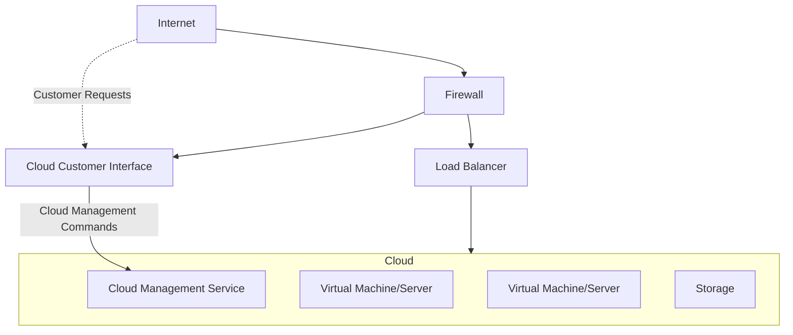

- Public cloud – available via Internet to anyone willing to pay
- Private cloud – run by a company for the company’s own use
- Hybrid cloud – includes both public and private cloud components
- Software as a Service (SaaS) – one or more applications available via the Internet (i.e., word processor)
- Platform as a Service (PaaS) – software stack ready for application use via the Internet (i.e., a database server)
- Infrastructure as a Service (IaaS) – servers or storage available over Internet (i.e., storage available for backup use)

# Environment

