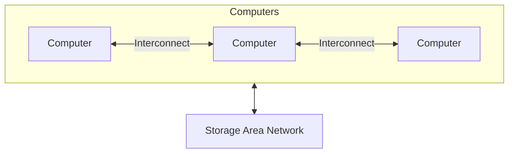

Like multiprocessor systems, but multiple systems working together

- Usually sharing storage via a storage-area network (SAN)
- Provides a high-availability service which survives failures
  - Asymmetric clustering has one machine in hot-standby mode
  - Symmetric clustering has multiple nodes running applications, monitoring each other
- Some clusters are for high-performance computing (HPC) - Applications must be written to use parallelization
  - Some have distributed lock manager (DLM) to avoid conflicting operations

