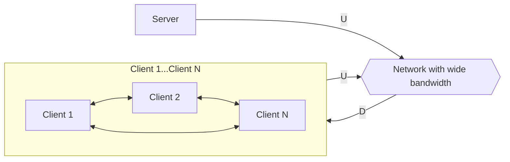

如 File Sharing、Movie Sharing、Streaming、VoIP (Skype) 等，有以下特徵：

- End System 直接來回間歇溝通
- 具有 Self-Capacity，New peer brings new service capacity, as well as service demand
- End System 上同時具有 Client Process 與 Server Process

:::info 提醒
BitTorrent (BT) 是一個 Peer-Peer 的使用範例。使用者加入 Torrent 後，當想下載時，會先從 Tracker 拿到 List (Chunk of data for a file)，接著就與 Subset Peer (Neighbor) 開始 Send/Receive Data。當使用者完成後，可以選擇繼續留在 Torrent 中繼續分享，或是直接離開。
:::

### DHT

Distributed Hash Table，儲存對應的 Key-Value 的 Database，Peer-Peer 用此來對應資源所在，格式如 `key: movie title, value: IP address`。Peer 可以 Insert Key-Value，並用 Key 去 Query 值 (資源)。可想而知，所有 Peer 的 IP 都會予他人知曉。

## Distribution Time

在 **Client-Server Architecture** 中，假設 $D_{c - s}$ 為 Client-Server Distribution Time，$F$ 為欲傳輸的檔案大小，$D_{min}$ 為最快下載速率，$U$ 為上傳速率，$N$ 為 Client 數量：

可以得出以下：

$$
D_{c - s} > \max\{\textbf{N} \times F/U, F/D_{min}\}
$$

但若是在 **Peer-Peer Architecture**：

可以看見，由於 Client 間也可以互相傳輸，我們得出以下：

$$
D_{p - p} > \max\{F/U, F/D_{min}, \textbf{N} \times F/(U + \Sigma U)\}
$$

注意到 $\textbf{N}$ 與 $\Sigma U$，這兩者代表、即使 Peer-Peer 與 Client-Server 一樣，需要的總時間呈 Linear 上升 ($N$)，但因為整體 Capacity 也隨著 $N$ 增加 ($\Sigma U$)，反而使整體 Distribution Time 減少：

> 圖片來源：[NYU CS Bridge](https://engineering.nyu.edu/academics/programs/nyu-tandon-bridge)
