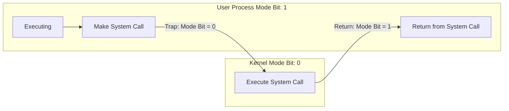

每個 Process 都有個 Process State Word，PSW (或 Mode Bit)，來紀錄為 **User Mode** 或 **Kernel Mode**。User Mode 的 Process 不能直接使用 System Hardware 而且不能隨意取用記憶體，而 Kernel Mode 的 Process 完全無限制。以前經常發生的藍螢幕大部分肇因於所有 Process 都是 Kernel Mode。

- How do we guarantee that user does not explicitly set the mode bit to “kernel”?
  - System call changes mode to kernel, return from call resets it to user
- Some instructions designated as privileged, only executable in kernel mode

對於 Process 而言，User Mode 切為 Kernel Mode 有幾種原因 (相反情況並不影響)：

- **Interrupt**: 硬體的使用，如網路連結、插入 I/O。會呼叫 **ISR**，Interrupt Services Runtime，來暫時性處理
- **Trap**: 當 Process 造成需要 OS 介入的情境
- **Blocking System Call**: 如讀取檔案等需要 OS 層級的呼叫

User Mode 切為 Kernel Mode 需以下步驟。若為 Multiprocessing，則會發生得更為頻繁與複雜：

1. 將當下 Context 存於 PCB
2. 更新 Accounting
3. 將該 Process 的 PCB 移到合適的 Queue (Ready、Blocked)，來指明下一個對該 Process 的動作
4. 將另一個 Process 放入 Running Queue
5. Update memory management
6. 恢復該 Process 的 Context

