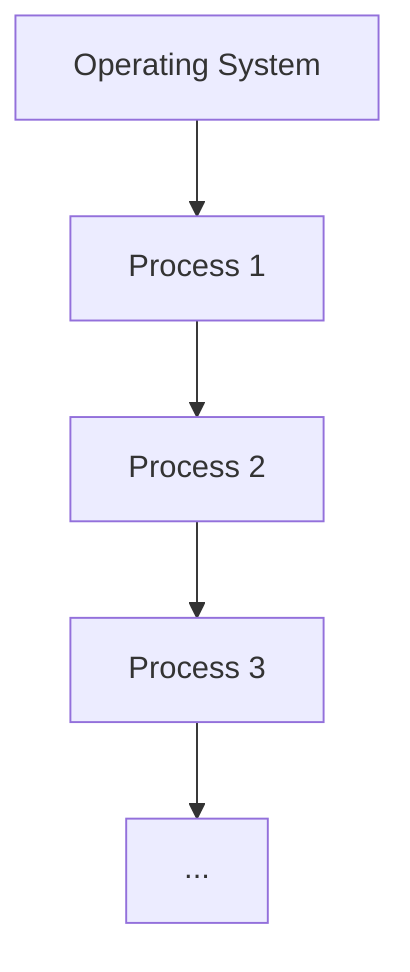

A logical extension of Batch systems – the CPU switches jobs so frequently that users can interact with each job while it is running, creating **interactive** computing

- Response time should be < 1 second
- Each user has at least one program executing in memory: process
- If several jobs ready to run at the same time: CPU scheduling
- If processes don’t fit in memory, **swapping** moves them in and out to run
- Virtual memory allows execution of processes not completely in memory

# Layout

