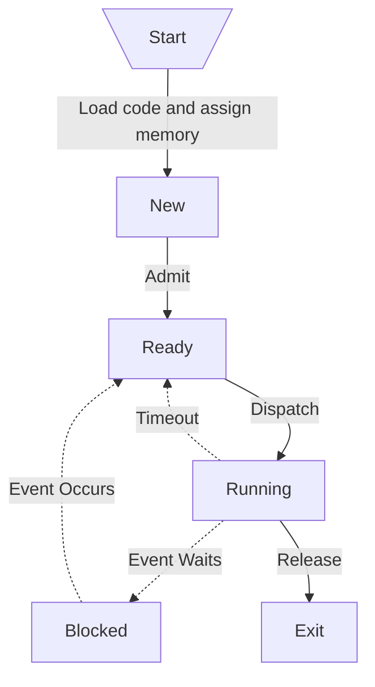
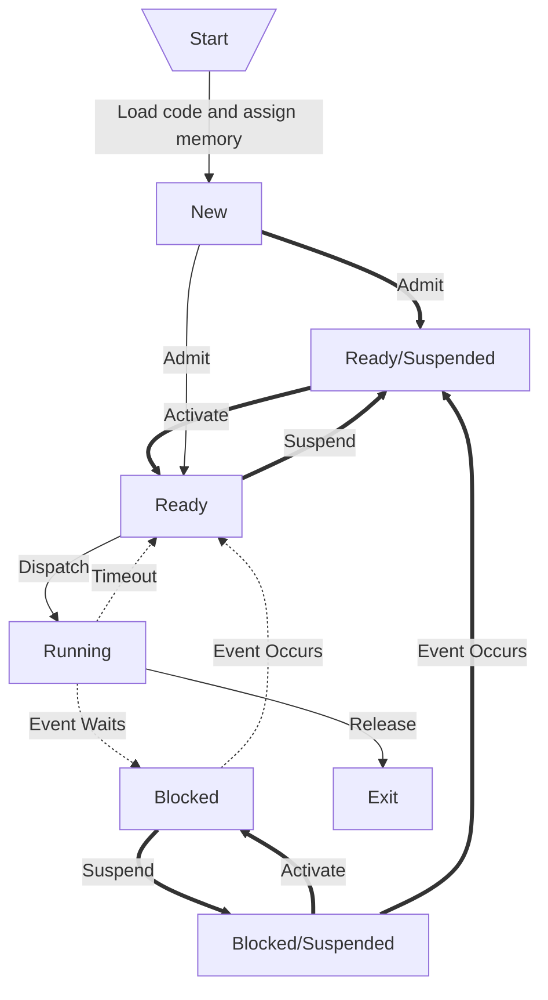

首先需要了解以下：

- **CPU**: 處理單元，一個 CPU Core 同時只能執行一個 Process
- **Program**: 執行的程式檔，通常是 Compile 過的 EXE 檔、還未 Load 進記憶體的 Code。具有唯一性

Process 即執行中的 Program，讓 OS 能追蹤執行的狀態與資源，一個 Program 可以同時有很多 Process。Process 間不可互相存取 Memory，但仍然有如 **IPC** 一類互相溝通資料的方法。一個 Process 是指 Thread 們的容器，默認時，Java 是單一 Thread，而 Python 是 Multi-Thread。Process 由以下構成：

- **Program Code**: 又稱 Code Section，即程式碼
- **Program Counter**: 下一個要執行的 Instruction 的位置
- **Process Counter**: 下一個要執行的 Process 的位置
- **Processor Register**: 又稱 Register Set，為小又能快速取用 CPU 資源的記憶體
- **Stack Space**: 儲存暫時性資料
- **Variables**: Dynamically Allocated Variables 和 Non-Thread-Local Global Variables
- **Data Section**: Thread 間的 Shared Data
- **Memory Cache**: 又稱 Heap，執行時產生的動態記憶體空間

Process needs the following resource to accomplish its task:

- CPU, memory, I/O, files
- Initialization data

### States

Process 有以下 5 種狀態。每個狀態都會佔據至少一段時間。其中，**Ready** 是在等待 Processor 使用，**Running** 是真正執行，**Block** 是暫時不執行、會發生主因爲該 Process 執行過久，而 **Exit** 是等待 Return Value 後即發生：

### Suspension

而在 5 State 之外，還有一 Suspension。當 Suspend 一個 Process 時，該 Process 會完全從 Main Memory 中移除、存到 Secondary Memory 中 (由 Medium-term Scheduling Algorithm 控制)，並且該 Process 不會意識到被 Suspended (回復到 Main Memory 時仍會與被移除時的狀態一致)。其發生，主要因：

- 空出 Main Memory 給其他 Process 使用
- Long-term Delay
- Debugging

:::info 提醒
Suspended 與 Blocked 相似，但差別在於，Blocked 是主動、如等待 I/O。而 Suspended 通常是被動，而且無法自行恢復。
:::

加上 Ready/Suspended 和 Blocked/Suspended，會產生 7 State：

### Process Control Block

又稱 PCB，列出一個 Process 的所有資訊，是 OS 的一個重要元件，主要有：

- **Memory Table**: Paging 和 Segmentation
- **I/O Table**: 列出該 Process 能夠使用的 Device
- **File Table**: 列出該 Process 能夠訪問的 File
- **Stack**: 所有 Active Function Call

而若細分：

| Content       | Description                                                                            |
| ------------- | -------------------------------------------------------------------------------------- |
| PID           | Process Identifier。16 Bits 的 ID，同時代表 OS 中最多只能有 65,535 個 Process          |
| PPID          | Parent Process ID，Parent Process 能夠得知 Child Process 何時結束並且接收 Return Value |
| UID           | 開啟該 Process 的使用者，影響訪問權                                                    |
| Register      | 理論上會一直變動。當被從 Running State 移出時，會儲存當下的值以便恢復                  |
| Stack Pointer | 指向在 Stack 中儲存的區                                                                |
| Scheduling    | 紀錄執行時長、等待時長，以及何時該移出 Running State                                   |
| Linkages      | 紀錄 Pipe Process。Pipe 中 Return Value 會被作為其他 Process 的 Input                  |
| IPC           | Internal Process Communication。紀錄可互相溝通的 Process                               |
| Resources     | 使用的 I/O Devices 和 Files                                                            |
| Memory        | 被分配到的記憶體                                                                       |
