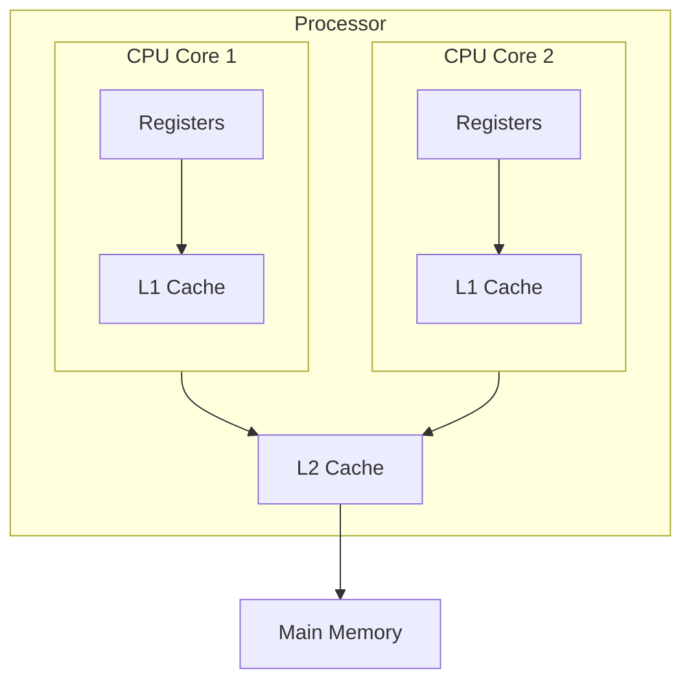

- Asymmetric Multiprocessing – each processor is assigned a specie task.
- Symmetric Multiprocessing – each processor performs all tasks

# Dual Core Design

- Multi-chip and multicore
- Systems containing all chips
  - Chassis containing multiple separate systems

## Non-Uniform Memory Access System

https://hackmd.io/@hPMCWajOS-ORQdEEAQ04-w/Hkd1rsonP
