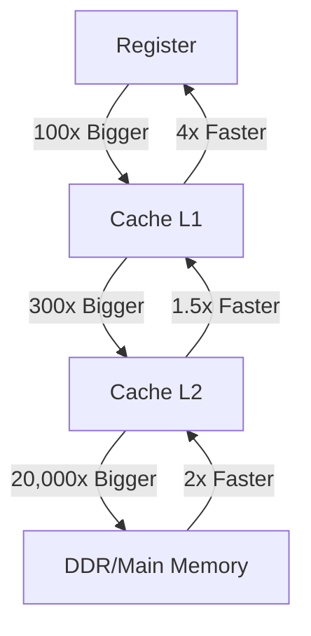

當 CPU 要執行 Code，Code 必須在 Register 內。為什麼不直接把所有東西都存在 Register 內？這樣就不必在每次計算前傳遞資料了。因為，太貴。所以有個 Memory Hierarchy，越高層越貴但越快，反之亦然：

在 Main Memory 下是 Secondary Storage，Main Memory 可以視為 Secondary Storage 的 Cache。

:::info
Cache 存在於 CPU 中，為 Hardware 層級。
:::
