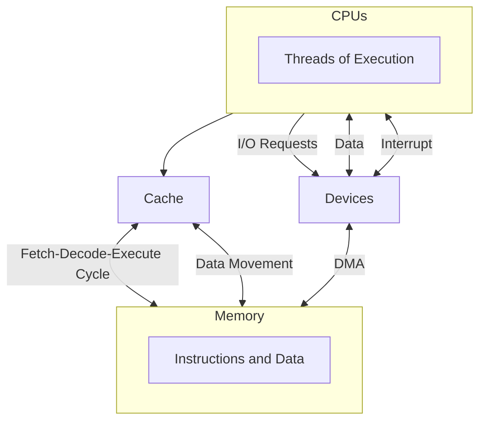

# DMA

Direct memory access (DMA) is a method that allows an input/output (I/O) device to send or receive data directly to or from the main memory, bypassing the CPU to speed up memory operations.

- Used for high-speed I/O devices able to transmit information at close to memory speeds
- Device controller transfers blocks of data from buffer storage directly to main memory without CPU intervention
- Only one interrupt is generated per block, rather than the one interrupt per byte
