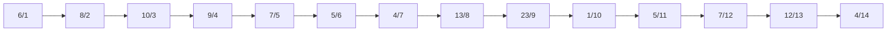

# Assignment

An assignment for class **MET CS 566** at Boston University, instructed by **Ming Zhang**. Student [Zhang, Jin Yu](siege@bu.edu) submitted on **October 15, 2022**.

## Question 1

Illustrate the operation of `MAX-HEAPIFY(A, 3)` on the array `(6, 8, 10, 9, 7, 5, 4, 13, 23, 1, 5, 7, 12, 4)`. Write your steps, and count the number of total swap operations (exchange of keys):

Execute `MAX-HEAPIFY(A, 3)`. The left child index `3 * 2 = 6` is lower than or equal to the size of the heap, this step is valid to proceed.

Indices start from `1`. `MAX-HEAPIFY(A, 3)` means to start maintaining the max-heap property at index `3`, which is the value of `10`. The left child is `5` at index `6`, right child is `4` at index `7`.

The largest value among the left and right children is `5`. `5` is not larger than `10`, there are no swap operations and further `MAX-HEAPIFY` calls.

## Question 2

Run the HEAP-Sort Algorithm on the above array and count up the total number of exchanges (You can assume the array has already been built as a heap):

- Write down the initial Max-heap array
- Write down the array after each key exchange in the HEAP-Sort.
- Write down the total number of key exchanges in the HEAP-Sort algorithm.
- No need to illustrate all your steps.

> Note: Number of exchanges is the number of times that you swap the position of two keys (Values of the array) until it is a sorted array.
