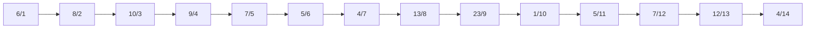
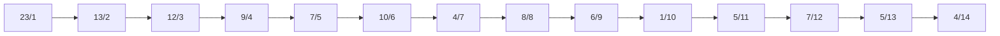

# Assignment

An assignment for class **MET CS 566** at Boston University, instructed by **Ming Zhang**. Student [Zhang, Jin Yu](siege@bu.edu) submitted on **October 15, 2022**.

## Question 1

Illustrate the operation of `Max-Heapify(A, 3)` on the array `(6, 8, 10, 9, 7, 5, 4, 13, 23, 1, 5, 7, 12, 4)`. Write your steps, and count the number of total swap operations (exchange of keys):



### Solution

Execute `Max-Heapify(A, 3)`. The left child index `3 * 2 = 6` is lower than or equal to the size of the heap, this call is valid to proceed.

Indices start from `1`. `Max-Heapify(A, 3)` means to start maintaining the max-heap property at index `3`, which is the value of `10`. The left child is `5` at index `6`, right child is `4` at index `7`.

The largest value among the left and right children is `5`. `5` is not larger than `10`, there are no swap operations and further `Max-Heapify` calls.

## Question 2

Run the Heap-Sort Algorithm on the above array and count up the total number of exchanges (you can assume the array has already been built as a heap):

- Write down the initial Max-heap array
- Write down the array after each key exchange in the Heap-Sort.
- Write down the total number of key exchanges in the Heap-Sort algorithm.
- No need to illustrate all your steps.

Number of exchanges is the number of times that you swap the position of two keys (values of the array) until it is a sorted array.

### Step 0

**You can assume the array has already been built as a heap**. It means the initial array is already a valid Max-Heap array. We should use `Build-Max-Heap` algorithm to construct the initial array first:

> The parameter `A` is `(6, 8, 10, 9, 7, 5, 4, 13, 23, 1, 5, 7, 12, 4)` from the first question. `Max-Heapify` as well.

```
Build-Max-Heap
Parameters: A

FOR index from floor(A.length / 2) down to 1
DO
    Max-Heapify(A, index)
END FOR
```

Initial Max-Heap array:



I implemented the algorithm in Python to help me to construct the array:

```Python
def heapify_max(list_integer, index):
    index_left = (index * 2) + 1
    index_right = index_left + 1
    index_largest = -1

    if index_left <= len(list_integer) - 1 and list_integer[index_left] > list_integer[index]:
        index_largest = index_left
    else:
        index_largest = index

    if index_right <= len(list_integer) - 1 and list_integer[index_right] > list_integer[index_largest]:
        index_largest = index_right

    if list_integer[index] < list_integer[index_largest]:
        cache = list_integer[index_largest]
        list_integer[index_largest] = list_integer[index]
        list_integer[index] = cache

        heapify_max(list_integer, index_largest)

def build_heap_max(list_integer):
    for index in range(floor(len(list_integer) / 2), -1, -1):
        heapify_max(list_integer, index)

list_integer = [6, 8, 10, 9, 7, 5, 4, 13, 23, 1, 5, 7, 12, 4]
build_heap_max(list_integer)

print(list_integer)
```

### Step 1

We should then use `Heap-Sort` algorithm below:

```
Heap-Sort
Parameters: A

FOR index from A.length down to 2
DO
    exchange A[1] with A[index]
    reduce A.length by 1
    Max-Heapify(A, 1)
END FOR
```

There are **13** times key exchanging (only between the max value at index `0` and the last position). There are **35** times if the exchanges happened in `heapify_max` also counted.

The following are the modified array after each step/key exchanging, I include the change after `heapify_max` in order to understand the flow more precisely:

#### 1

```bash
# After key exchanging:
[
  4, 13, 12, 9, 7, 10,
  4,  8,  6, 1, 5,  7,
  5, 23
]
# After heapify_max:
[
  13,  9, 12, 8, 7, 10,
   4,  4,  6, 1, 5,  7,
   5, 23
]
```

#### 2

```bash
# After key exchanging:
[
   5,  9, 12, 8, 7, 10,
   4,  4,  6, 1, 5,  7,
  13, 23
]
# After heapify_max:
[
  12,  9, 10, 8, 7, 7,
   4,  4,  6, 1, 5, 5,
  13, 23
]
```

#### 3

```bash
# After key exchanging:
[
   5,  9, 10, 8, 7,  7,
   4,  4,  6, 1, 5, 12,
  13, 23
]
# After heapify_max:
[
  10,  9, 7, 8, 7,  5,
   4,  4, 6, 1, 5, 12,
  13, 23
]
```

#### 4

```bash
# After key exchanging:
[
   5,  9, 7, 8,  7,  5,
   4,  4, 6, 1, 10, 12,
  13, 23
]
# After heapify_max:
[
   9,  8, 7, 6,  7,  5,
   4,  4, 5, 1, 10, 12,
  13, 23
]
```

#### 5

```bash
# After key exchanging:
[
   1,  8, 7, 6,  7,  5,
   4,  4, 5, 9, 10, 12,
  13, 23
]
# After heapify_max:
[
   8,  7, 7, 6,  1,  5,
   4,  4, 5, 9, 10, 12,
  13, 23
]
```

#### 6

```bash
# After key exchanging:
[
   5,  7, 7, 6,  1,  5,
   4,  4, 8, 9, 10, 12,
  13, 23
]
# After heapify_max:
[
   7,  6, 7, 5,  1,  5,
   4,  4, 8, 9, 10, 12,
  13, 23
]
```

#### 7

```bash
# After key exchanging:
[
   4,  6, 7, 5,  1,  5,
   4,  7, 8, 9, 10, 12,
  13, 23
]
# After heapify_max:
[
   7,  6, 5, 5,  1,  4,
   4,  7, 8, 9, 10, 12,
  13, 23
]
```

#### 8

```bash
# After key exchanging:
[
   4,  6, 5, 5,  1,  4,
   7,  7, 8, 9, 10, 12,
  13, 23
]
# After heapify_max:
[
   6,  5, 5, 4,  1,  4,
   7,  7, 8, 9, 10, 12,
  13, 23
]
```

#### 9

```bash
# After key exchanging:
[
   4,  5, 5, 4,  1,  6,
   7,  7, 8, 9, 10, 12,
  13, 23
]
# After heapify_max:
[
   5,  4, 5, 4,  1,  6,
   7,  7, 8, 9, 10, 12,
  13, 23
]
```

#### 10

```bash
# After key exchanging:
[
   1,  4, 5, 4,  5,  6,
   7,  7, 8, 9, 10, 12,
  13, 23
]
# After heapify_max:
[
   5,  4, 1, 4,  5,  6,
   7,  7, 8, 9, 10, 12,
  13, 23
]
```

#### 11

```bash
# After key exchanging:
[
   4,  4, 1, 5,  5,  6,
   7,  7, 8, 9, 10, 12,
  13, 23
]
# After heapify_max:
[
   4,  4, 1, 5,  5,  6,
   7,  7, 8, 9, 10, 12,
  13, 23
]
```

#### 12

```bash
# After key exchanging:
[
   1,  4, 4, 5,  5,  6,
   7,  7, 8, 9, 10, 12,
  13, 23
]
# After heapify_max:
[
   4,  1, 4, 5,  5,  6,
   7,  7, 8, 9, 10, 12,
  13, 23
]
```

#### 13

```bash
# After key exchanging:
[
   1,  4, 4, 5,  5,  6,
   7,  7, 8, 9, 10, 12,
  13, 23
]
# After heapify_max:
[
   1,  4, 4, 5,  5,  6,
   7,  7, 8, 9, 10, 12,
  13, 23
]
```

## Question 3

Write pseudo-code to extract the Median of an array using a heap structure. Name it `Extract−Median(A)` where `A` is an array. Develop an algorithm with the best running time.

- You can use similar pseudo-code syntax similar to the CLRS book or lecture slides.
- Discuss what is the running time of your best algorithm

The efficient algorithm to extract median using heap needs to build two heaps: Max-heap to hold smaller half part of the values; Min-heap to save bigger half part of the values. The size difference between two heaps should be within `1`. The key algorithm in `Extract-Median` is `Median-Heapify` (you may refer Max-Heapify algorithm in the lecture).

### Solution

We should assume that the `A` parameter for `Extract-Median` is already a heap. Otherwise, we will have to contract heaps and modify the input array every time we use `Extract-Median`. `Median-Heapify` is also useless since the property of the heap is not reused (because we construct new heaps every time).

The hint is about using `2` heaps to find the median by their difference. However, we only have `1` parameter to use as `Extract-Median` requires. The following is the pseudo-code to construct the heap we need for `Extract-Median`:

```
Build-Median-Heap
Parameters: A

find index_median from A

create heap_max from every element in A less than or equal to A[index_median]
create heap_min from every element in A larger than A[index_median]

create B as an empty array with length 2
B[1] = heap_max
B[2] = heap_min

reference A from A to B
```

Now we have the heap we need for `Extract−Median` from `Build-Median-Heap`, which is a 2-dimension array:

```
Extract−Median
Parameters: A

IF A[1].length < 1 && A[2].length < 1
    throw Error "Heap Underflow"
END IF

IF A[1].length > A[2].length
    return Extract-Max(A[1])
ELSE IF A[2].length > A[1].length
    return Extract-Min(A[2])
ELSE
    return Extract-Max(A[1])

```

The pseudo-code for `Extract-Min` and `Extract-Max` are as same as the lecture and therefore not necessary list here. `Median-Heapify` is not a must when we use 2-dimension array for 2 heaps here because we already handle the extraction in `Extract-Min` and `Extract-Max`.

### Running Time

`Median-Heapify` is not implemented and therefore not discussed here:

- **Build-Median-Heap**: $\theta(n)$
  - Find `index_median` algorithm is $\theta(n)$
  - Build `heap_max` is $\theta(n)$
  - Build `heap_min` is $\theta(n)$
  - $\theta(3 \times n)$ = $\theta(n)$
- **Extract−Median**: $\theta(\log(n))$
  - Extracting median from `heap_max` requires `Extract-Max`, then `Max-Heapify` is used. `Max-Heapify` is $\theta(\log(n))$
  - Extracting median from `heap_min` requires `Extract-Min`, then `Min-Heapify` is used. `Min-Heapify` is $\theta(\log(n))$

## Question 4

Demonstrate what happens when we insert the keys `(6, 8, 10, 9, 7, 5, 4, 13, 23, 1, 5, 7, 12, 4)` into a hash table with collisions resolved by chaining. Let the table have `9` slots, and let the hash function be $h(k) = k \mod 9$.

- Count the number of collisions
- How many collisions would the hash table have if you use $h(k) = k \mod 7$?

Hash table indexes start from zero.

### Solution

Hash table after inserting all the elements using $h(k) = k \mod 9$. There are `6` collisions.:

```
0: 9
1: 10 1
2:
3: 12
4: 4 13 4
5: 5 23 5
6: 6
7: 7 7
8: 8
```

What happens when we inserts the keys:

1. Insert 6 at position (6 % 9 = 6).
2. Insert 8 at position (8 % 9 = 8).
3. Insert 10 at position (10 % 9 = 1).
4. Insert 9 at position (9 % 9 = 0).
5. Insert 7 at position (7 % 9 = 7).
6. Insert 5 at position (5 % 9 = 5).
7. Insert 4 at position (4 % 9 = 4).
8. Insert 13 at position (13 % 9 = 4). Collision happens.
9. Insert 23 at position (23 % 9 = 5). Collision happens.
10. Insert 1 at position (1 % 9 = 1). Collision happens.
11. Insert 5 at position (5 % 9 = 5). Collision happens.
12. Insert 7 at position (7 % 9 = 7). Collision happens.
13. Insert 12 at position (12 % 9 = 3).
14. Insert 4 at position (4 % 9 = 4). Collision happens.

Hash table after inserting all the elements using $h(k) = k \mod 7$. There are `7` collisions.:

```
0: 7 7
1: 8 1
2: 9 23
3: 10
4: 4 4
5: 5 5 12
6: 6 13
7:
8:
```

## Question 5

Consider inserting the keys `{31, 11, 5, 17, 25}` into a hash table of length $m = 7$ using open addressing with the hash function

$$
h(k, i) = (h'(k) + i) \mod m
$$

$$
h'(k) = k \mod 7
$$

- Illustrate the result of inserting these keys using linear probing and provide insertion table index
  results
- Count the number of collisions

```

```
