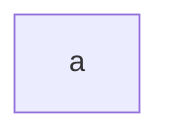
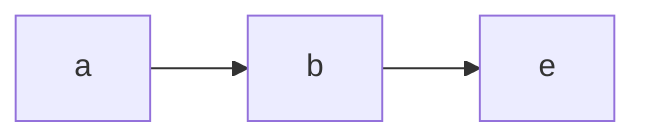
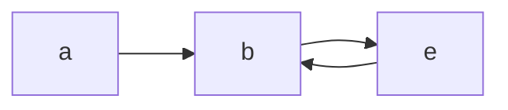
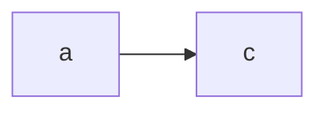
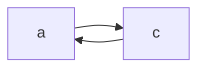
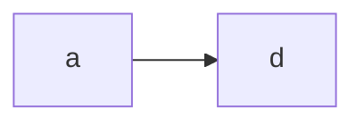
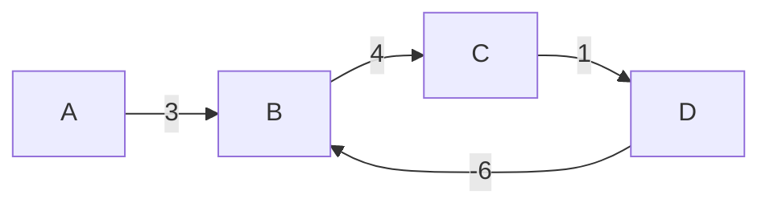

# Assignment

An assignment for class **MET CS 566** at Boston University, instructed by **Ming Zhang**. Student [Zhang, Jin Yu](siege@bu.edu) submitted on **November 7, 2022**.

## Correction

Score: `17.5/20`

### Question 2

There are three cross edges, $(d,e), (d,c), (c,e)$.

### Question 3

In the undirected graph, we get only back edges. In an undirected graph, the instance between $u$ and $v$ are the same as $v$ and $u$. If a vertex $v$ is discovered by the search from the edge $(u,v)$ then the edge $(v,u)$ is identified as a back edge. The reason why forward edges and cross edges cannot exist in undirected graphs is that in the case $(v,u)$ would have been traversed during the DFS process before reaching $u$ and try to visit $v$.

## Question 1

Dijkstra’s Algorithm:


### Solution

Represent the above graph in Adjacent Matrix format:

$$
\begin{pmatrix}
  & a & b & c & d & e \\
a & 0 & 5 & 6 & 1 & \infin \\
b & \infin & 0 & \infin & \infin & 1 \\
c & \infin & \infin & 0 & \infin & 3 \\
d & \infin & \infin & 3 & 0 & 9 \\
e & \infin & \infin & \infin & \infin & 0 \\
\end{pmatrix}
$$

> Unconnected edge is represented with `0` in slides. However, I think using $\infin$ is more meaningful.

Run the Dijkstra’s algorithm on the above directed graph, using vertex `a` as the start source. Write down your steps and describe them briefly. You may use an array to show the value of vertices in each step:

| Step  | a   | b   | c   | d   | e        |
| ----- | --- | --- | --- | --- | -------- |
| 1 (a) | 0   | 5   | 6   | 1   | $\infin$ |
| 2 (d) | 0   | 5   | 4   | 1   | 9        |
| 3 (b) | 0   | 5   | 4   | 1   | 6        |
| 3 (c) | 0   | 5   | 4   | 1   | 6        |
| 3 (e) | 0   | 5   | 4   | 1   | 6        |

## Question 2

Consider the above directed Graph from task 1:


### Solution

Start from the vertex `a` and apply the Depth-First Algorithm. Write your steps and describe them briefly:

First of all, we start from `a`:



Then we go to `b`:


Follow the principle of BFS, we always go to the first adjacent node that the current one connected:



There is no node connect to `e`, so we have to go back:




Since `b` and `e` have been visited, we go to `c` this time:



`c` is connected to `e`. However, `e` has been visited. We go back to `a`:



`b` and `c` are visited. We go to `d` from `a`:



Then we go back to `a` because the adjacent nodes to `d` all have been visited.

Do you have any Back, Forward or Cross Edges?

- Back Edge: **Yes**. We have edges such as $\overline{ea}$
- Forward Edge: **Yes**. We have edges such as $\overline{ae}$
- Cross Edge: **Yes**. We have edges such as $\overline{bd}$


## Question 3

As we have learned in the lecture when we apply Depth-First the algorithm on graphs, it is possible to have Back, Forward or Cross Edges. Which kind of edges (Back, Forward or Cross Edges) is possible on undirected graphs? Describe your answer.

### Solution

In a connected undirected graph, every node is either a ancestor or a descendent of each other. Therefore, we have back edges and forwards edges in undirected graph with DFS.

Cross edges are impossible to exist in an undirected graph since it requires connected 2 nodes such that they do not have any ancestor/descendant relationship.

## Question 4

Design an optimal algorithm that can detect cycles in a given directed graph $G = (V, E)$:

### Solution

Provide pseudo-code for your algorithm:

```
Detect-Cycles
Parameters: G

FOR V in G
    initialize V with visited as false,
    and children as an empty list
END FOR

FOR V in G
    IF V.visited IS false
        IF Detect-Cycles-Recursion(V) IS true
            RETURN true
    END IF
END FOR
```

```
Detect-Cycles-Recursion
Parameters: V

V.visited = true

FOR children in V
    IF child.visited is true
        RETURN true
    ELSE
        Detect-Cycles-Recursion(child)
END FOR

RETURN false
```

Describe the running time of your algorithm:

$\mathcal{O}(V + E)$. The time-complexity of `Detect-Cycles` is as same as `Depth-First Search` since we call `Detect-Cycles-Recursion` only once because it's parent is set, which is $\mathcal{O}(E)$ (every parent-to-child relationship for V.children is actually an edge). `Detect-Cycles` only adds linear time, which is $\mathcal{O}(V)$.

## Question 5

Consider the following Graph:


### Solution

Run the Bellman-Ford algorithm on the above directed graph, using vertex `a` as the start source. Write down your steps and describe them briefly. You may use an array to show the value of vertices in each step:

| Step  | a   | b        | c        | d   | e        | f        |
| ----- | --- | -------- | -------- | --- | -------- | -------- |
| 1 (a) | 0   | $\infin$ | $\infin$ | 1   | $\infin$ | $\infin$ |
| 2 (d) | 0   | $\infin$ | $\infin$ | 1   | -1       | $\infin$ |
| 3 (e) | 0   | $\infin$ | 2        | 1   | -1       | $\infin$ |
| 4 (c) | 0   | 7        | 2        | 1   | -1       | $\infin$ |
| 5 (b) | 0   | 7        | 2        | 1   | -1       | 6        |
| 6 (f) | 0   | 7        | 2        | 1   | -1       | 6        |

The result is already yielded after the first iteration. We start from `a` and assign `d` with value `1`, then we start looping all nodes adjacent to `d`, which is `e`. Afterward, we can move to `c` from `e`.

`c` is adjacent to `a`, `b`, and `d`. For `a` and `b`, the value passed from `c` is not lower than theirs, so the table is not updated. We assign value `7` to `b`. We then make a relaxation on `f` from `b`. `e` is not updated from `f` since its value is lower.

The second to fifth iterations don't update the table.

## Question 6

Bellman-Ford algorithm.

### Solution

Describe why the Bellman-Ford algorithm does not work when the given graph includes negative cycles:

For Bellman-Ford algorithm, we have to run $|V| - 1$ iterations to loop every node and relax them in order to handle negative edges. However, if negative circles happen, the nodes related to the negative circles would have lower value after each iteration, which leads to an error.

Describe how the Bellman-Ford algorithm detects the negative cycles. Provide an example graph with negative cycles and show how it can be detected:



Negative cycle exists in $\overline{BCD}$ because $4 + 1 + (-6) < 0$. In this graph, we have `4` vertices, so we will have `3` times relaxation. After relaxations, we will have costs for each node.

If we run another loop to check all the edges, we will find out that `B`'s value is larger than $\overline{DB} + D$. When it happens, we come to the conclusion that a negative cycle is discovered.
