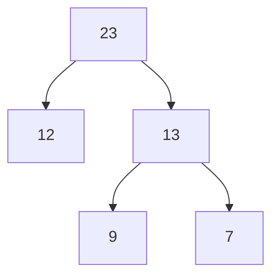
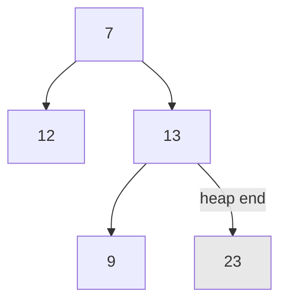

# Assignment

An assignment for class **MET CS 566** at Boston University, instructed by **Ming Zhang**. Student [Zhang, Jin Yu](siege@bu.edu) submitted on **October 20, 2022**.

## Question 1

**Ordering by asymptotic growth rates**. Rank the following functions by order of growth. This means finding an arrangement $g_1, g_2, ..., g_9$ of the functions that satisfy $g_1 = \Omega(g_2), g_2 = \Omega(g_3), ..., g_7 = \Omega(g_8)$:

1. $g_1 = \log(\log(n))$
2. $g_2 = 2^{\log(n)}$
3. $g_3 = 2^{\sqrt{2 \times \log(n)}}$
4. $g_4 = n^{8.2} + \log(n)$
5. $g_5 = n^{8.2} + n!$
6. $g_6 = n^{2024} + n^{512} + n \times \log(n)$
7. $g_7 = e^n + e^{ln(n)}$
8. $g_8 = \sqrt{\log(n)}$

Work in stepwise format. Find the fastest growing function first, and then the next fast one.

### Solution

Refine some functions to get rid of lower-order terms in order to compare them precisely:

1. $g_1 = \log(\log(n))$
2. $g_2 = 2^{\log(n)}$
3. $g_3 = 2^{\sqrt{2 \times \log(n)}}$
4. $g_4 = n^{8.2} + \log(n) = n^{8.2}$
5. $g_5 = n^{8.2} + n! = n!$
6. $g_6 = n^{2024} + n^{512} + n \times \log(n) = n^{2024}$
7. $g_7 = e^n + e^{ln(n)} = e^n$
8. $g_8 = \sqrt{\log(n)}$

Here is the list. Fastest goes first:

$g_1$
$g_8$

$g_3$
$g_2$

$g_4$
$g_6$
$g_7$
$g_5$

$e^{\log_{e}^{n}}$

What does `stepwise format` mean?

What is $e^n + e^{ln(n)}$?

<div style="page-break-after: always;"></div>

## Question 2

**Asymptotic notations**. For each pair of the following functions $f(n)$ and $g(n)$, check if:

1. $f(n) = \Theta(g(n))$
2. $f(n) = \mathcal{O}(g(n))$
3. $f(n) = \Omega(g(n))$
4. $f(n) = o(g(n))$
5. $f(n) = \omega(g(n))$

Functions $f(n)$ and $g(n)$ are:

1. $f(n) = 128^{\frac{n}{4}} \ vs.\ g(n) = 512^{\frac{n}{8}}$
2. $f(n) = n^{64} \times 2^n \ vs.\ g(n) = \log(n) \times 2^n+ 4^n + n^{32}$
3. $f(n) = n^{1024} \ vs. \ g(n) = 2^{\log(n) \times \log(n)}$

You do not need to provide a formal proof. Describe your justifications in text form.

### Solution

#### $f(n) = 128^{\frac{n}{4}} \ vs.\ g(n) = 512^{\frac{n}{8}}$

We first change the form:

$$
f(n) = 128^{\frac{n}{4}} = \sqrt[2^2]{128}^n = \sqrt[2^2]{2^7}^n = 2^{\frac{7 \times n}{4}}
$$

$$
g(n) = 512^{\frac{n}{8}} = \sqrt[2^3]{512}^n = \sqrt[2^3]{2^9}^n = 2^{\frac{9 \times n}{8}}
$$

<div style="page-break-after: always;"></div>

## Question 3

**Big O notation**. What is the running time of this code in Big O notation regarding $n$?

```
1. y = 0
2. j = 1
3. while (j * j <= n) do
4.     y = y + 1
5.     j = j + 1
6. end while
```

Line 4 is some constant cost.

<div style="page-break-after: always;"></div>

## Question 4

**Big O notation**. What is the running time of this code in Big O notation regarding $n$?

```
1. a = 0
2. k = n * n
3. while (k > 1) do
4.    for j <- 0 to n*n do
5.         a = a + j
6.    end for
7.    k = k / 2
8. end while
```

### Solution

We can first assume that `a` is not a factor to the running time since `a` is not used as an index or length of execution.

The time complexity for the while-loop at line 3 is $\log(n^2)$ because we run `k = k / 2` every loop, and `k` starts at `n * n`. The time complexity for the for-loop at line 4 is $n^2$ since `j` only exists in the for-loop scope and starts from `0` to `n * n` every time.

$$
\mathcal{O}(f(n)) = \log(n^2) \times n^2 = 2 \times \log(n) \times n^2 = \log(n) \times n^2
$$

<div style="page-break-after: always;"></div>

## Question 5

**Recursive function**. What is the running time of the following python code in Big O notation regarding $n$?

```Python
def isThis(n):
    print(n)
    if (n == 1):
        return True
    if (n == 0):
        return False
    if ((n % 3) == 0):
        return isThis(n / 3)
    else:
        return False
```

### Solution

Only remainder for `n % 3` equals to $0$ will lead to another call stack, hence, the worst case should be $n$ is a $3 \times m$ for any positive integer $m$ such as $9$, $27$, ..., $300$.

For example, when $n$ comes to $9$, it calls another call on stack with $n = 3$, then calls another one with $n = 0$. The result is `False` for $n = 9$.

$$
\mathcal{O}(f(n)) = \log_3^n
$$

<div style="page-break-after: always;"></div>

## Question 6

**`HEAP-EXTRACT-MAX` worst case**. Describe when the worst case of `HEAP-EXTRACT-MAX` happens after you removed a max value from a heap. Provide an example.

### Solution

The main factor of the time complexity for `HEAP-EXTRACT-MAX` is the number of running times of `MAX-HEAPIFY`. Every time we swap the max value at the first index with the element at the last index, we have to execute `MAX-HEAPIFY(Array, 0)` to maintain the heap property for the given array. Thus, the worst cast of `HEAP-EXTRACT-MAX` happens when we have to run `MAX-HEAPIFY` from head to bottom to maintain the heap property, which is $\mathcal{O}(\log(n))$.

For example, we have the following heap `(23 13 12 9 7)`:



Once we execute `HEAP-EXTRACT-MAX`, we swap the max value at the first index with the element at the last index, and then reduce the heap size by `1`:



<div style="page-break-after: always;"></div>

## Question 7

**Hash function**. Name two properties a good hash function should have. Describe your answer (if possible, with an example).

<div style="page-break-after: always;"></div>

## Question 8

**Double hashing**. When you use double hashing in a hash table, does the number of potential collisions depend on the sequence of key insertions into the table? In other words, if you change the sequence of insertions, would the number of collisions change? Support your answer using an example.
