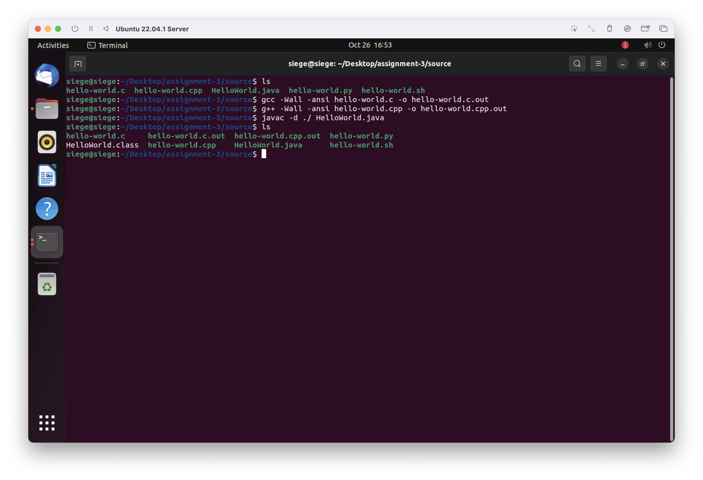
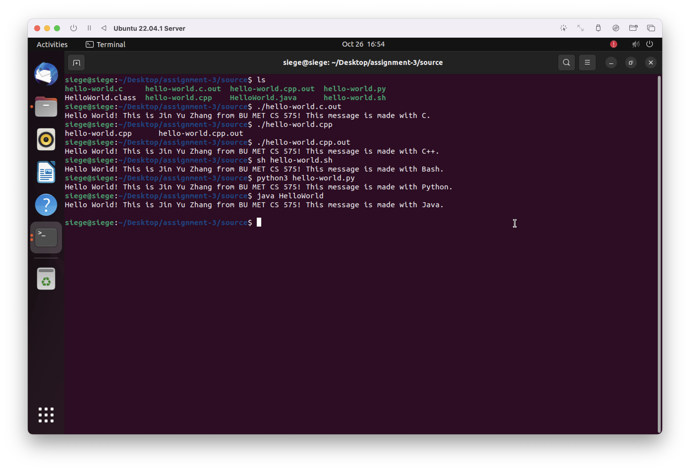

# Assignment

An assignment for class **MET CS 575** at Boston University, instructed by **Dr. Nourai**. Student [Zhang, Jin Yu](siege@bu.edu) submitted on **October 27, 2022**.

## Step 1: Create Hello World Programs

| Input Filename    | Command Used for Compiling                              | Output Filename       |
| ----------------- | ------------------------------------------------------- | --------------------- |
| `hello-world.c`   | `gcc -Wall -ansi hell-world.c -o hello-world.c.out`     | `hello-world.c.out`   |
| `hello-world.cpp` | `g++ -Wall -ansi hell-world.cpp -o hello-world.cpp.out` | `hello-world.cpp.out` |
| `hello-word.py`   |                                                         |                       |
| `hello-world.sh`  |                                                         |                       |
| `HelloWorld.java` | `javac -d ./ HelloWorld.java`                           | `HelloWorld.class`    |

### Java

I had no issues while using `gcc`, `g++`, and `python3`. However, I had to run a few steps to install Java Compiler. `jdk-8u351-linux-aarch64.tar.gz` has been downloaded and put in the shared folder:

```bash
cd <shared_folder>
cp jdk-8u351-linux-aarch64.tar.gz ./jdk-8
chmod 666 jdk-8

sudo mkdir /usr/local/java
cp jdk-8 /usr/local/java/
sudo tar zxvf jre-8
sudo rm jre-8
sudo update-alternatives --install "/usr/bin/java" "java" "/usr/local/java/jdk1.8.0_351/bin/java" 1
sudo update-alternatives --install "/usr/bin/javac" "javac" "/usr/local/java/jdk1.8.0_351/bin/javac" 1
```



<div style="page-break-after: always;"></div>



<div style="page-break-after: always;"></div>

## Step 2: Execute Hello World Programs

Execute each Hello World program with `strace`:


<div style="page-break-after: always;"></div>


<div style="page-break-after: always;"></div>


<div style="page-break-after: always;"></div>

## Step 3: Record System Calls

| System Calls        | C                           | C++                  | Java                        | Python                   | Bash                     |
| ------------------- | --------------------------- | -------------------- | --------------------------- | ------------------------ | ------------------------ |
| `execvc`            | 1                           | 1                    | 1                           | 1                        | 1                        |
| `open()`/`openat()` | 2                           | 5                    | 29                          | 49                       | 48                       |
| `close()`           | 2                           | 5                    | 9                           | 49                       | 47                       |
| `read()`            | 1                           | 4                    | 8                           | 68                       | 62                       |
| `write()`           | 1                           | 1                    |                             | 1                        | 1                        |
| `mmap()`            | 6                           | 18                   | 25                          | 24                       | 24                       |
| Any System Calls    | 32                          | 69                   | 149                         | 648                      | 624                      |
| strace output file  | `hello-world.c.out.summary` | `HelloWorld.summary` | `hello-world.c.out.summary` | `hello-world.py.summary` | `hello-world.sh.summary` |

<div style="page-break-after: always;"></div>

## Step 4: Conclusion

Why does one Hello World program run slower or faster than another? What conclusion can you draw on the performance of the five programs from the information filled in the table? Defend your answer including the assumptions that you made concerning the CPU time.

CPU time to execute Program on a $z Hz$ CPU is estimated by:

$$
CPU Time = Number Of Instructions \times Average Instruction Cost CPU Cycles \times \frac{1}{z}
$$

The biggest factor for Hello World programs run faster or slower is the **number of instructions** they execute. As we can see from `strace`, Python and Bash make more than 600 System Calls while C and C++ make not more than 100. Also, programs made by languages other than C and C++ also call a lot of other kinds of System Calls such as `rt_sigprocmask`, `rt_sigaction`, and `fcntl`.

The average time per System Call, which is `usecs/call`, is another factor for impacting performance for languages like Java and Bash. As `HelloWorld.summary` shows, the `usecs/call` for `futex` is $13343$ in Java, which a way beyond other languages (only $48$ in C++).
