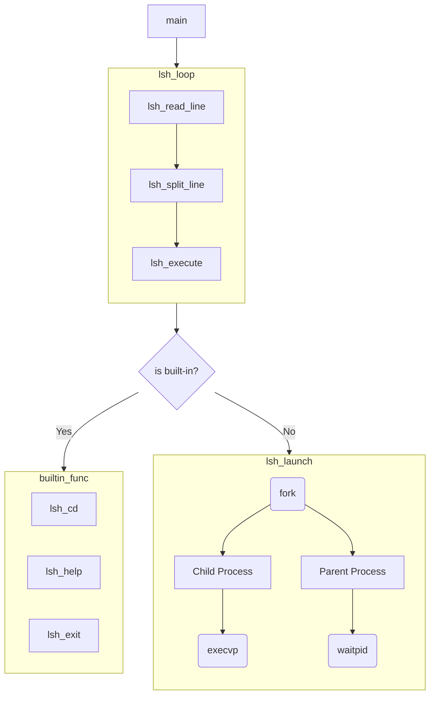

# Assignment

An assignment for class **MET CS 575** at Boston University, instructed by **Dr. Nourai**. Student [Zhang, Jin Yu](siege@bu.edu) submitted on **November 15, 2022**.

## Notes

Notes for the assignment.

### Shell Flow

A flowchart to understand how `shell.c` works:



### Origin

According to the [GitHub Repository](https://github.com/brenns10/lsh) and [main.c](https://github.com/brenns10/lsh/blob/master/src/main.c#L9), `lsh` means it only demonstrates the basics of how a shell works with many limitations, including:

- Commands must be on a single line
- Arguments must be separated by whitespace
- No quoting arguments or escaping whitespace
- No piping or redirection
- Only built-ins are: `cd`, `help`, `exit`

### Questions

Why `strtok` in while-loop need a `NULL` parameter? What does `strtok(NULL, LSH_TOK_DELIM)` do?

```C
char **lsh_split_line(char *line)
{
    /** ... */
    char **tokens = malloc(bufsize * sizeof(char *));
    char *token, **tokens_backup;
    /** ... */

    token = strtok(line, LSH_TOK_DELIM);
    while (token != NULL)
    {
        /** ... */
        token = strtok(NULL, LSH_TOK_DELIM);
    }
    /** ... */
}
```

`fork` would copy all the recourse used by the current process. What if we want an empty process? Isn't it a waste if what we are going to run on the child process is not related to the parent process?

### Commands

Compile `shell.c`:

```bash
gcc -Wall -ansi shell.c -o shell.c.out
```
