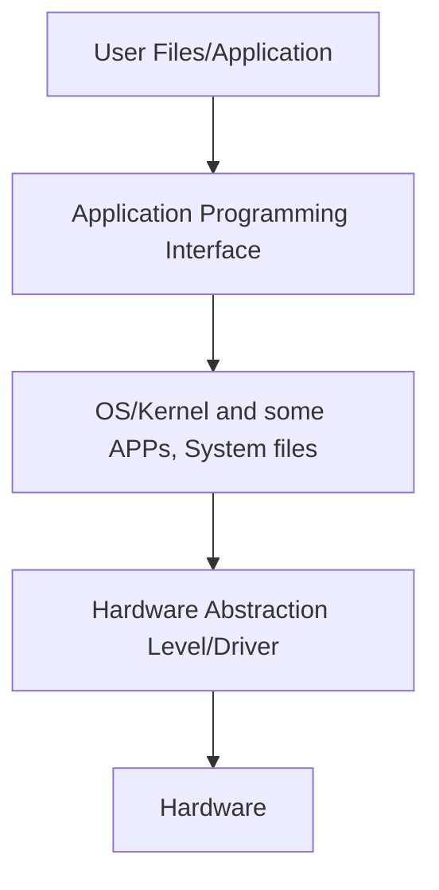

# VirtualBox Overview and OS Concept

32 bits processor comes from 2^32 (4096 MB), 32 means 32 bits. For example, 2^2 means 2 bits, we can have 4 kinds of status from it (00, 01, 10, 11). The reason for CPUs to upgrade to 64 bits is primary because we want more memory to use (64 bits is 2^64) at once. OS always catch up with the trend.

However, we don't have enough technology and reason to create unlimited (or bigger than 64) bits general purpose processor so far.

# Privilege Instructions

| Instruction   | User Mode | Kernel Mode |
| ------------- | --------- | ----------- |
| MOV           | Yes       | Yes         |
| JEQ           | Yes       | Yes         |
| HALT          | No        | Yes         |
| Intra-Disable | No        | Yes         |

:::info
JEQ means Jump if equal.
:::

:::info
Intra-Disable is generated from hardware(CPU instruction). `exception` is generated from software.
:::

## Review

- Best network adapter: NAT
- VirtualBox
  - Storage
    - Controller: IDE (IDE Secondary Device)
    - Controller: SATA
- `multi-programming/concept.md` and `multi-tasking/concept.md`s' chart may be replaced from each other
- Driver/HAL
- CPU instruction: Intra-Disable
- Register memory address: rax
- Difference between shells
- Today's trend: Hybrid for layers and micro-kernel

## From PPT

- System call process (Parameters, API)
- OS Registry
- Linkers and Loaders
- Policy and Mechanism
- ABI: Application Binary Interface
- BRF complier collection
