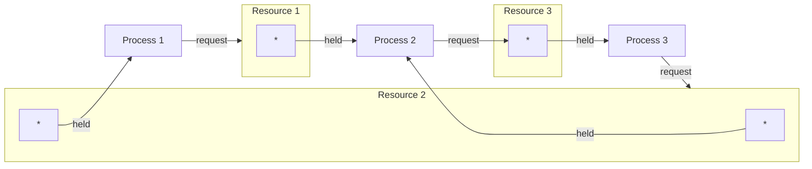
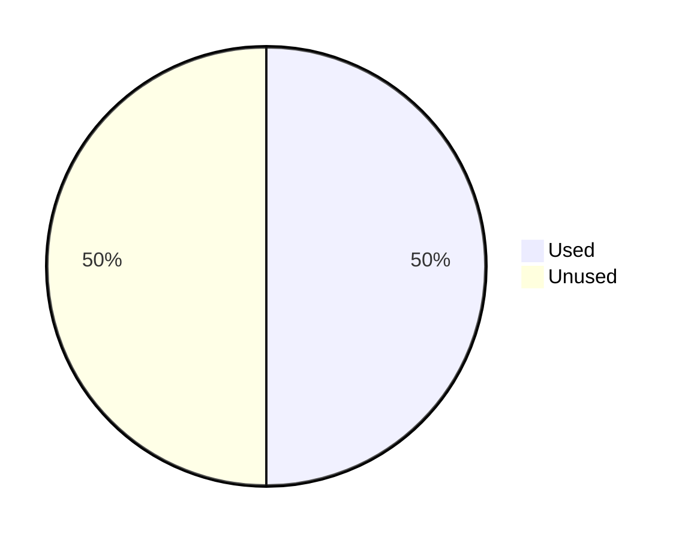
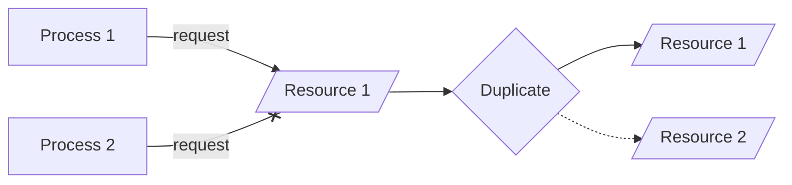
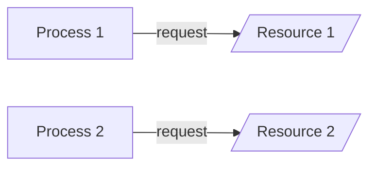
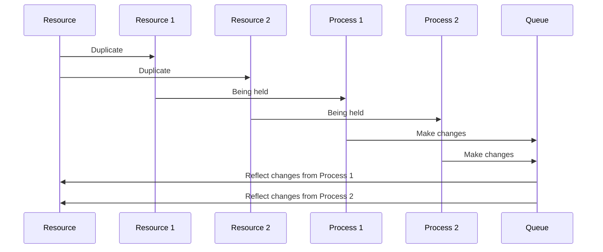

# Operating Systems Deadlocks Properties and Solutions

Research project paper for class **MET CS 575** at Boston University, instructed by **Dr. Nourai**. Student [Zhang, Jin Yu](siege@bu.edu) submitted on **December 5, 2022**.

#### Table of Contents

- [Operating Systems Deadlocks Properties and Solutions](#operating-systems-deadlocks-properties-and-solutions) - [Table of Contents](#table-of-contents)
  - [Abstract](#abstract)
  - [Introduction](#introduction)
    - [Four Conditions](#four-conditions)
      - [Prevention](#prevention)
      - [Avoidance](#avoidance)
      - [Detection](#detection)
  - [Main Contents](#main-contents)
    - [Situation](#situation)
    - [Solution](#solution)
  - [Conclusion](#conclusion)
  - [References](#references)

## Abstract

Deadlocks are an unsolved problem for multitask operating systems. While we have identified the root cause and conditions for it, the current theoretical solutions are not really practical to use. The scope of the topic cover the brief introduction of operating systems Deadlocks, and a possible simple solution.

## Introduction

Deadlock is a situation that one or more processes are unable to meet the requirement for obtaining the recourses they need, and it will not be automatically fixed over time unless some superior actions are taken by the operator, some monitor programs, or the operating system [[1](#references)].

Here is a possible scenario that will trigger Deadlocks:

### Four Conditions

Also, four conditions have to be satisfied to invoke a Deadlock:

- **Mutual Exclusion**: Only one process is allowed in a specific critical section at the same time
- **Hold and Wait**: Processes can hold recourses while waiting for resources
- **No Preemption**: No operating system or superior monitor program to control and distribute resources
- **Circular Wait**: A series of processes hold a recourse each other needs, such as C waits for B, B waits for A, and A waits for C

Currently, there are no practical solutions for Operating Systems Deadlocks. However, theoretically, we have three possible solutions:

- **Prevention**: Prevent one of the four conditions (Mutual Exclusion, Hold and Wait, No Preemption, Circular Wait) from happening
- **Avoidance**: Inspect the processes' status whenever we allocate resources to them. Cancel or insert back to the queue if the allocation would cause a Deadlock
- **Detection**: Detect the appearance of Deadlocks and solve them in advance

#### Prevention

Prevent one of the four conditions from happening [[2](#references)]:

- **Mutual Exclusion**: Usually not possible to prevent since it is a protection mechanism for concurrency
- **Hold and Wait**: A process can not request a resource while it is holding a lock
- **No Preemption**: A process will release the resources it holds once its request for locks denied
- **Circular Wait**: Number the processes, and processes with a higher number can not request resources from processes with a lower number

#### Avoidance

Notify the operating system that a process is requesting resources before completing the request, which is hard to achieve. Once the operating system gets notified, it runs **the Banker's algorithm** to detect if the resource allocation would cause any Deadlock [[3](#references)]. If it is the case, the allocation would be canceled or inserted back into the queue.

#### Detection

Acknowledge that Deadlocks happen and periodically run the Detection algorithm to identify them. When Deadlocks happen, solve it with one of the following methods:

- **Rollback**: Rollback to the previous unlocked state. Logging is needed [[4](#references)]
- **Abort All**: Abort all the deadlocked processes
- **Abort One**: Abort one of the processes and inspect if any Deadlock is still happening. Repeat until there is no Deadlock
- **Preemption Distribution**: Distribute resources in a preemption way until there is no Deadlock

All methods could damage or pollute the data except for **Rollback**.

Since there is no efficient solution for OS deadlocks and the existing ones (Prevention, Avoidance, Detection) are not really implemented in modern Operating Systems [[5](#references)], I want to discuss an attempt to solve Operating Systems deadlocks in a **restricted** situation with **reasonable** costs.

## Main Contents

When we execute multiple instruction sequences simultaneously, which means concurrency, an Operating System Deadlock happens if we have two or more processes are waiting for each other to release the recourse they hold, or more than two processes are waiting for recourses in a circular chain.

### Situation

As what we have mentioned in [Introduction](#introduction), what we mainly discuss here is to offer a solution that really solves Deadlocks rather ignore them in a **restricted** situation with **reasonable** costs. To begin, below is a simple scenario without Deadlocks:

As we can see, Process 2 is holding Resource 1 and requesting Resource 2. Meanwhile, Process 1 is requesting Resource 1. There is no preemption here. Process 1 will eventually obtain the resource it needs as long as Process 2 obtain the resource it needs from Resource 2 and then release Resource 1. However, this scenario will not be Deadlock-free scenario once Process 1 holds Resource 2 while requesting resources:

Let's verify if it is Deadlocked with the four conditions:

- **Mutual Exclusion**: Yes. Only one process is using one resource in the same time
- **Hold and Wait**: Yes. Process 1 and Process 2 are holding and requesting resources
- **No Preemption**: Yes. There is no preemption here
- **Circular Wait**: Yes. Process 1 and Process 2 hold recourses each other needs

Although there are only two processes and two resources, it is Deadlocked.

### Solution

Assume the machine or hardware we use for our software is capable to perform two times better than our expectation. In other words, we will never use more than half of the machine's capability:

The solution is pretty simple. We have always duplicate a resource whenever a process holds it. For example, we have two processes and one resource. Once a process request and hold the resource, we will duplicate it, which means copy all the current status and data the resource have, and then create a new one:

In this case, Process 2 no longer needs to wait for Process 1 to release Resource 1. Process 2 can use Resource 2 freely, which is identical with Resource 1:

Here we have a new problem: How do we sync the data originally in the critical section in Resource 1? We would like to keep Mutual Exclusion working here since we don't want processes pollute the data each other is using. We simply apply an queue here. The changes made from the last process will overwrite the resource:

## Conclusion

We have shortly described the cause for a Deadlock, and the four conditions, Mutual Exclusion, Hold and Wait, No Preemption, and Circular Wait, we have to meet to produce one. Furthermore, The current solutions for Deadlock, Prevention, Avoidance, and Detection have been briefly outlined, and we know the fact that there is no modern operating system apply any of them due to the cost and technical barrier.

Beyond the properties of Deadlocks, we introduced a possible solution, which is simple and brute, and not efficient, but easy to implement. **Duplicating used resources**. Deadlocks can be solved in the other way — Not to prevent it from happening or find a way to recover, but increase the total number of identical resources we need.

## References

The citation style includes follows [IEEE Editorial Style Manual](http://journals.ieeeauthorcenter.ieee.org/wp-content/uploads/sites/7/IEEE-Editorial-Style-Manual-for-Authors.pdf).

1. RICHARD C. HOLT, "Some Deadlock Properties of Computer Systems", _Computing Surveys_, Volume 4, Number 3, pp. 179-180, University of Toronto, Toronto, Ontario, Canada, Sept. 1972
2. A. N. HABERMANN, "Prevention of System Deadlocks", _Communications of the ACM_, Volume 12 / Number 7, Carnegie-Mellon University,Pittsburgh, Pennsylvania, Jul. 1969
3. J. W. Havender, "Avoiding deadlock in multitasking systems", _IBM Systems Journal_, Volume 7, Issue 2, 1968
4. Donald Fussell, Zvi M. Kedem, Abraham Silberschatz, "Deadlock removal using partial rollback in database systems", _Proceedings of the 1981 ACM SIGMOD international conference on Management of data_, pp. 65-73, Apr. 1981
5. George Dimitoglou, "Deadlocks And Methods For Their Detection, Prevention And Recovery In Modern Operating Systems", _ACM SIGOPS Operating Systems Review_, Volume 32, Issue 3, pp. 51–54, Jul. 1998
