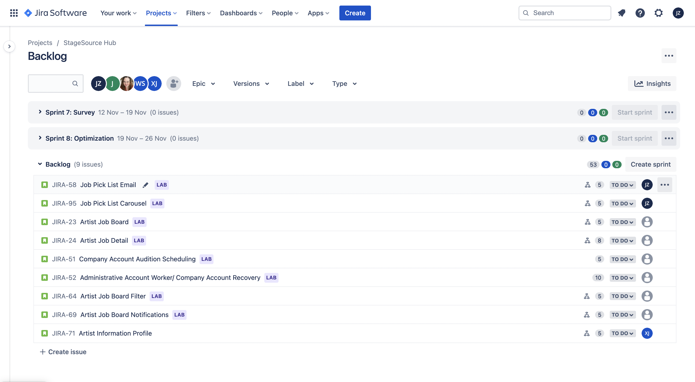

# Lab 2

A lab for class **MET CS 673** at Boston University, instructed by **Yuting Zhang**. Student [Zhang, Jin Yu](siege@bu.edu) submitted on **October 5, 2022**.

## User Stories

Our team is using Jira. All of our issues created for `lab 2` is in Backlog section and under Epic `Lab`:

- **Project URL**: [Link](https://bumetcs673-2022fall-stage-source-project.atlassian.net/jira/software/projects/JIRA/boards/1/backlog)
- **Username**: [Jin Yu Zhang](siege@bu.edu)

### Job Pick List Email

**As** an artist seeking a job, **I want to** subscribe to relevant job-pick-list emails with a maximum of 10 items **so that** I don’t need to spend time searching and filtering for companies I want to apply for.

- **Story URL**: [Link](https://bumetcs673-2022fall-stage-source-project.atlassian.net/browse/JIRA-58)

### Job Pick List Carousel

**As** an artist seeking a job, **I want to** see a carousel section with job picks relevant to my profile when I am searching for employment **so that** I can save time on finding the companies I am going to apply to.

- **Story URL**: [Link](https://bumetcs673-2022fall-stage-source-project.atlassian.net/browse/JIRA-95)

## Domain Objects

A brief list for domain objects:

- **Entities**: Artist, Company, Job
- **Controls**: Selection
- **Boundaries**: List, Carousel

Class diagram:

[](https://mermaid.live/edit#pako:eNqtVMFu2zAM_RVDp65pDrsaQYGty2XoLuvVgMFYTKpNEg2KLmAU-fdKttMqjYO02HwxwfcoUo8Un1VDGlWpGgsh_DCwY3CVL-KnDWMjhnxx_3v0DJziG4sJUjyPvvStVmsvRvrb2zff0mj0IqYvyiIIG7_LMHRg7BzgweGcH7RmjLlnoNBtQsOmHSotiw2RRfB57C4dabzkxXlh0l0zBb0_dMG4i3dEvvqSOVvggHUeeoD3lc8VuiPXgu8_JlF0_h8lzhRNQeo_tDlT6k_a_FMnI9nO1qkx78pnGoqutdS7mLOWvj3tXQsj6FAeSc_BNYOcxC0aSwFnGppVekakB7TTSziS6o7SKNhcq8UTstn2dT6URynDcFTtEbieNJjDGS08pUteLu7-5DF-p85r4KMmLoygi5KsLSbxjmQxzd86weemGZi6WNfHk-BnkhweS6W-VqpYLZfRuo5WnMyRMO2b0TviifnalJGVBvkC5a2Nea5kJQ0vcQ4yqBvlkOMC03FrDpJUSh7jhStVRlPjFjorlar8PlK7VsdZXGsjxKrcgg14o6ATeuh9o0rhDg-kafm-snAI-jWt5_TbvwDxgbJy)
