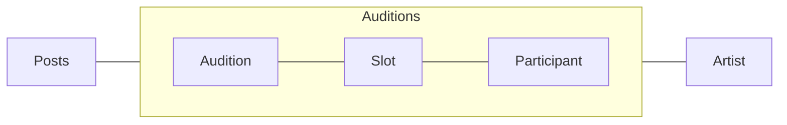

# Lab 3

A lab for class **MET CS 673** at Boston University, instructed by **Yuting Zhang**. Student [Zhang, Jin Yu](siege@bu.edu) submitted on **November 2, 2022**.

## Refactoring

Identify one or two bad smells in any code in your project. Then apply appropriate refactoring techniques to get rid of those smells:

### Build JSON Source for Files Recursively

```TypeScript
import { writeFileSync } from "fs";
import { readdir } from "fs/promises";

async function buildEntryOfArticle(prefix: string, path: string) {
  async function readDirectoryRecursive(
    filepath: string,
    listOfFile: string[]
  ) {
    const listOfItem = await readdir(`${prefix}${filepath}`);

    await Promise.allSettled(
      listOfItem.map(async (item) => {
        if (item.includes(".md")) listOfFile.push(`${filepath}${item}`);
        else await readDirectoryRecursive(`${filepath}${item}/`, listOfFile);
      })
    );
  }

  const listOfFile: string[] = [];
  await readDirectoryRecursive(path, listOfFile);
  const entry: { [path: string]: string[] } = {};
  listOfFile.forEach((file) => {
    const category = file.split("/")[1];
    if (!entry[category]) entry[category] = [];
    entry[category].push(file);
  });
  writeFileSync(`${prefix}${path}/entry.json`, JSON.stringify(entry));
  console.log(`Successfully create entry.json for files within ${path}.`);
}

buildEntryOfArticle("./public/", "articles/");
```

<div style="page-break-after: always;"></div>

The paths in the code are not parameterized. The algorithm isn't efficient as well, we should be able to construct the structure we need in one recursive-loop rather than applying another for-loop. I extract `folder` and `filename` to parameterize the function, remove hard-to-read code regrading paths, and improve the efficiency of the recursive algorithm by only using one recursive-loop:

```TypeScript
import { readdirSync, writeFileSync } from "fs";
import { join } from "path";

function build(folder: string, filename: string) {
  const read = (listOfPath: string[], entry: any) => {
    readdirSync(join(process.cwd(), ...listOfPath)).forEach((item) => {
      const isDirectory = item.indexOf(".") == -1;
      if (!entry.listOfFile && listOfPath.length > 1) entry.listOfFile = [];

      if (isDirectory) {
        if (!entry[item]) entry[item] = {};
        read(listOfPath.concat(item), entry[item]);
      } else {
        if (item.includes(".json")) return;
        entry.listOfFile.push(item);
      }
    });
  };

  const entry = {};
  read([folder], entry);
  writeFileSync(`${folder}/${filename}`, JSON.stringify(entry));
  console.info(`Successfully create ${filename} for ${folder}.`);
}

build("articles", "entry.json");
```

<div style="page-break-after: always;"></div>

### Authenticate to ECR

```YAML
build:
    runs-on: ubuntu-latest
    environment: develop
    needs: [integration]
    steps:
        - name: Checkout repository code
          uses: actions/checkout@v3
        - name: Authenticate to the elastic container registry repository
          uses: ./.github/actions/authentication
        - name: Authenticate to the elastic container registry repository through SSM
          uses: peterkimzz/aws-ssm-send-command@master
          with:
            aws-region: ${{ secrets.AWS_REGION }}
            aws-access-key-id: ${{ secrets.AWS_SERVICE_IDENTITY }}
            aws-secret-access-key: ${{ secrets.AWS_SERVICE_KEY }}
            instance-ids: ${{ secrets.AWS_INSTANCE_IDENTITY }}
            working-directory: /home/ubuntu/application
            command: |
                aws configure set aws_access_key_id ${{ secrets.AWS_SERVICE_IDENTITY }} --profile ${{ secrets.AWS_PROFILE }}
                aws configure set aws_secret_access_key ${{ secrets.AWS_SERVICE_KEY }} --profile ${{ secrets.AWS_PROFILE }}
                aws configure set legion ${{ secrets.AWS_REGION }} --profile ${{ secrets.AWS_PROFILE }}
                aws configure set output json --profile ${{ secrets.AWS_PROFILE }}
        - name: Authenticate to the elastic container registry repository through SSM
          uses: peterkimzz/aws-ssm-send-command@master
          with:
            aws-region: ${{ secrets.AWS_REGION }}
            aws-access-key-id: ${{ secrets.AWS_SERVICE_IDENTITY }}
            aws-secret-access-key: ${{ secrets.AWS_SERVICE_KEY }}
            instance-ids: ${{ secrets.AWS_INSTANCE_IDENTITY }}
            working-directory: /home/ubuntu/application
            command: aws ecr get-login-password --region ${{ secrets.AWS_REGION }} --profile ${{ secrets.AWS_PROFILE }} | docker login --username AWS --password-stdin ${{ secrets.AWS_ACCOUNT_IDENTITY }}.dkr.ecr.${{ secrets.AWS_REGION }}.amazonaws.com
```

<div style="page-break-after: always;"></div>

The code uses an external action to send command to EC2 instance. The problem is that the action only accepts one line command, we have to duplicate lots of lines to input variables. We also need to duplicate secret in GitHub secrets from AWS. I implement OIDC to use long-term-living secret to get rid of the need of service account, and send command to EC2 instance without authentication every time:

```YAML
build:
    runs-on: ubuntu-latest
    environment: develop
    needs: [integration]
    permissions:
      id-token: write
      contents: read
    steps:
        - name: Checkout repository code
          uses: actions/checkout@v3
        - name: Configure AWS credentials
          uses: aws-actions/configure-aws-credentials@v1
        - name: Copy all files on S3 to local directory with SSM
          run: aws ssm send-command --parameters commands="aws s3 cp s3://$AWS_S3_BUCKET ./$AWS_S3_BUCKET/ --recursive" --instance-ids ${{ secrets.AWS_INSTANCE_IDENTITY}} --document-name AWS-RunShellScript
        - name: Remove all Docker images with SSM
          run: aws ssm send-command --parameters commands="docker image rm $(docker image ls --quiet) | docker kill $(docker ps --quiet) | docker rm $(docker ps --quiet)" --instance-ids ${{ secrets.AWS_INSTANCE_IDENTITY}} --document-name AWS-RunShellScript
          continue-on-error: true
```

<div style="page-break-after: always;"></div>

## Testing

Choose a simple user story or a simple functionality in your project as an example, use the TDD/BDD flow to develop the test code and the production code. You will need to choose the proper automated testing framework for your project (e.g. junit, unittest, selenium, cucumber, etc.):

### Job Auditions

**As** a company, **I need to** post a call for auditions that other users can see **so** I can get a list of people ready to audition for the role.

Since we just started developing it, I applied TDD for models(database schema) and basic MTV(model-template-view) setups. The main value for test cases in this phase is the relationship between models. For better understanding, please take a look at the simple diagram extracted from our ERD:



> **Posts** and **Artist** are not modified in this feature branch.

- **Testing Module**: [unittest](https://docs.djangoproject.com/en/4.1/topics/testing/overview/)
- **Testing COmmand**: `docker exec application pipenv run python manage.py test`

<div style="page-break-after: always;"></div>

#### Test Code

```Python
class ViewMain(TestCase):
    def setUp(self):
        self.client = Client()

    def test_get(self):
        self.assertEqual(self.client.get('/').status_code, 200)

class ModelAudition(TestCase):
    def setUp(self):
        self.client = Client()

        now = timezone.now()
        list_audition = models.Audition.objects.get_or_create(
            date=timezone.now(),
            datetime_start=timezone.datetime(now.year, now.month, now.day, hour=0, minute=0, second=0),
            datetime_end=timezone.datetime(now.year, now.month, now.day, hour=12, minute=0, second=0),
            minutes_per_slot=60,
            minutes_between_slots=0
        )
        self.audition = list_audition[0]

    def test_method_representation(self):
        self.assertEqual(str(self.audition), timezone.now().strftime('%Y-%m-%d'))

    def test_method_absolute_url(self):
        self.assertTrue('audition' in self.audition.get_absolute_url())
        self.assertTrue(str(self.audition.id) in self.audition.get_absolute_url())

    def test_related_slots(self):
        self.assertEqual(self.audition.number_of_slots, 12)
```

<div style="page-break-after: always;"></div>

#### Source Code

```Python
# application/auditions/models.py

from django.db import models
from django.urls import reverse
from django.utils import timezone
import math

from artist.models import Artist

class Audition(models.Model):
    date = models.DateField('audition date',
        default=timezone.now,
        help_text='The date the audition happens.')
    datetime_start = models.DateTimeField('audition starting datetime',
        default=timezone.now,
        help_text='What time the audition starts.')
    datetime_end = models.DateTimeField('audition ending datetime',
        default=timezone.now,
        help_text='What time the audition ends.')
    minutes_per_slot = models.PositiveSmallIntegerField('minutes per audition slot',
        default=5,
        help_text='How many minutes each slot has.')
    minutes_between_slots = models.PositiveSmallIntegerField('minutes between audition slots',
        default=0,
        help_text='How many minutes to take a break between slots.')

    class Meta:
        ordering = ['-date', '-datetime_start']
        verbose_name = 'Audition'
        verbose_name_plural = 'Auditions'
        get_latest_by = 'id'

    def __str__(self):
        return self.date.strftime('%Y-%m-%d')

    def save(self, *args, **kwargs):
        super().save(*args, **kwargs)
        number_of_slots = self.number_of_slots
        for order in range(1, number_of_slots + 1):
            Slot(order=order, audition=self).save()

    def get_absolute_url(self):
        return reverse(
            'auditions:audition', kwargs={
                'audition_id': self.id})

    @property
    def number_of_slots(self):
        minutes_audition = math.floor((self.datetime_end - self.datetime_start).seconds / 60)
        minutes_unit = self.minutes_per_slot + self.minutes_between_slots

        number_of_slots = math.floor(minutes_audition / minutes_unit)
        if (minutes_audition % minutes_unit) >= self.minutes_per_slot:
            number_of_slots += 1
        return number_of_slots

class Slot(models.Model):
    order = models.PositiveSmallIntegerField('audition slot order',
        help_text='Assign the order for this slot.')
    is_filled = models.BooleanField('slot filled status',
        default=False,
        help_text='Open or close this slot.'
    )
    audition = models.ForeignKey(Audition,
        verbose_name='slot related audition',
        on_delete=models.CASCADE,
        related_name='slots')
    applicants = models.ManyToManyField(Artist,
        verbose_name='slot related applicants',
        through='Participant',
        through_fields=('slot', 'artist'),
        related_name='slots',
        blank=True
    )

    class Meta:
        ordering = ['order']
        verbose_name = 'Slot'
        verbose_name_plural = 'Slots'
        get_latest_by = 'id'

    def __str__(self):
        return self.order.__str__()

class Participant(models.Model):
    STATUS = (
        ('A', 'Applied'),
        ('B', 'Booked'),
        ('I', 'Interested'),
        ('R', 'Rejected'),
        ('W', 'Wait-listed'),
    )

    slot = models.ForeignKey(Slot,
        verbose_name='participant related slot',
        on_delete=models.CASCADE,
        related_name='participants')
    artist = models.ForeignKey(Artist,
        verbose_name='slot related artist',
        on_delete=models.CASCADE,
        related_name='participants')
    status = models.CharField('application status',
        max_length=1,
        choices=STATUS,
        help_text='Assign the current application status.')

    class Meta:
        ordering = ['status']
        verbose_name = 'Participant'
        verbose_name_plural = 'Participants'
        get_latest_by = 'id'

    def __str__(self):
        return self.status
```

<div style="page-break-after: always;"></div>

```Python
# application/auditions/urls.py

from django.urls import path

from . import views, apps

app_name = apps.AuditionsConfig.name
urlpatterns = [
    path('', views.ViewMain.as_view(), name='auditions'),
    path(r'audition/<int:audition_id>/', views.ViewAudition.as_view(), name='audition')
]
```

```Python
# application/auditions/views.py

from django.views import generic

from . import models

class ViewMain(generic.TemplateView):
    template_name = 'auditions/main.html'

class ViewAudition(generic.DetailView):
    template_name = 'auditions/audition.html'
    model = models.Audition
    pk_url_kwarg = 'audition_id'
    context_object_name = 'audition'
```

<div style="page-break-after: always;"></div>

#### Test Result Screenshots


