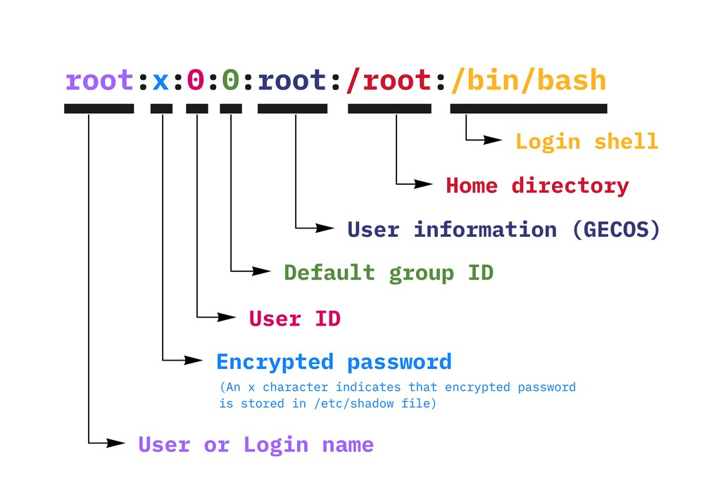
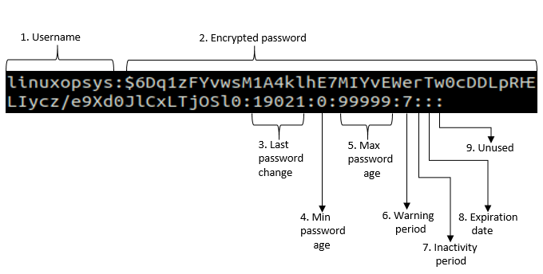
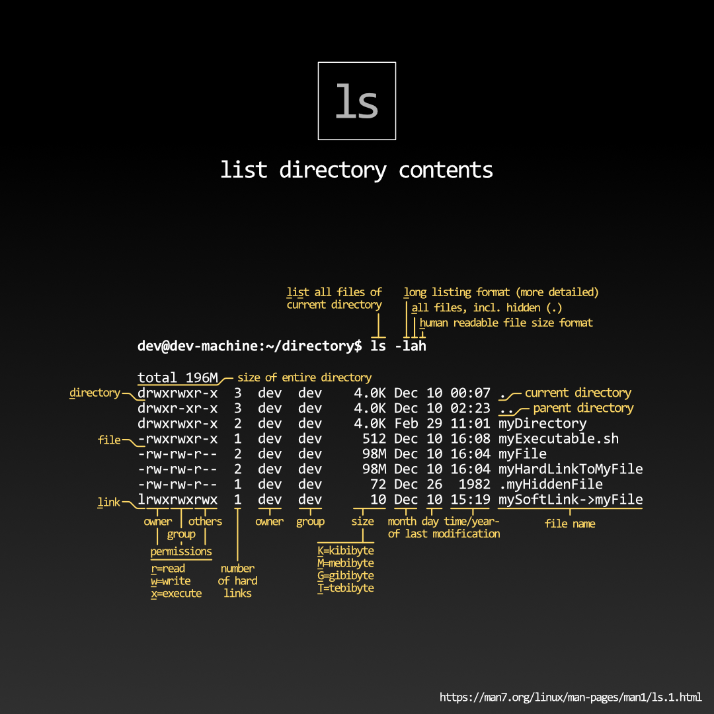

Refer to [Explain Shell](https://explainshell.com/) for more detail explanation for commands.

## Basic

Display a file:

```bash
cat <file>
less <file>
more <file>
```

Pipe result:

```bash
cat <file> | less # Result of cat <file> will be sent to less
```

Replace or append content to a file:

```bash
echo <content> >  <file> # Replace
echo <content> >> <file> # Append
```

List and execute commands from the current path:

```bash
history
!<number_of_command>
```

## Search

Use the following to highlight/find lines with the desired keyword:

```bash
grep <keyword> <file>
```

It is common to receive piped data:

```bash
cat <file> | grep <keyword>
cat <file> | grep <keyword> > <file> # Output the result
```

## Manage Users

Know how is the current user:

```bash
whoami
```

Create a new user:

```bash
sudo adduser <new_username>
```

Switch the current terminal session to another user:

```bash
su <username>
```

Delete a user:

```bash
sudo userdel <username>
sudo userdel -r <username> # -r Clear all files under /home/<username>
```

Modify a user:

```bash
sudo usermod -a -G <group_name> <username> # -a Append rather than replace
```

Change password for the current user:

```bash
passwd
```

Change password for another user:

```bash
sudo passwd <username>
```

Exit from the current user to the previous one. Terminal will close if the current one is the last:

```bash
exit
```

Change a file or folder's owner and owner group:

```bash
sudo chown <owner_name>:<owner_group> <folder_or_file>
```

### Information

`/etc/passwd` stores user account information, the format is as following:



`/etc/shadow` stores password information, the format is as following:



```python
import crypt

crypt.crypt('password', '$---$---$') # Generate the encrypted password
```

### Group

`/etc/group` is where the file contains the groups information. You will have to use `sudo` to read it. The format for the file would be `<group_name>:x:<id>:<member_username>,`.

Show what groups the current user belongs to:

```bash
groups
id # With identifier
```

Or show a specific user's groups with:

```bash
groups <username>
id <username> # With identifier
```

### Super User

`/etc/sudoers` is where the file contains the super users information. You will have to use `sudo` to read it. Use the following to edit `sudoers`:

```bash
sudo visudo
```

## Permissions



> [Source](https://www.reddit.com/r/linux/comments/kao98k/linux_shell_ls_command_in_shortinfographic/)

Change a file or folder's permission:

```bash
chmod <value> <file>
```

| Abbr. | Meaning | Value |
| ----- | ------- | ----- |
| r     | read    | 4     |
| w     | write   | 2     |
| x     | execute | 1     |
| -     | none    | 0     |

For example, change a file's permission to `-rwxrwxrwx` would be `chmod 777 file`.
