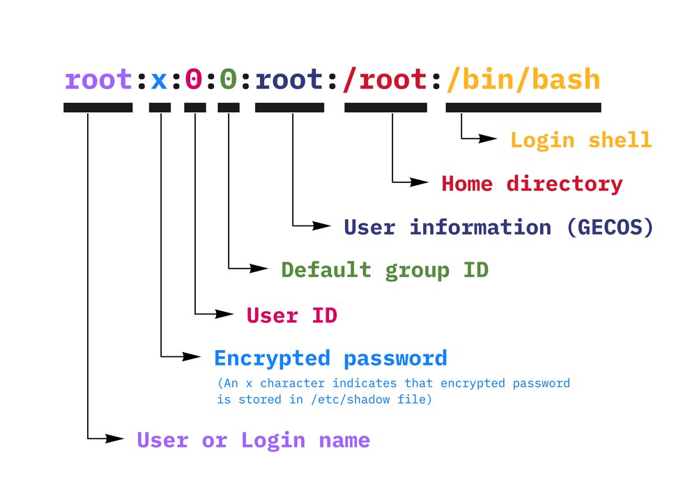
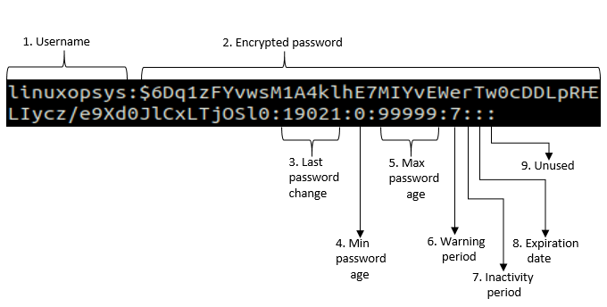
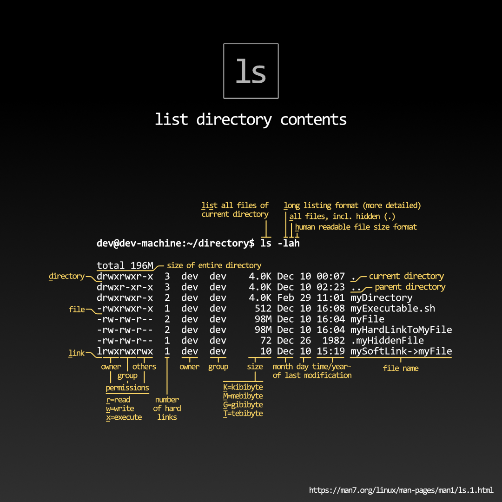

## Linux

Refer to [Explain Shell](https://explainshell.com/) for more detail explanation for commands.

### Basic

Display a file:

```bash
cat <file>
less <file>
more <file>
```

Pipe result:

```bash
cat <file> | less # Result of cat <file> will be sent to less
```

Replace or append content to a file:

```bash
echo <content> >  <file> # Replace
echo <content> >> <file> # Append
```

List and execute commands from the current path:

```bash
history
!<number_of_command>
```

### Search

Use the following to highlight/find lines with the desired keyword:

```bash
grep <keyword> <file>
```

It is common to receive piped data:

```bash
cat <file> | grep <keyword>
cat <file> | grep <keyword> > <file> # Output the result
```

### Manage Users

Know how is the current user:

```bash
whoami
```

Create a new user:

```bash
sudo adduser <new_username>
```

Switch the current terminal session to another user:

```bash
su <username>
```

Delete a user:

```bash
sudo userdel <username>
sudo userdel -r <username> # -r Clear all files under /home/<username>
```

Modify a user:

```bash
sudo usermod -a -G <group_name> <username> # -a Append rather than replace
```

Change password for the current user:

```bash
passwd
```

Change password for another user:

```bash
sudo passwd <username>
```

Exit from the current user to the previous one. Terminal will close if the current one is the last:

```bash
exit
```

#### Information

`/etc/passwd` stores user account information, the format is as following:



`/etc/shadow` stores password information, the format is as following:



```python
import crypt

crypt.crypt('password', '$---$---$') # Generate the encrypted password
```

#### Group

`/etc/group` is where the file contains the groups information. You will have to use `sudo` to read it. The format for the file would be `<group_name>:x:<id>:<member_username>,`.

Show what groups the current user belongs to:

```bash
groups
id # With identifier
```

Or show a specific user's groups with:

```bash
groups <username>
id <username> # With identifier
```

#### Super User

`/etc/sudoers` is where the file contains the super users information. You will have to use `sudo` to read it. Use the following to edit `sudoers`:

```bash
sudo visudo
```

### Permissions



> [Source](https://www.reddit.com/r/linux/comments/kao98k/linux_shell_ls_command_in_shortinfographic/)

Change a file or folder's permission:

```bash
chmod <value> <file>
```

| Abbr. | Meaning | Value |
| ----- | ------- | ----- |
| r     | read    | 4     |
| w     | write   | 2     |
| x     | execute | 1     |
| -     | none    | 0     |

For example, change a file's permission to `-rwxrwxrwx` would be `chmod 777 file`.

## Network

Show network interface configs:

```bash
ifconfig # Mac and Kali
ip a # Ubuntu and CentOS
```

Test if a network is reachable:

```bash
ping <address>
```

> There are differences between an unreachable network and a down/sleep network but reachable

#### IP Address

Let's say we have an IP address `172.20.66.100/16`, `172.20.66.100` is the address, and `16` is the netmask. `16` means from left to right, there are 16 sequential 1 bits out of 32 bits. `11111111111111110000000000000000` in 2-bit format, `11111111.11111111.00000000.00000000` in 8-bit format, and `255.255.0.0` in 10-bit format. 10-bit format is what we fill in the network interfaces.

onvert `address` and `netmask` to 2 bits, and do AND operation, the result would be the network you are in. For the example above, we will get `172.20.0.0`. Note that `172.20.9.0` is the network itself, and `172.20.0.255` is the broadcast address. In IPV4 we have $2^{16} - 2$ addresses can be distributed.

### Kali

`/etc/network/interfaces` is where to configure network interfaces:

-   `<interface_name>`: Must be an existing interface, for example, `ens18` for Ubuntu and `eth0` for Kali
-   `<method>` can be `loopback` to direct back to the machine or `static` to use determined address, or `dhcp` for automatically being assigned if you have a DHCP server available

```
auto <interface_name>
iface <interface_name> inet <method>
    address <#.#.#.#>
    netmask <#.#.#.#>
```

Restart system services:

```bash
sudo systemctl restart networking
```

### CentOS

`/etc/sysconfig/network-scripts/` is where to configure network interfaces, each interface is contained in separate files. For example, `/etc/sysconfig/network-scripts/ifcfg-eth0`.

```
BOOTPROTO=<method>
ONBOOT=<boolean>
IPADDR=<#.#.#.#>
NETMASK=<#.#.#.#>
```

Restart system services:

```bash
sudo systemctl restart network
```

### Ubuntu

`/etc/netplan/` is where to configure network interfaces, each file in the folder is a network paln.

```
network:
  version: #
  renderer: NetworkManager
  ethernets:
    ens18:
      addresses:
        - #.#.#.#/#
```

Restart system services:

```bash
sudo netpaln apply
```
