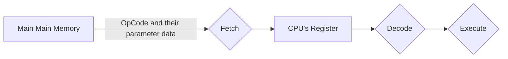

Computer's Brain。

- Silicon Chip
- Computer 唯一執行 Code 的地方
- 只執行 Machine Language (OpCode、Instruction)，平常我們寫的 Higher Level Language 會轉譯過來
- 每種 CPU 有自己的 ISA，Instruction Set Architecture，如 ARM、x86-64 等，供他自己閱讀與執行 OpCode
- 每個 CPU 有微量的 Memory，稱為 Registers (Instruction Register)，暫時儲存結果來進行計算
- 只能執行 Basic Command 像是 Move、Add、Subtract、Multiply、Compare、Jump 等，並且執行這些 Command (Instruction) 的能力是物理上被寫在 Silicon Chip 中的
- Operates on a Fetch-Decode-Execute Cycle
- 每個 CPU 有 Cache Memory，提供比 Main Memory 更快的存取速度，但軟體工程師一般無法對此進行操作

| Instruction | OpCode (Numeric Value) |
| ----------- | ---------------------- |
| ADD         | 0x00                   |
| AND         | 0x20                   |
| CMP         | 0x38                   |
| INT         | 0xCD                   |
| JMP         | 0xE9                   |

### Fetch-Decode-Execute Cycle

不斷重複直到完成指令，CPU 每秒可執行數百萬次 Cycle：

