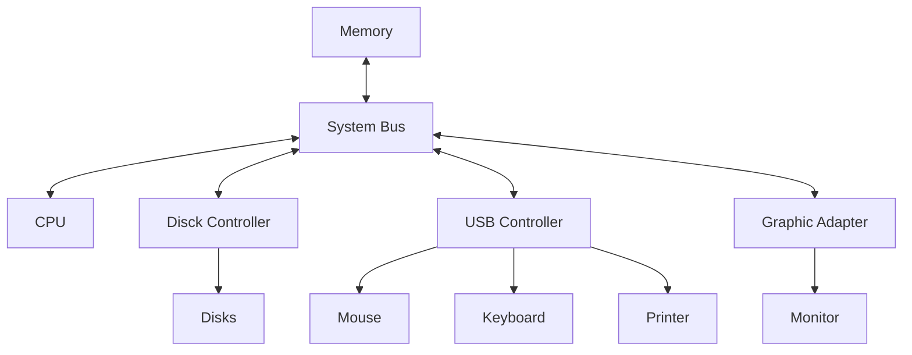

所有 Computer 都適用以下定義與大部分配件：

- **CPU**: 全部的計算
- **System Bus**: Information Bus。在 I/O Devices 與 CPU、Main Storage 中來回運送資料，I/O Devices 的優先權較低
- **Main Storage**: DDR (SDRAM、RAM)。當下 Data 與 Code 存在的地方，關機即消失
- **Secondary Storage**: 硬碟。唯一電腦中可永久儲存的地方
- **Tertiary Storage**: Offline 硬碟，像是 USB、Flash Drive、Tape Drive，通常不需馬上存取
- **GPU**: Video Card，圖形計算

:::info 提醒
Main Storage 等同 Main Memory。
:::

- I/O devices and the CPU can execute concurrently
- Each device controller is in charge of a particular device type
- Each device controller has a local buffer
- Each device controller type has an operating system device driver to manage it
- CPU moves data from/to main memory to/from local buffers
- I/O is from the device to local buffer of controller
- Device controller informs CPU that it has finished its operation by causing an interrupt

## Device Driver

硬體工程師開發供給 OS 中的 Kernel 使用的一系列指令供使用者下載 (OS 不會裝有所有硬體的指令)，以便當使用到對應硬體時，Kernel 能下達正確指令。然而，這些 Device Driver 可能因為自身錯誤導致整個 OS Crash (即藍螢幕)。Microsoft 為了避免這種狀況，設立了 Windows Hardware Quality Labs，WHQL，所有要用在 Windows 上的 Device Driver 都必須送去軟硬體來取得認證。
