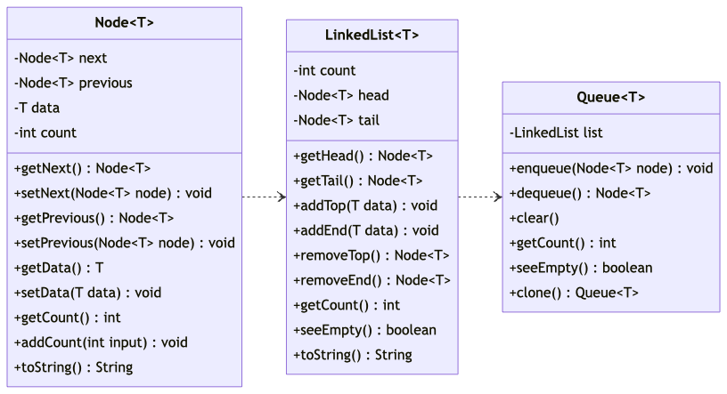

# Programming Assignment

A programming assignment for class **MET CS342** at Boston University, instructed by **Vic Berry**. Student [Zhang, Jin Yu](mailto:siege@bu.edu) submitted on **July 29, 2022**.

## File Structure

Submitted files:

```
├── LinkedList.java
├── Node.java
├── Parser.java
├── Queue.java
├── HashMap.java
├── flowchart.java
├── README.md
├── source.txt
└── Entry.java
```

## Queues

You are to write a program that reads in a body of text and inserts the text into a Queue class that you write from scratch. Each word must be inserted in the Queue irrespective of duplicates (add all words to the queue). At the end of the text insertion you will show statistics for the run.

### Detail

The purpose of this exercise is to give you familiarity with Queues. You should have already built a Text Parser from earlier in the course. As you read the text you will map all words to lower case and remove all punctuation characters (Only numbers or letters should remain) removed characters should be eaten, NOT replaced with a space. Once the words are pre-processed you will add them to your Queue.

When the Queue is completely loaded, make a copy of it. You will need to implement a copy method in your Queue. Once the Queue is copied you will perform queries to answer the following questions:

- How many times do you have to remove the head from an unmodified queue until you reach the following words?
  - `superhuman`
  - `chiromancy`
  - `unsatisfactory`
  - `percutaneous`
  - `discernible`
- How many entries are in the Queue?
- In the first 1000 entries, how many words occur more than 20 times? (this requires some thought)
- Remove all entries from the queue and determine which word occurs most frequently?
- Remove all entries from the queue and determine which word is the longest in the book?

No User Interface is required for this project.

## Algorithmic Design

The core flow is relatively simple. We should read the text file first, then follow the assignment requirements to parse and store it into a queue. After the parsing process is done, we print out the 5 queries listed in [Detail](#detail).

Since the user interface is not required, we will assume that every file is placed as how File Structure represents. No input for filename.

```
MAIN:
  Create queue;
  Parse article;
  WHILE (valid word found)
    Store word into queue;
  ENDWHILE;

  DETAIL 1:
    Create array of string;
    FOR (all array elements)
      Clone queue;
      Create count;
      WHILE (queue.head is not equal to current element)
        Dequeue queue;
        Add 1 to count;
      ENDWHILE;
      Print count;
    ENDFOR;

  DETAIL 2:
    Print queue.count;

  DETAIL 3:
    Create list;
    Clone queue;
    WHILE (queue is not empty and
            queue.count is larger than or equal to 1000)
      Dequeue queue;
      IF (queue.head.count is larger than 20)
        THEN Store queue.head into list;
      ENDIF;
    ENDWHILE;
    Print list;

  DETAIL 4:
    Clone queue;
    Create node;
    WHILE (queue is not empty)
      Dequeue queue;
      IF (queue.head.count is higher than node)
        Update node with queue.head;
      ENDIF;
    ENDWHILE;
    Print node;

  DETAIL 5:
    Clone queue;
    Create node;
    WHILE (queue is not empty)
      Dequeue queue;
      IF (queue.head.data.length is longer than node)
        Update node with queue.head;
      ENDIF;
    ENDWHILE;
    Print node;
```

### UML Diagram

According to the requirements, instead of keeping tracking some properties, we should use a more general way to query nodes, such as what occurs most frequently and the longest one. A doubly-Linked list is implemented here for a more convenient way to manipulate the list.

Return type for methods is `name() : type` rather than `type name()` due to **mermaid.js** generic type syntax issue.



## Runs

Run result.

### 1th

```
DETAIL 1:
Removed 6855 times to reach superhuman.
Removed 4091 times to reach chiromancy.
Removed 385 times to reach unsatisfactory.
percutaneous is not in the article.
Removed 1130 times to reach discernible.
DETAIL 2:
There are 10089 entries in the queue.
DETAIL 3:
There are 3 words appear more than 20 times.
DETAIL 4:
the occurs must frequently.
DETAIL 5:
httpswwwgutenbergorg93932 is the longest word.
```

### 2th

```
DETAIL 1:
Removed 6855 times to reach superhuman.
Removed 4091 times to reach chiromancy.
Removed 385 times to reach unsatisfactory.
percutaneous is not in the article.
Removed 1130 times to reach discernible.
DETAIL 2:
There are 10089 entries in the queue.
DETAIL 3:
There are 3 words appear more than 20 times.
DETAIL 4:
the occurs must frequently.
DETAIL 5:
httpswwwgutenbergorg93932 is the longest word.
```

### 3th

```
DETAIL 1:
Removed 6855 times to reach superhuman.
Removed 4091 times to reach chiromancy.
Removed 385 times to reach unsatisfactory.
percutaneous is not in the article.
Removed 1130 times to reach discernible.
DETAIL 2:
There are 10089 entries in the queue.
DETAIL 3:
There are 3 words appear more than 20 times.
DETAIL 4:
the occurs must frequently.
DETAIL 5:
httpswwwgutenbergorg93932 is the longest word.
```
