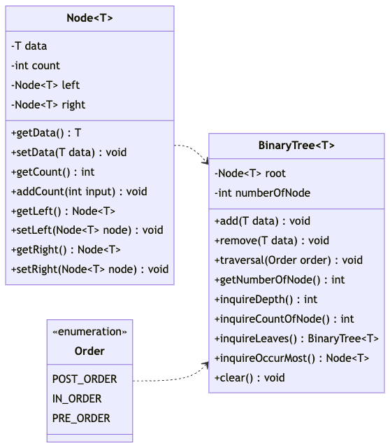

## Programming Assignment

A programming assignment for class **MET CS342** at Boston University, instructed by **Vic Berry**. Student [Zhang, Jin Yu](mailto:siege@bu.edu) submitted on **August 3, 2022**.

## File Structure

Submitted files:

```
├── diagram.png
├── source.txt
├── README.md
└── Entry.java
```

## Binary Trees

You are to write a program that reads in a body of text and inserts the text into a binary tree class that you write from scratch based on alphabetical order. You should keep an instance count for each word in the text. Each time a duplicate word is added you should be able to update the instance count for that word. At the end of the text insertion you will show statistics for the run.

### Detail

The purpose of this exercise is to give you familiarity with Binary Trees. You will read in a lengthy text file. As you read the text you will map all words to lower case, and remove all punctuation characters (Only numbers or letters should remain) removed characters should be eaten, NOT replaced with a space. Once the words are pre-processed you will insert them into a binary tree. (Use the parser from assignment #1)

When the binary tree is completely loaded you will perform queries to exhibit the following things:

- How many times do the following words appear in the text?
  - `transylvania`
  - `harker`
  - `renfield`
  - `vampire`
  - `expostulate`
- What is the depth of the tree?
- How many different words are there in the book?
- What word is at the root of the tree?
- What words are at the deepest leaves in the tree?
- How many total words are in the book?
- Which word occurs most frequently?
- What is the first word in a Pre-Order Traversal of the tree?
- What is the first word in a Post-Order Traversal of the tree?
- What is the first word in an In-Order Traversal of the tree?

No User Interface is required for this project.

## Algorithmic Design

The core flow is relatively simple. We should read the text file first, then follow the assignment requirements to parse and store it into a binary tree. After the parsing process is done, we print out the queries listed in [Detail](#detail).

### Compare

We use Java String `compareTo` to compare two given strings and the return value is formed by the difference between the two strings:

```
COMPARE:
    PARAMETER String a, String b;
    IF (a > b)
        Return positive integer (difference of character value);
    ENDIF;
    IF (a < b)
        Return negative integer (difference of character value);
    ENDIF;
    IF (a == b)
        Return 0;
    ENDIF;
```

Use cases. Since we store all text as lowercase, there is no need to check if the method is case sensitive. As the table below, `compareTo` compares the first character then the length of the whole word:

| `a.compareTo(b)` | a   | b   | ab  | abc |
| ---------------- | --- | --- | --- | --- |
| a                | 0   | -1  | -1  | -2  |
| b                | 1   | 0   | 1   | 1   |
| ab               | 1   | -1  | 0   | -1  |
| abc              | 2   | -1  | 1   | 0   |

### Pseudo Code

Since the user interface is not required, we will assume that every file is placed as how File Structure represents. No input for filename:

```
PARSER:
  Create tree;
  Parse article;
  WHILE (valid word found)
    Compare word and store it into tree;
  ENDWHILE;
```

Let's try the sentence _No pain, no gain._. First of all, we insert _no_ as the root node since it is the first word, then insert _pain_:

```
    no
  / [-2]
pain
```

_pain_ is on the left side of _no_ since `"no".compareTo("pain")` gives us `-2`. Now we insert the second _no_, it stays on the root node and increase count variable by 1:

```
    no (count: 2)
  /
pain (count: 1)
```

Finally, we insert _gain_:

```
    no
  /   \ [7]
pain  gain
```

### Binary Search Tree

It is hard to tell if this will be a **Binary Search Tree**. If we now insert a word `fly`, it will be the right child of _no(7)_ then the left child of _gain(-1)_. When we do `"no".compareTo("fly")` it returns `8` which is greater than `"no".compareTo("gain")`.

```
      "no".compareTo("fly") : 8
    /                           \
"pain".compareTo("fly") : 10    "gain".compareTo("fly") : 1
                                   \
                                   "fly".compareTo("fly") : 0
```

There is no standard for us to determine whether it is a binary search tree such as integers 8, 10, 3. Therefore, I would not announce that I am making a binary search tree so far.

### Diagram

Most of the requirements can be simply implemented by a binary tree. Here we use UML diagram:



## Runs
