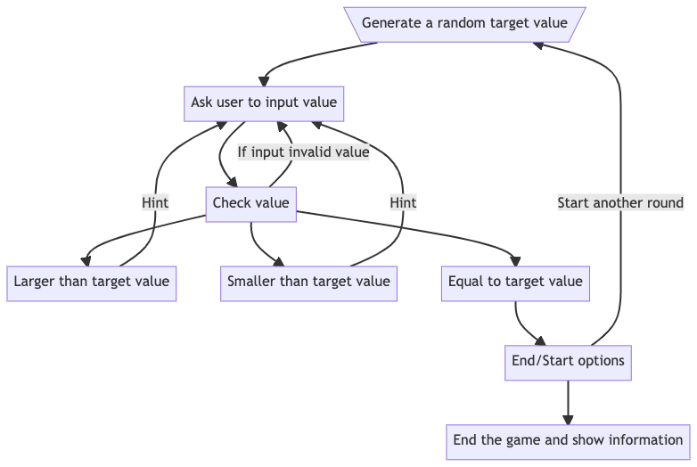

# Homework Assignment


A homework assignment for class **MET CS342** at Boston University, instructed by **Vic Berry**. Student [Zhang, Jin Yu](siege@bu.edu) submitted on **July 12, 2022**.

## File Structure

Submitted files.

```
├── README.md
├── flow-chart.png
├── Entry.java
├── Game.java
└── compile.sh
```

## Question 1

Define the following Terms (As used in Java) (10 points each):

### Protected

For example, we have a Super Class Vehicle:

```java
class Vehicle {
    protected int tier = 4;
}
```

We have noticed that there is no accessor/mutator for `tier`. However, we can still access and even modify the data member directly in any Sub Class of Vehicle:

```java
class Car extends Vehicle {
    public void upgrade() {
        /** Modify without a mutator */
        tier++;
    }

    public void toString() {
        System.out.println("The car is at tier " + this.tier + ".");
    }
}
```

The `protected` keyword is an access modifier used for attributes, methods and constructors, making them accessible in the same package and subclasses. The following table summarizes the access level of different modifiers for members:

| Modifier    | Within the Class | Same Package | Sub Classes | The World |
| ----------- | ---------------- | ------------ | ----------- | --------- |
| `public`    | Y                | Y            | Y           | Y         |
| `protected` | Y                | Y            | Y           | N         |
| No Modifier | Y                | Y            | N           | N         |
| `private`   | Y                | N            | N           | N         |

### Static

The `static` keyword is a non-access modifier used for methods and attributes. Static methods/attributes can be accessed without creating an object of a class.

Java only allocate memory once for a static member. For example, we have the following class Boat:

```java
class Boat {
    private static int count;

    public Boat() {
        count++;
    }

    /** Only static method can access/modify static data members */
    public static int accessCount() {
        /**
         * Notice that we can't use this.count since it uses static binding
         * and doesn't belong to a single object
         */
        return count;
    }
}
```

The static data member `count` is increased every time when there is a Boat created:

```java
public class Playground {
    public static void main(String[] arguments) {
        for (int count = 0; count < 100; count++) {
            new Boat();
        };

        /** Boat.accessCount() will return 100 in this case */
        System.out.println("There were " + Boat.accessCount() + " boats.");
    }
}
```

Java's garbage collector will not retrieve `count`'s memory back because it is static. `count` remains 100 even when there is no pointer for one single Boat.

### Lambda

We do the following before Java 8:

```java
import java.util.Arrays;
import java.util.Comparator;

public class Demonstrate {
    public void sort() {
        Integer[] arrayOfInteger = {2, 5, 1, 6};
        /**
         * Create a Comparator object which corresponds to the interface requirement
         * and override its compare method
         */
        Arrays.sort(arrayOfInteger, new Comparator<Integer>() {
            @Override
            public int compare(Integer previous, Integer next) {
                if(previous < next)
                    return -1;
                return 0;
            }
        });

        /** The output will be 1 2 5 6 */
        for (Integer integer : arrayOfInteger) {
            System.out.print(integer + " ");
        }
    }
}
```

However, it is not convenient when we only need to pass a parameter function or callback. We can take a look at anonymous function in JavaScript:

```javascript
const arrayOfInteger = [0, 1, 2, 3];

/** The parameter function for sort has no name */
arrayOfInteger.sort((previous, next) => {
  return next - previous;
});
/** The output will be [3, 2, 1, 0] */
console.log(arrayOfInteger);
```

Like other functional programming languages such as Go and JavaScript. A lambda expression is a short block of code which takes in parameters and returns a value. Lambda expressions are similar to methods, but they do not need a name and they can be implemented right in the body of a method. Java's lambda expression alternative for `Demonstrate.sort` is:

```java
public void sort() {
    Integer[] arrayOfInteger = {2, 5, 1, 6};
    /** A lambda expression. No need for an object */
    Arrays.sort(arrayOfInteger, (previous, next) -> {
        if(previous < next)
            return -1;
        return 0;
    });

    /** The output will be 1 2 5 6 */
    for (Integer integer : arrayOfInteger) {
        System.out.print(integer + " ");
    }
}
```

The type for the second parameter of `sort` is a object which meets the condition of functional interface, contains only one abstract method. Preferable but not required to use `@FunctionalInterface` annotation.

Lambda Expressions were added in Java 8.

### Volatile

In multi-thread programming, which values may be seen by a read of shared memory that is updated by multiple threads is always an issue.

Threads in Java copy values from other thread, and maintain the value by its own by the favor of efficiency. Only certain actions will trigger the values exist among different threads to be synchronized. As result, there are some scenarios that threads hold different values for the same variable.

`volatile` keyword is a modifier for data members, it indicates that the variable is highly possible to be changed by other threads. Therefore, rather than maintaining a copy, all thread access the variable from its holder (Thread) directly. Hereby, using `volatile` data members consumes more resource.

We can use `volatile` for the following code:

```java
public class Stoppable extends Thread {

    private volatile boolean isStopped;

    public void run() {
    /**
     * isStopped has to be volatile in case any other thread changes the value.
     * If it is not, run is possible to execute more than expected
     */
        while (!isStopped) {
            ...
        }
    }

    public void stop() {
        isStopped = true;
    }
}
```

However, `volatile` doesn't promise atomic since non-atomic actions such as `n++` are often used (On the other hand, `n = m + 1` is atomic). We may use `synchronized` modifier for methods or Atomic wrapper classes.

### Abstract

The `abstract` keyword is a non-access modifier, used for classes and methods. We indicate a class/method is abstract by the following way:

```java
public abstract class Person {
    private String name = "Unknown";

    /** Abstract class can still have method implantation */
    public void mutateName(String input) {
        if (input == null || input.length() == 0) {
            System.out.println("Illegal input.");
            return;
        }
        this.name = input;
    };

    /**
     * Methods in abstract classes are not automatically an abstract method,
     * We have to use abstract modifier to indicate it.
     */
    public abstract String accessName();

    private String getName() {
        return this.name;
    }
}
```

Instead of using abstract class to create an object directly, we need to inherit it from a Sub Class in order to create an object:

```java
public class Student extends Person {
    /** Preferably but not required */
    @Override
    public String accessName() {
        if (this.getName().equals("Unknown")) System.out.println("You haven't set a name.");
        return this.getName();
    };
}
```

```java
public class Playground {
    public static void main(String[] arguments) {
        /** Not allowed */
        Person person = new Person();

        /** Allowed */
        Student student = new Student();
        student.mutateName("One");
        /** The output is The name is One. */
        System.out.println("The name is " + student.accessName() + ".");
    }
}
```

All methods in **Interface** are automatically with `abstract`, therefore, using `abstract interface T {}` is redundant. However, we can use `default` modifier to allow an interface method have a implantation. On the hand, data members in interface are automatically with `static final`.

## Question 2

Write a Java program that plays the game I am thinking of a number between 1
and 1000. The computer will think of the number, and the user will repeatedly
guess until they answer correctly. The program will tell the user if guesses are too
high or too low.

When the user guesses the correct number, the game should show the user how
many turns it took. You must handle incorrect input (letters when numbers were
expected). You should submit to blackboard source code for this problem, and
output from 2 runs of the program. (50 Points)

### Algorithmic Design

According to the requirement, there are a few things we must achieve. First we need to have the user to input value and catch if it is not a number, second we have to hint the user if the input value is too large or too small. Please see the following pseudo-code:

```
get a random target value
ask user to input value
try-catch input value
while game is not end
    read input
    catch non-numeric value
    if input == target value
        print game information
        end game or start another round
    if input < target value or input > target value
        print hint for target value
```

It is clearer to check the flow chart:



### Java Code

Please see [Entry.java](./Entry.java) or use `sh compile.sh` to compile and execute.

### Runs

Start a game. Guess until get the correct value. Chose not to start another round:

```
The game I am thinking of a number (1th round) has begun. The target value is between 1 to 1000.
Please enter an integer within the range 1-1000. Input STOP to give up:
700
The target value is smaller.
Please enter an integer within the range 1-700. Input STOP to give up:
400
The target value is smaller.
Please enter an integer within the range 1-400. Input STOP to give up:
200
The target value is bigger.
Please enter an integer within the range 200-400. Input STOP to give up:
300
The target value is smaller.
Please enter an integer within the range 200-300. Input STOP to give up:
250
The target value is smaller.
Please enter an integer within the range 200-250. Input STOP to give up:
210
The target value is bigger.
Please enter an integer within the range 210-250. Input STOP to give up:
220
The target value is bigger.
Please enter an integer within the range 220-250. Input STOP to give up:
225
The target value is bigger.
Please enter an integer within the range 225-250. Input STOP to give up:
230
The target value is smaller.
Please enter an integer within the range 225-230. Input STOP to give up:
226
The target value is bigger.
Please enter an integer within the range 226-230. Input STOP to give up:
227
The target value is bigger.
Please enter an integer within the range 227-230. Input STOP to give up:
228
Congratulation! The target value is indeed 228! It took you 12 times to guess.
The game is over. Would you like to start another round? (Y)
N
The game is closed. Thank you for participating in our event. You have played 1 times.
```

Intend to guess 0, negative numbers, and guess larger/smaller numbers when the range already printed:

```
The game I am thinking of a number (1th round) has begun. The target value is between 1 to 1000.
Please enter an integer within the range 1-1000. Input STOP to give up:
0
The target value is bigger.
Please enter an integer within the range 1-1000. Input STOP to give up:
-500
The target value is bigger.
Please enter an integer within the range 1-1000. Input STOP to give up:
500
The target value is bigger.
Please enter an integer within the range 500-1000. Input STOP to give up:
250
The target value is bigger.
Please enter an integer within the range 500-1000. Input STOP to give up:
700
The target value is smaller.
Please enter an integer within the range 500-700. Input STOP to give up:
600
The target value is smaller.
Please enter an integer within the range 500-600. Input STOP to give up:
550
The target value is smaller.
Please enter an integer within the range 500-550. Input STOP to give up:
540
The target value is smaller.
Please enter an integer within the range 500-540. Input STOP to give up:
530
The target value is smaller.
Please enter an integer within the range 500-530. Input STOP to give up:
520
The target value is smaller.
Please enter an integer within the range 500-520. Input STOP to give up:
510
The target value is smaller.
Please enter an integer within the range 500-510. Input STOP to give up:
505
The target value is smaller.
Please enter an integer within the range 500-505. Input STOP to give up:
501
Congratulation! The target value is indeed 501! It took you 13 times to guess.
The game is over. Would you like to start another round? (Y)
Y

The game I am thinking of a number (2th round) has begun. The target value is between 1 to 1000.
Please enter an integer within the range 1-1000. Input STOP to give up:
700
The target value is smaller.
Please enter an integer within the range 1-700. Input STOP to give up:
900
The target value is smaller.
Please enter an integer within the range 1-700. Input STOP to give up:
300
The target value is smaller.
Please enter an integer within the range 1-300. Input STOP to give up:
500
The target value is smaller.
Please enter an integer within the range 1-300. Input STOP to give up:
222
The target value is smaller.
Please enter an integer within the range 1-222. Input STOP to give up:
111
The target value is smaller.
Please enter an integer within the range 1-111. Input STOP to give up:
55
The target value is smaller.
Please enter an integer within the range 1-55. Input STOP to give up:
22
The target value is bigger.
Please enter an integer within the range 22-55. Input STOP to give up:
24
The target value is bigger.
Please enter an integer within the range 24-55. Input STOP to give up:
34
The target value is bigger.
Please enter an integer within the range 34-55. Input STOP to give up:
44
The target value is smaller.
Please enter an integer within the range 34-44. Input STOP to give up:
40
The target value is bigger.
Please enter an integer within the range 40-44. Input STOP to give up:
42
The target value is smaller.
Please enter an integer within the range 40-42. Input STOP to give up:
41
Congratulation! The target value is indeed 41! It took you 27 times to guess.
The game is over. Would you like to start another round? (Y)
Nope
The game is closed. Thank you for participating in our event. You have played 2 times.
```

Input non-numeric values. Play 3 times. Give up at the first time:

```
The game I am thinking of a number (1th round) has begun. The target value is between 1 to 1000.
Please enter an integer within the range 1-1000. Input STOP to give up:
500
The target value is bigger.
Please enter an integer within the range 500-1000. Input STOP to give up:
I am handsome
The entered value is not a integer, please try again. (This guess doesn't count)
Please enter an integer within the range 500-1000. Input STOP to give up:
STOP
You gave up. The target value was 708. You guessed 2 times.
The game is over. Would you like to start another round? (Y)
Y

The game I am thinking of a number (2th round) has begun. The target value is between 1 to 1000.
Please enter an integer within the range 1-1000. Input STOP to give up:
708
The target value is smaller.
Please enter an integer within the range 1-708. Input STOP to give up:
500
The target value is smaller.
Please enter an integer within the range 1-500. Input STOP to give up:
200
The target value is smaller.
Please enter an integer within the range 1-200. Input STOP to give up:
105
The target value is smaller.
Please enter an integer within the range 1-105. Input STOP to give up:
50
The target value is bigger.
Please enter an integer within the range 50-105. Input STOP to give up:
75
The target value is bigger.
Please enter an integer within the range 75-105. Input STOP to give up:
85
The target value is bigger.
Please enter an integer within the range 85-105. Input STOP to give up:
95
The target value is bigger.
Please enter an integer within the range 95-105. Input STOP to give up:
100
The target value is smaller.
Please enter an integer within the range 95-100. Input STOP to give up:
99
The target value is smaller.
Please enter an integer within the range 95-99. Input STOP to give up:
98
The target value is smaller.
Please enter an integer within the range 95-98. Input STOP to give up:
96
The target value is bigger.
Please enter an integer within the range 96-98. Input STOP to give up:
95
The target value is bigger.
Please enter an integer within the range 96-98. Input STOP to give up:
97
Congratulation! The target value is indeed 97! It took you 16 times to guess.
The game is over. Would you like to start another round? (Y)
Y

The game I am thinking of a number (3th round) has begun. The target value is between 1 to 1000.
Please enter an integer within the range 1-1000. Input STOP to give up:
2
The target value is bigger.
Please enter an integer within the range 2-1000. Input STOP to give up:
500
The target value is bigger.
Please enter an integer within the range 500-1000. Input STOP to give up:
700
The target value is smaller.
Please enter an integer within the range 500-700. Input STOP to give up:
600
The target value is bigger.
Please enter an integer within the range 600-700. Input STOP to give up:
650
The target value is smaller.
Please enter an integer within the range 600-650. Input STOP to give up:
640
The target value is bigger.
Please enter an integer within the range 640-650. Input STOP to give up:
633
The target value is bigger.
Please enter an integer within the range 640-650. Input STOP to give up:
645
The target value is smaller.
Please enter an integer within the range 640-645. Input STOP to give up:
655
The target value is smaller.
Please enter an integer within the range 640-645. Input STOP to give up:
643
Congratulation! The target value is indeed 643! It took you 26 times to guess.
The game is over. Would you like to start another round? (Y)

The game is closed. Thank you for participating in our event. You have played 3 times.
```
