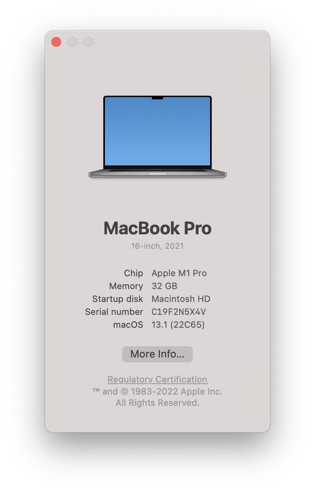

# Assignment

An assignment for class **MET CS 579** at Boston University, instructed by **Jae Lee**. Student [Jin Yu Zhang](siege@bu.edu) submitted on **January 20, 2023**.

## Download

I finished the installation of MySQL on my MacBook laptop with M1 chip. Here is the machine information:



The `.dmg` files sources:

- **MySQL**: [8.0.32 macOS-arm64](https://dev.mysql.com/downloads/file/?id=516827)
- **MySQL Workbench**: [8.0.32 macOS-x86](https://dev.mysql.com/downloads/workbench/)

After the installation finished, I found out that `mysql` wasn't added properly. My terminal complained `zsh: command not found` when I tried to use `mysql`, and I also couldn't find MySQL in my OS's application list.

> The root password was set up during the installation process

So I added the MySQL path to `~/.zshrc` in order to use `mysql` with terminals without entering the full path:

```bash
# ~/.zshrc
...
# >>> mysql setup >>>
export PATH=/usr/local/mysql/bin:$PATH
# <<< mysql setup <<<
```

Then ran the following command to activate the script:

```bash
% source ~/.zshrc
```

## Users

I then used `mysql --user root --password` to login, creating users with the following SQL. Passwords are not hidden since I only allow the users to connect from `localhost`:

```sql
mysql> CREATE USER 'company'@'localhost' IDENTIFIED WITH caching_sha2_password BY '0000';
mysql> CREATE USER 'zhang'@'localhost' IDENTIFIED WITH caching_sha2_password BY '0000';
```
