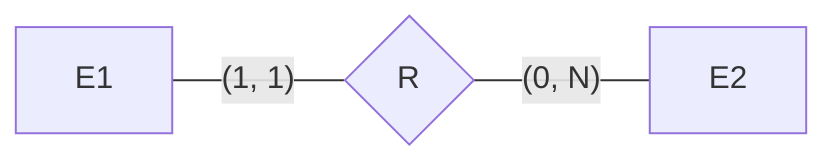
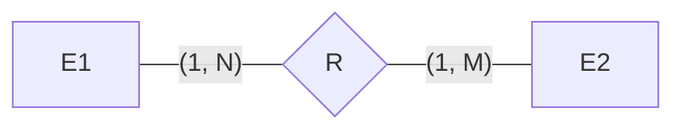
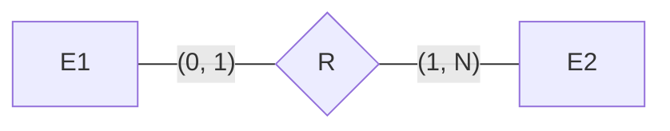
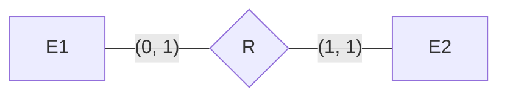
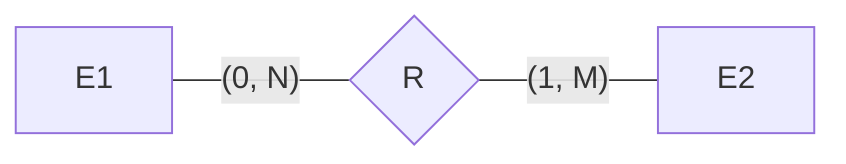
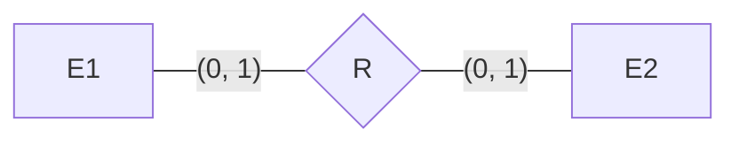
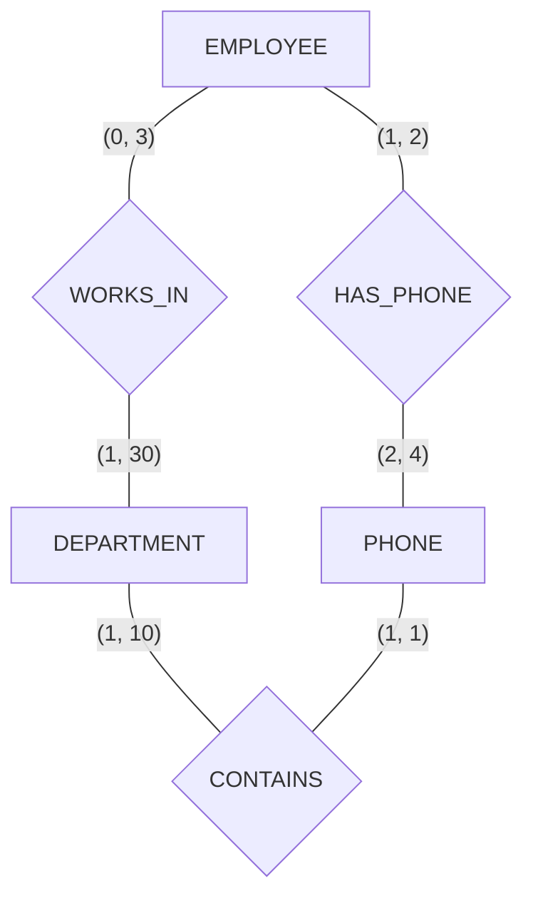

# Assignment

An assignment for class **MET CS 579** at Boston University, instructed by **Jae Lee**. Student [Jin Yu Zhang](siege@bu.edu) submitted on **February 2, 2023**.

## Problem 1

**In a database, we don't want any redundancy. However, sometimes we intentionally keep (or introduce) redundancy in a database. What is the purpose of this?**

Improve query performance. Introducing redundancy in a database can help to speed up query execution times by reducing the number of joins required to retrieve the desired information. By duplicating certain data, the database can be optimized for specific queries and provide faster response times as caches. Textbook page 18 provides a good example with a redundant file `GRADE_REPORT`.

## Problem 2

**Describe the difference between database schema and database instance.**

A database schema is a blueprint or a description of the structure of a database. It defines the tables, fields, relationships, and constraints that make up the database. The schema defines the structure of the data and the rules for organizing and storing the data in the database.

A database instance, on the other hand, is a single and unique copy of the database created from the database schema. It is a running version of the database that contains the actual data and can be manipulated, updated and queried by the users. A database schema can have multiple instances, each with its own set of data and each serving different purposes or users.

In short, the database schema defines what the database is, while the database instance is what the database contains. See the following paragraphs from textbook page 34 and slides 2-7, 2-8, and 2-10:

- **Database Schema**: Also called Intension. Changes very infrequently. The description of a database. Includes descriptions of the database structure, data types, and the constraints on the database
- **Database Instance**: Also called Extension. Changes every time the database is updated. In the slides, database instance is equivalent to database state: The actual data stored in a database at a particular moment in time. This includes the collection of all the data in the database. Also called database instance (or occurrence or snapshot)

## Problem 3

**What does _a database is in a valid state_ mean?**

A database is said to be in a _valid state_ when it meets certain conditions or constraints that have been defined for the data stored in it. This may or may not include conditions such as the data being complete and accurate, meeting specific business rules and regulations, and being properly formatted and organized. A valid state is important because it helps to ensure that the data stored in the database can be trusted and used for accurate decision making. When a database is in a valid state, it provides confidence to its users that the data is correct, consistent and can be relied upon for critical business operations. See the following paragraphs from slide 2-9 and textbook page 35: A state that satisfies the structure and constraints of the database.

## Problem 4

**Consider the ER schema diagram of the AIRLINE database in Figure 3.21 (page 98):**

**(1). List all multi-valued attributes. If there is none, then write "none".**

None.

**(2). List all composite attributes. If there is none, then write "none".**

None.

**(3). List all derived attributes. If there is none, then write "none".**

None.

**(4). List all weak entity types. For each weak entity type, show the owner entity type and the identifying relationship type.**

| Weak Entity Type | Identifying Relationship Type | Owner Entity Type |
| ---------------- | ----------------------------- | ----------------- |
| LEG_INSTANCE     | INSTANCE_OF                   | FLIGHT_LEG        |
| FLIGHT_LEG       | LEGS                          | FLIGHT            |
| FARE             | FARES                         | FLIGHT            |
| SEAT             | RESERVATION                   | LEG_INSTANCE      |

> I had questions about:
>
> - Can a weak entity type be an owner entity type
> - Can a weak entity type has more than 1 owners
> - How an identifying relationship diagramed
>
> There are all be answered on textbook page 79

## Problem 5

**In the following ER diagrams, represent the constraints on the relationship types using the (min, max) notations.**

**(a)**

**(b)**

**(c)**

**(d)**

**(e)**

**(f)**

## Problem 6

**Consider the following ER diagram:**

**Determine the (min, max) constraints on all relationship types in this model based on the following assumption:**

- **Each department can have anywhere between one and thirty employees**
- **Each phone belongs to one, and only one, department**
- **Each phone is assigned to at least two and may be assigned to up to four employees**
- **Each employee is assigned at least one but no more than two phones**
- **An employee may work for up to three departments or may not be assigned to any department**
- **A department must have at least one and at most ten phones**

