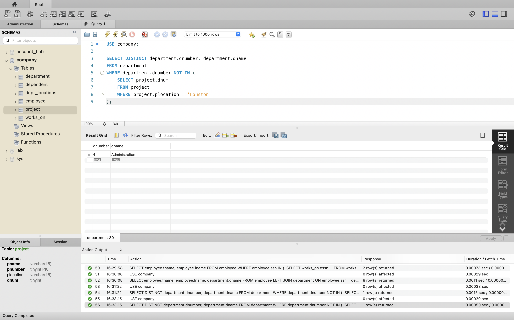
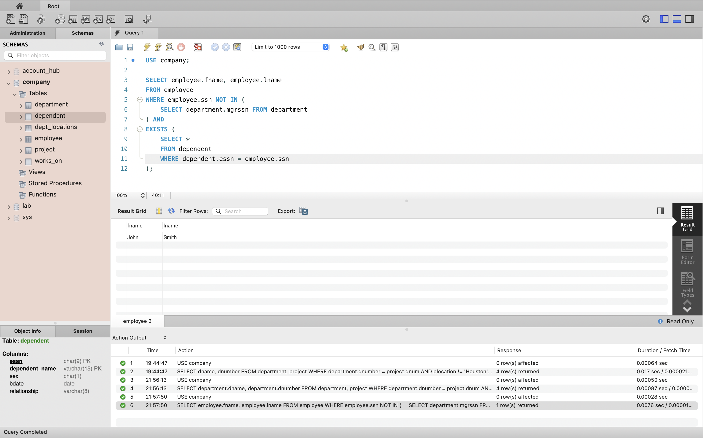
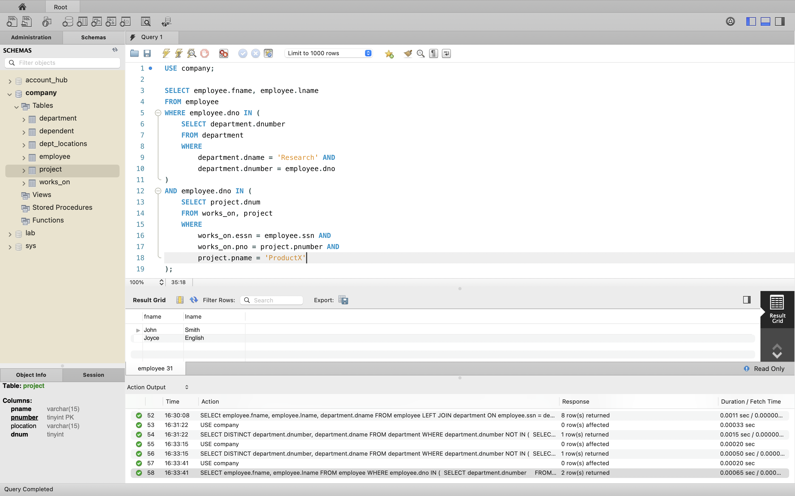
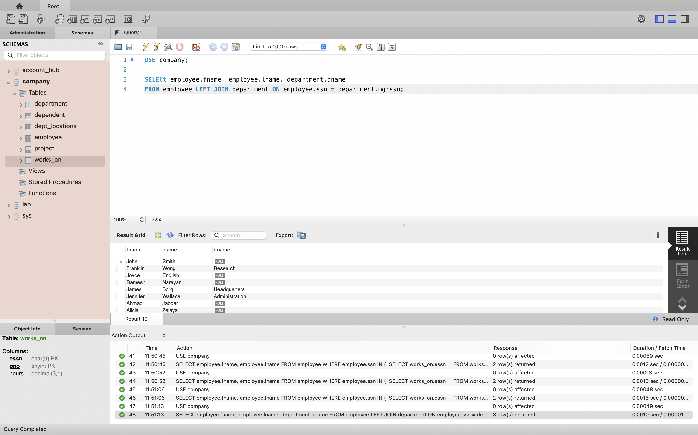

- [Homework](#homework)
  - [Problem 1](#problem-1)
    - [1](#1)
    - [2](#2)
    - [3](#3)
    - [4](#4)
    - [5](#5)

# Homework

A homework for class **MET CS 579** at Boston University, instructed by **Jae Lee**. Student [Jin Yu Zhang](siege@bu.edu) submitted on **March 28, 2023**.

## Problem 1

### 1

Show the department number and the department name of every department that controls a
project that is not located in Houston:

```sql
USE company;

SELECT DISTINCT department.dnumber, department.dname
FROM department
WHERE department.dnumber IN (
	SELECT project.dnum
    FROM project
    WHERE project.plocation != 'Houston'
);
```



### 2

Show the first name and the last name of every employee who is a not manager and has a
dependent:

```sql
USE company;

SELECT employee.fname, employee.lname
FROM employee
WHERE employee.ssn NOT IN (
    SELECT department.mgrssn FROM department
) AND
EXISTS (
    SELECT *
    FROM dependent
    WHERE dependent.essn = employee.ssn
);
```



### 3

Show the first name and the last name of every employee who works for the Research
department and works on the ProductX project:

```sql
USE company;

SELECT employee.fname, employee.lname
FROM employee
WHERE employee.dno IN (
	SELECT department.dnumber
    FROM department
    WHERE
		department.dname = 'Research' AND
        department.dnumber = employee.dno
)
AND employee.dno IN (
	SELECT project.dnum
    FROM works_on, project
    WHERE
		works_on.essn = employee.ssn AND
        works_on.pno = project.pnumber AND
        project.pname = 'ProductX'
);
```



### 4

Show the first name and last name of every employee who works on only one project:

```sql
USE company;

SELECT employee.fname, employee.lname
FROM employee
WHERE employee.ssn IN (
	SELECT works_on.essn
    FROM works_on
	WHERE (
		SELECT COUNT(*)
        FROM works_on AS w
        WHERE w.essn = works_on.essn
    ) = 1
);
-- or
USE company;

SELECT employee.fname, employee.lname
FROM employee
WHERE employee.ssn IN (
	SELECT works_on.essn
    FROM works_on
    WHERE works_on.essn = employee.ssn
    GROUP BY works_on.essn
    HAVING COUNT(DISTINCT works_on.pno) = 1
);
```


### 5

Show the first name and the last name of every employee. If an employee is the manager of a
department, then show the name of the department the employee manages too. The result must
be in a single relation:

```sql
USE company;

SELECt employee.fname, employee.lname, department.dname
FROM employee LEFT JOIN department ON employee.ssn = department.mgrssn;
```


