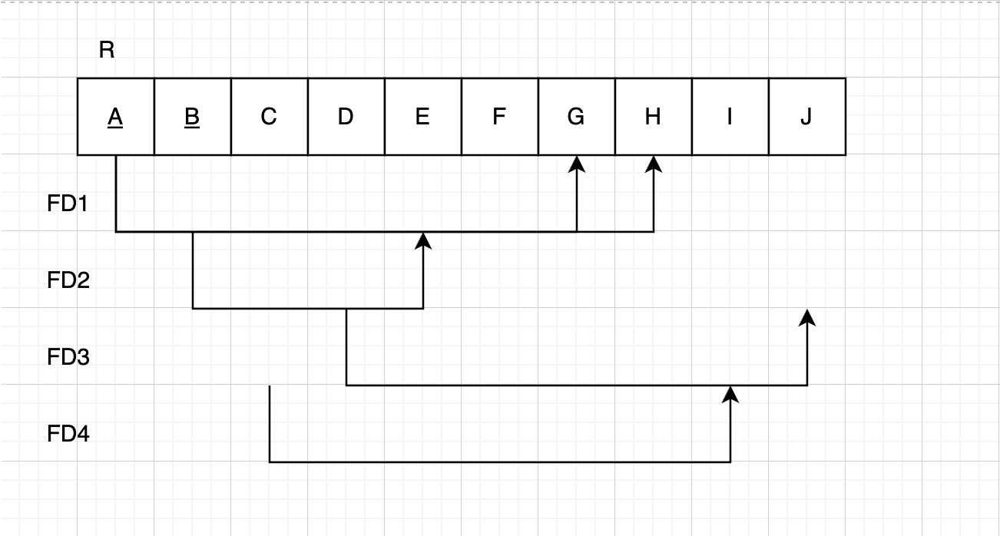
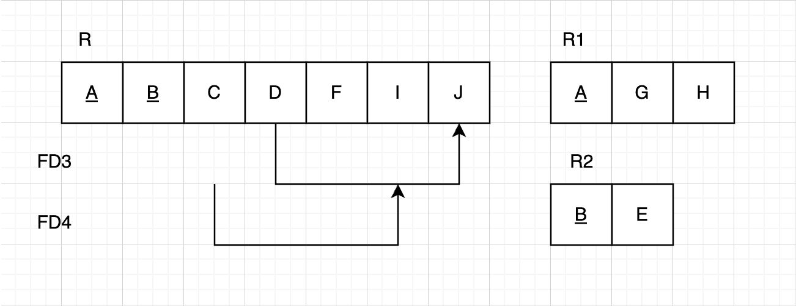
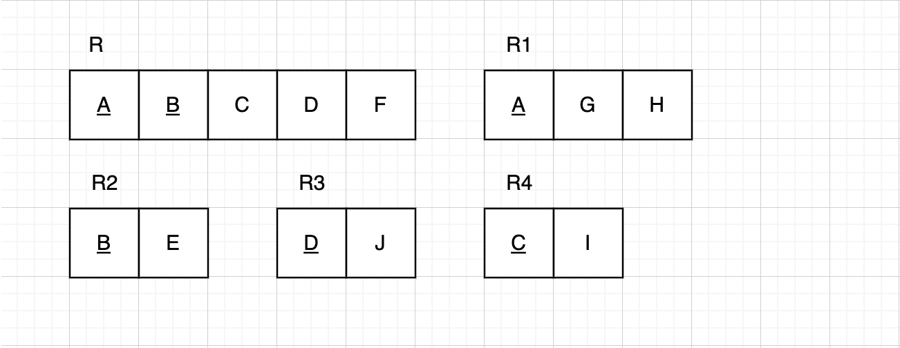
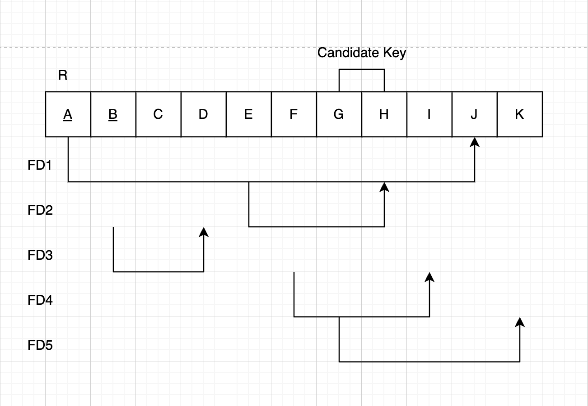
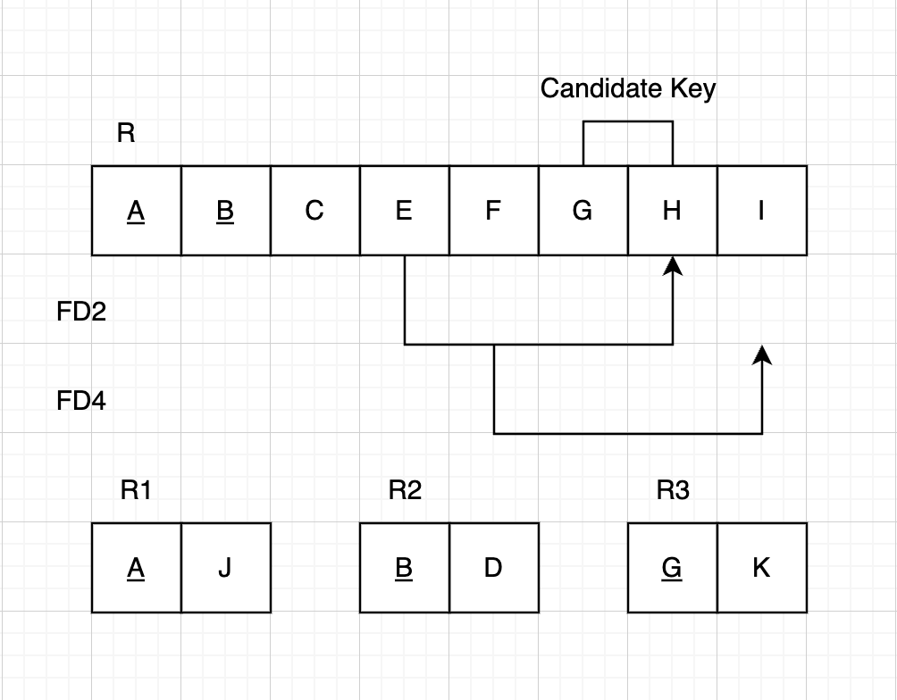
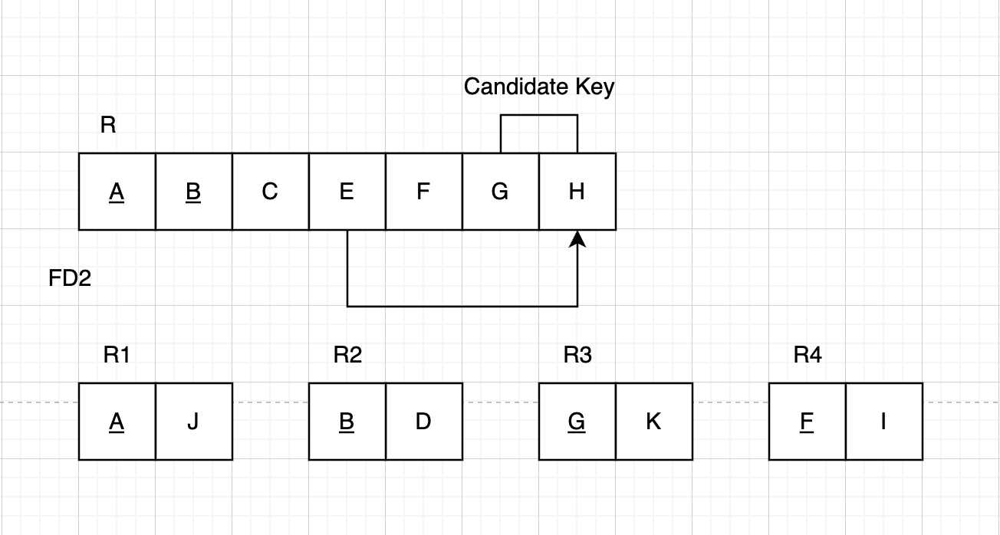
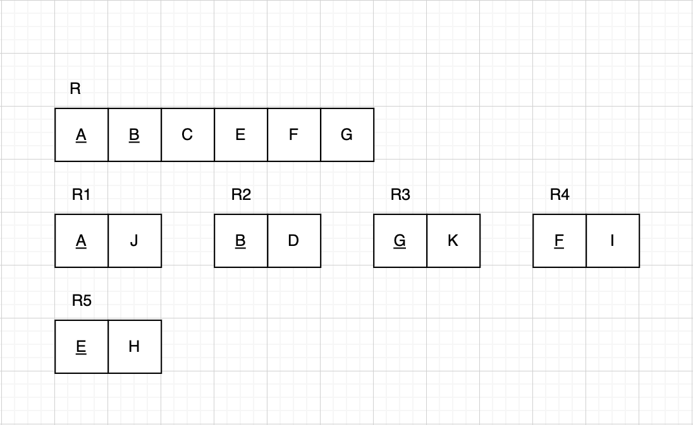

- [Homework](#homework)
  - [Problem 1](#problem-1)
  - [Problem 2](#problem-2)
  - [Problem 3](#problem-3)

# Homework

A homework for class **MET CS 579** at Boston University, instructed by **Jae Lee**. Student [Jin Yu Zhang](siege@bu.edu) submitted on **April 12, 2023**.

## Problem 1

- (a): Doesn't exist. There are two duplicated value `10`, and they map to different values `b1` and `b2`
- (b): FD may hold
- (c): Doesn't exist. There are two duplicated value `b1`, and they map to different values `10` and `13`
- (d): Doesn't exist. There are three duplicated value `c1`, and they map to different values `10`, `11`, and `13`
- (e): FD may hold

## Problem 2

Normalize R to 2NF. Primary key attributes as underlined. A from R1 is a foreign key of A from R, B from R2 is a foreign key of B from R:

Normalize R to 3NF. Primary key attributes as underlined. A from R1 is a foreign key of A from R, B from R2 is a foreign key of B from R, D from R3 is a foreign key of D from R, C from R4 is a foreign key of C from R:

## Problem 3

Normalize R to 2NF. Primary key attributes as underlined. A from R1 is a foreign key of A from R, B from R2 is a foreign key of B from R, G from R3 is a foreign key of G from R:

Normalize R to 3NF. Primary key attributes as underlined. A from R1 is a foreign key of A from R, B from R2 is a foreign key of B from R, G from R3 is a foreign key of G from R, F from R4 is a foreign key of F from R:

Normalize R to BCNF. Primary key attributes as underlined. A from R1 is a foreign key of A from R, B from R2 is a foreign key of B from R, G from R3 is a foreign key of G from R, F from R4 is a foreign key of F from R, E from R5 is a foreign key of E from R:

