- [Homework](#homework)
  - [Problem 1](#problem-1)
  - [Problem 2](#problem-2)
  - [Problem 3](#problem-3)

# Homework

A homework for class **MET CS 579** at Boston University, instructed by **Jae Lee**. Student [Jin Yu Zhang](siege@bu.edu) submitted on **April 19, 2023**.

## Problem 1

**Can we build two primary indexes on a file? Why?**

No, we can not build two primary indexes on a single file. A primary index is built on a unique key, often the primary key, which is a unique identifier for each record in the file. This key is used to arrange the records in a sorted order and maintain a separate index file that stores the key and the corresponding record's address.

Since primary indexes are based on unique keys, having two primary indexes on a single file would mean having two unique keys to identify a single record. This is not possible, as it would create redundancy and confusion in uniquely identifying a record.

**Can we build two clustering indexes on a file? Why?**

No, we can not build two clustering indexes on a single file. A clustering index is an indexing structure that determines the physical order of data on disk. In a clustering index, records are stored on disk in a specific order based on the clustering key, which is often a non-unique key.

The main reason we can not have two clustering indexes on a single file is that the file can only be sorted physically in one specific order. Since a clustering index determines the physical order of the records in the file based on the clustering key, having two clustering indexes would require the file to be sorted based on two different keys simultaneously, which is not possible.

**Can we build two secondary indexes on a file? Why?**

Yes, we can build multiple secondary indexes on a single file. Here are reasons for it:

- **Independent Indexing Structures**: Secondary indexes are separate from the actual data file, and they maintain their own indexing structure. This means that each secondary index can focus on optimizing retrieval for a specific attribute or field without interfering with the other indexes
- **Non-Unique Keys**: Unlike primary indexes, secondary indexes can be built on non-unique keys. This allows we to optimize searches based on multiple attributes, even if those attributes do not uniquely identify a record

## Problem 2

Preparation:

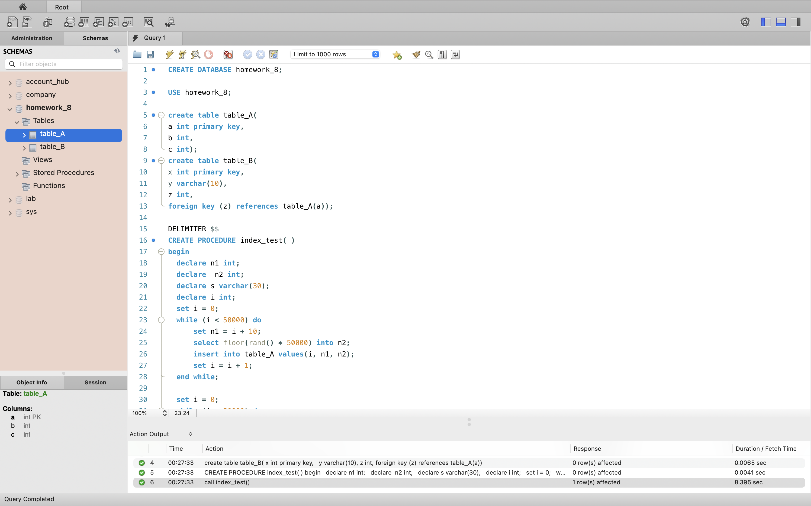

Visual explain for the given query:

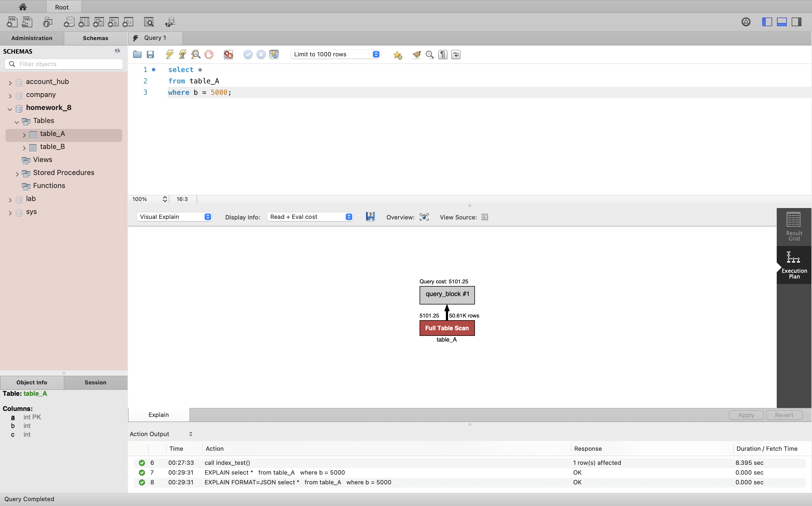

Visual explain for the given query with indexes:

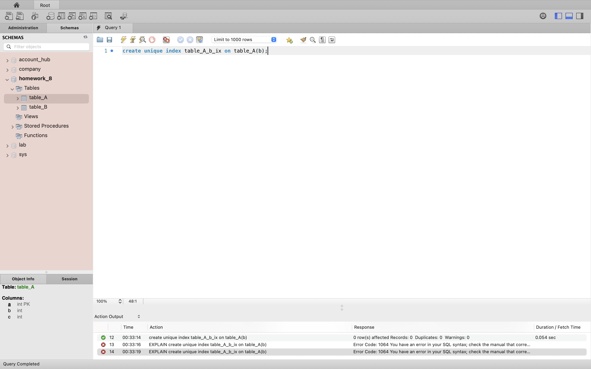

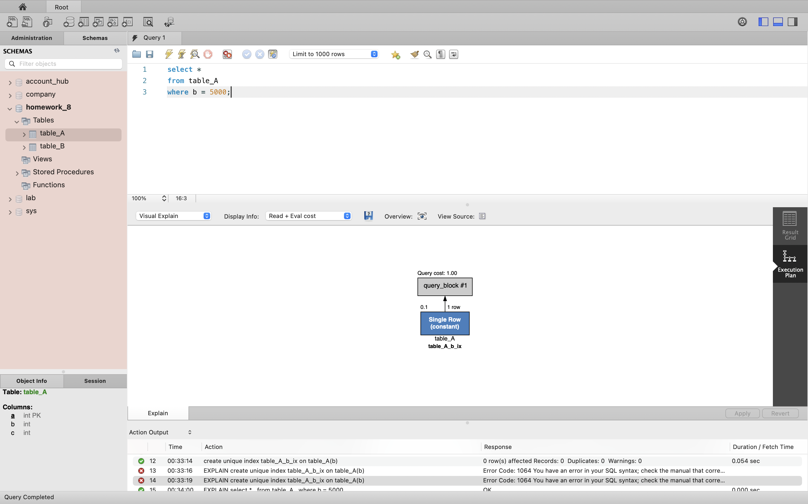

Compare the query cost from the two visual explain, we can clearly see that the second one (with indexes) is a way faster than the first one, which is 1.00 versus 5101.25. We can draw the conclusion that the first one applies **Full Table Scan**, searching through the whole table (50.61K rows), while the second one applies **Single Row**, simply retrieving all keys from the primary index file, therefore it only affects 1 row and is constant.

Visual explain for the given query:

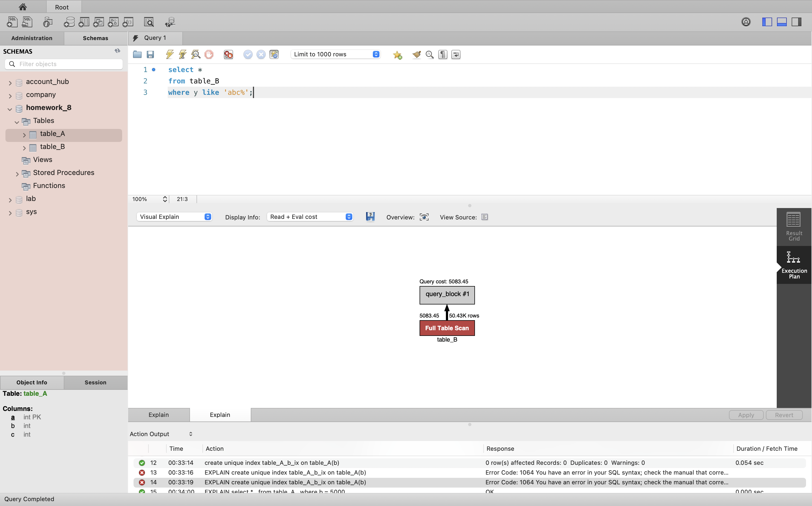

Visual explain for the given query with indexes:

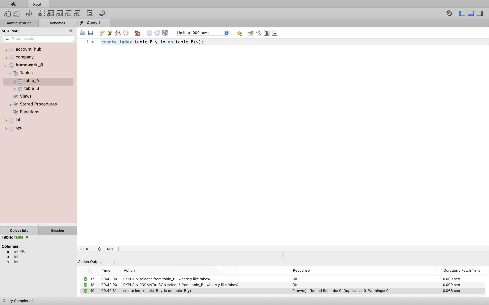

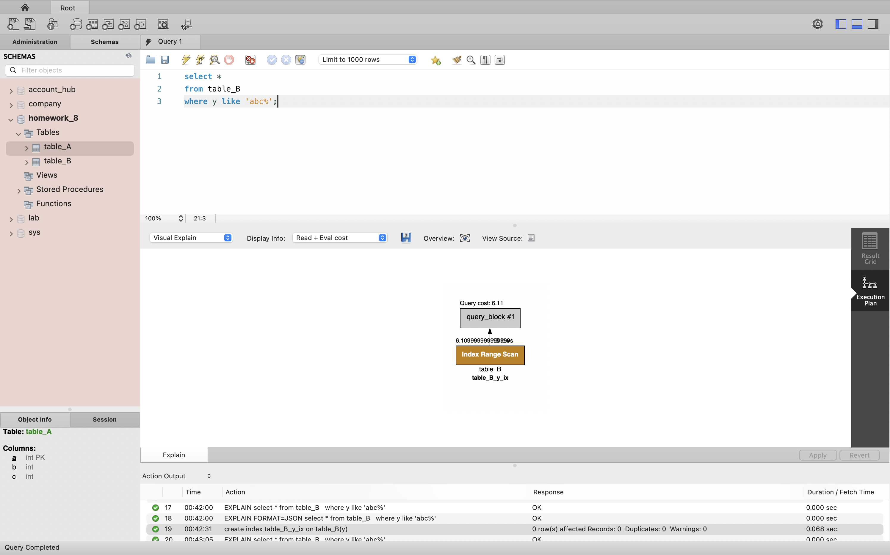

Compare the query cost from the two visual explain, we can clearly see that the second one (with indexes) is a way faster than the first one, which is 6.11 versus 5083.45. We can draw the conclusion that the first one applies **Full Table Scan**, scanning the entire table (50.43K rows) for the desired value. On the other hand, the second one applies **Index Range Scan** that utilizes an index to efficiently retrieve a range of records from a table. Instead of performing a full table scan, the database system searches the index to find the starting point of the desired range and then retrieves the records in that range sequentially by following the index structure.

## Problem 3

Insert `23`, `37`, `65`:

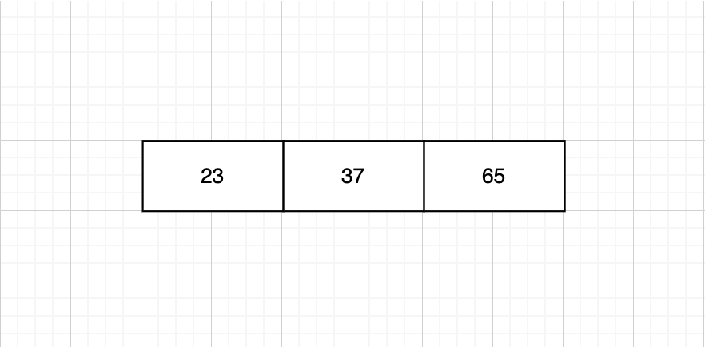

Insert `60`. Overflow occurs and a new level is created:

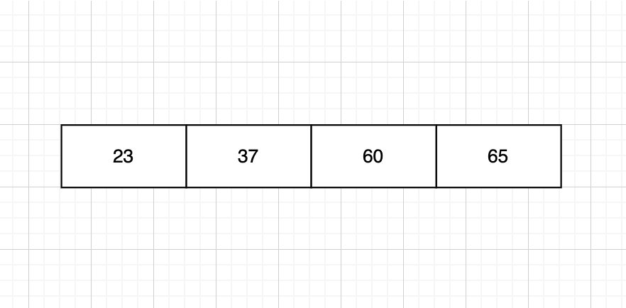

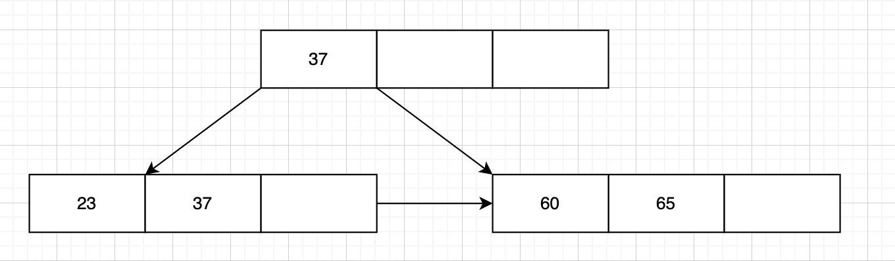

Insert `46`:

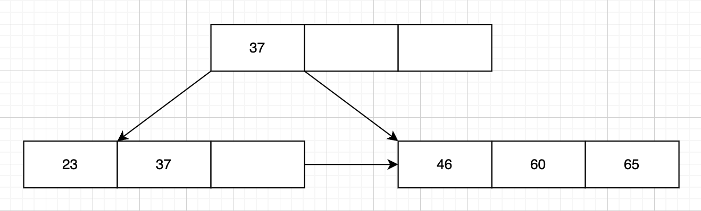

Insert `92`. Overflow occurs:

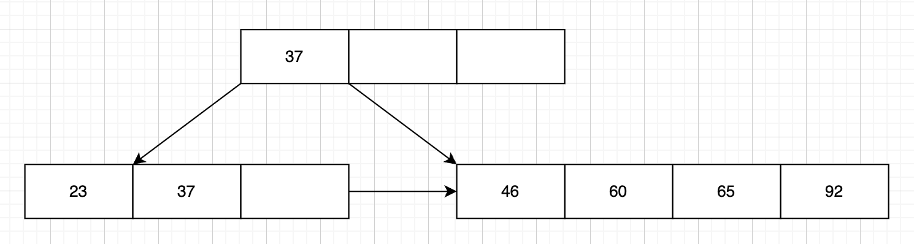

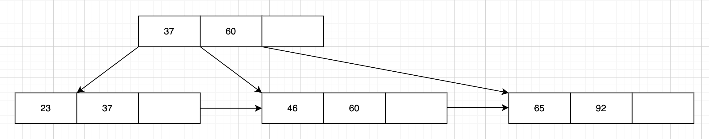

Insert `48`:

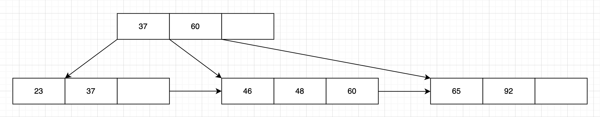

Insert `71`:

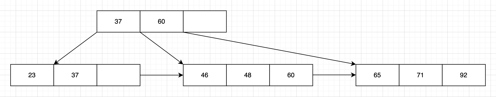

Insert `56`. Overflow occurs:

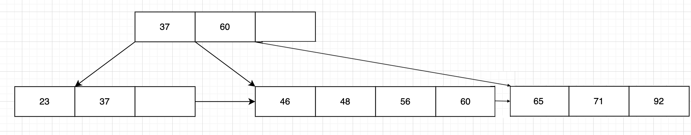

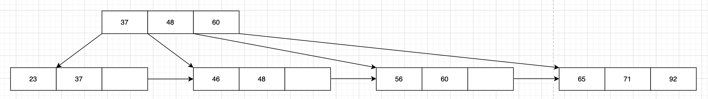

Insert `59`:

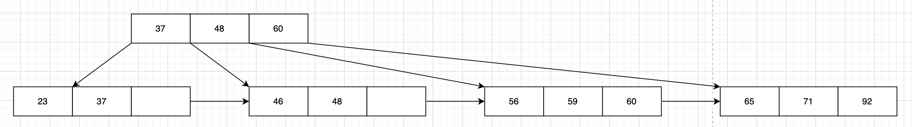

Insert `18`:

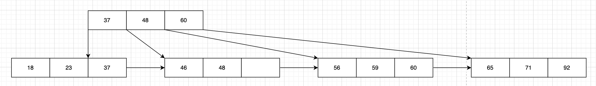

Insert `21`. Overflow occurs and a new level is created:

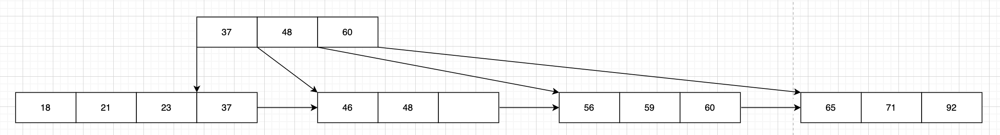

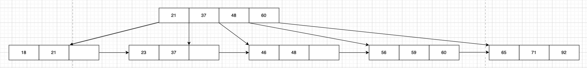

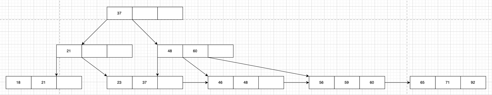
