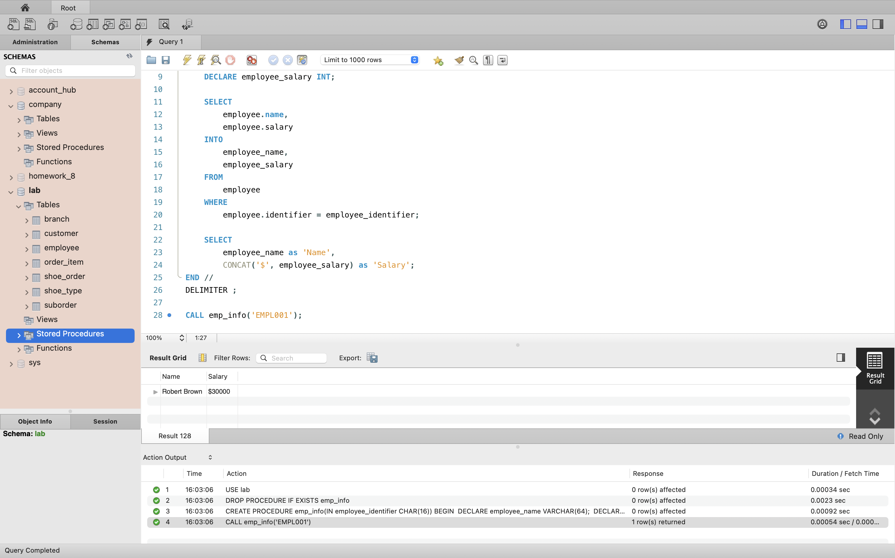
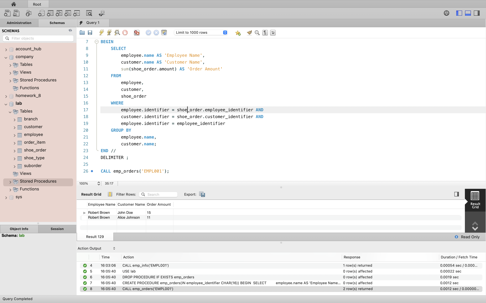
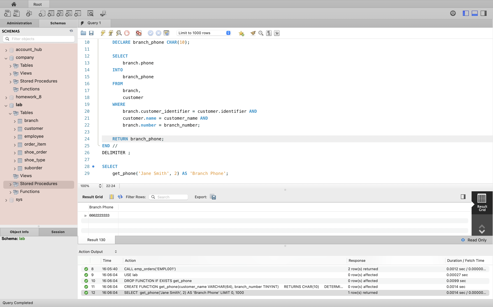
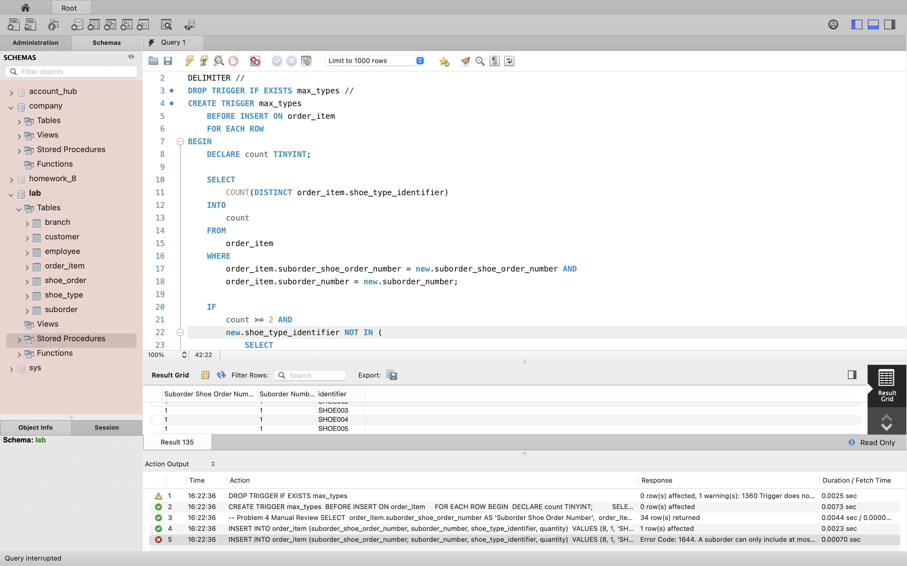
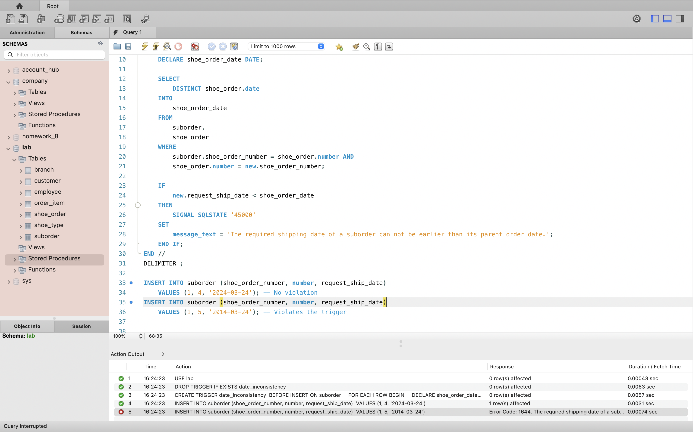

- [Lab 3](#lab-3)
  - [Screenshots](#screenshots)

# Lab 3

An assignment for class **MET CS579** Database Management at Boston University due on **April 27, 2023**, instructed by **Jae Lee**. Students [Jin Yu Zhang](siege@bu.edu) and [Wei Wang](wwwemma820@gmail.com) submitted on **April 27, 2023**.

## Screenshots

Problem 1:

Problem 2:

Problem 3:

Problem 4 (A `SELECT` is performed for manual review):

Problem 5:

