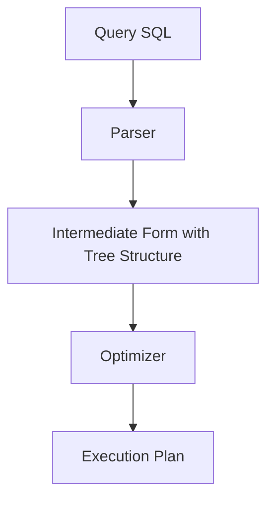
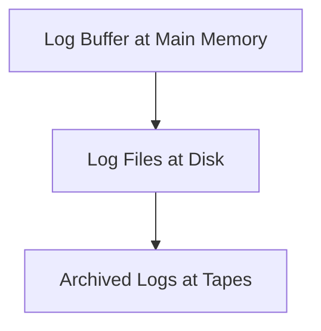

# Query Transformation

Chapter 19.

- Apply filtering condition first to the bottom of the transformation tree to reduce the number of products from the cartesian product
- Possibly swap equivalent tables if the cartesian product can be less

## JOIN

Cartesian product with selection:

- Nested Loop Join
- Hash Join
- Merge Join

# Transaction

Chapter 20. Means a program accesses the database.

- Transaction Concept
- Concurrency Control
- Isolation Level
- ACID
  - A: All or nothing
  - C: The database is in a valid state before and after a transaction
    - A valid state: All data doesn't violate all integrity constraint
  - I: All operations within a transaction doesn't affect the database before `commit`
  - D: All changes are permanent

# Buffer (Cache in Databases)

- Data buffer
- Log (System Log / Transaction Log) buffer

CPU goes to the main memory looking for the data buffer or log buffer first. Once a miss happens, CPU goes to the disk then.

Replacement policy (LRU - replace the one last longest in the buffer with the new one from the disk) happens when buffers are full.

- Optimizer: Auto?
- Concurrency: Due to interleaved. Update problems handles by concurrency control (isolation level)?
- Getaway: History token
