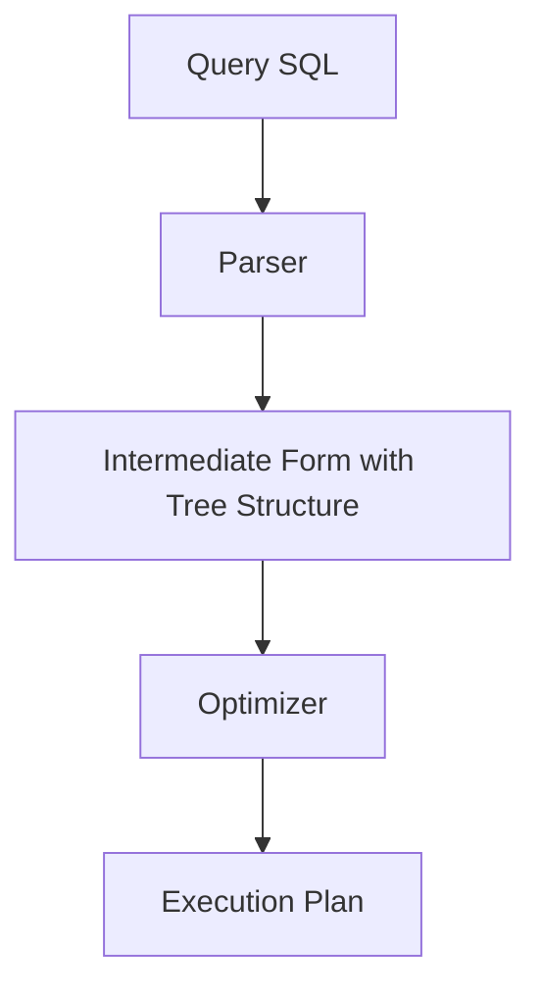
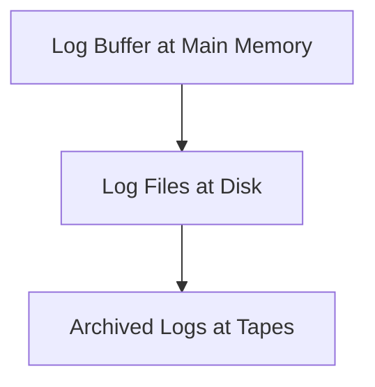

# Stored Procedure

INOUT?

# Query Transformation

- Step 1: scanner and parser generate initial query representation
- Step 2: representation is optimized according to heuristic rules
- Step 3: query execution plan is developed (Execute groups of operations based on access paths available and files involved)

Chapter 19.

- Apply filtering condition first to the bottom of the transformation tree to reduce the number of products from the cartesian product (Apply SELECT and PROJECT before JOIN)
- Possibly swap equivalent tables if the cartesian product can be less
- Many different query trees can be used to represent the query and get the same results
- The SELECT and JOIN operations that are most restrictive should be executed before other similar operations

## JOIN

Cartesian product with selection:

- Nested Loop Join
- Hash Join
- Merge Join

# Transaction

Chapter 20. Means a program accesses the database.

- Transaction Concept
- Concurrency Control
- Isolation Level
- ACID
  - Atomicity: All or nothing
  - Consistency preservation: The database is in a valid state before and after a transaction
    - A valid state: All data doesn't violate all integrity constraint
  - Isolation: All operations within a transaction doesn't affect the database before `commit`
  - Durability: All changes are permanent
- READ ONLY or READ WRITE
- Must have COMMIT or ROLLBACK at the end

## Level

- Level 0: isolation does not overwrite the dirty reads of higher-level transactions
- Level 1: isolation has no lost updates
- Level 2: isolation has no lost updates and no dirty reads
- Level 3: (true) isolation has repeatable reads. In addition to level 2 properties
- Snapshot isolation: Transaction sees data items that it reads based on the committed values of the items in the database snapshot when transaction starts. Ensures phantom record problem will not occur

- Dirty read: A transaction reads a data that was written by an uncommitted transaction.
- Nonrepeatable read: A transaction reads a data twice at different times, but another committed transaction changed or deleted the data between the two reads
- Phantom read: A transaction reads a set of tuples that satisfy a selection condition. When the same transaction re-reads the tuples with the same selection condition, it finds that there are more tuples than before because another committed transaction inserted tuples between the two reads.

- In SQL:
  - | Isolation level  | Dirty read | Nonrepeatable read | Phantom read |
    | ---------------- | ---------- | ------------------ | ------------ |
    | Read uncommitted | Y          | Y                  | Y            |
    | Read committed   | N          | Y                  | Y            |
    | Repeatable read  | N          | N                  | Y            |
    | Serializable     | N          | N                  | N            |

# Buffer (Cache in Databases)

- Data buffer
- Log (System Log / Transaction Log) buffer

CPU goes to the main memory looking for the data buffer or log buffer first. Once a miss happens, CPU goes to the disk then.

Replacement policy happens when buffers are full:

- Least Recently Used: replace the one last longest in the buffer with the new one from the disk
- Page Replacement Policy: Selects particular buffers to be replaced when all are full
- Domain Separation (DS) Method: Index Pages, Data Pages, Log Pages
- Hot Set Method: Useful in queries that scan a set of pages repeatedly. Does not replace the set in the buffers until processing is completed
- DBMIN Method: Predetermines the pattern of page references for each algorithm for a particular type of database operation

- Optimizer: Auto?
- Concurrency: Due to interleaved. Update problems handles by concurrency control (isolation level)?
- Getaway: History token
