- [Lab](#lab)
  - [Question 1](#question-1)
    - [Solution](#solution)
  - [Question 2](#question-2)
    - [Solution](#solution-1)
      - [SonarCube](#sonarcube)
  - [Question 3](#question-3)
    - [Solution](#solution-2)
  - [Question 4](#question-4)
    - [Solution](#solution-3)
      - [1. Non-constant string passed to execute on an SQL statement](#1-non-constant-string-passed-to-execute-on-an-sql-statement)
      - [2. HTTP cookie formed from untrusted input](#2-http-cookie-formed-from-untrusted-input)
      - [3. Servlet reflected cross site scripting vulnerability](#3-servlet-reflected-cross-site-scripting-vulnerability)
    - [4. Relative path traversal in servlet](#4-relative-path-traversal-in-servlet)
      - [5. HTTP parameter directly written to HTTP header output](#5-http-parameter-directly-written-to-http-header-output)
  - [Question 5](#question-5)
    - [Solution](#solution-4)
  - [Question 6](#question-6)
    - [Solution](#solution-5)
      - [SonarCube](#sonarcube-1)
  - [Summary](#summary)

# Lab

A lab for class **MET CS 763** at Boston University, instructed by **Yuting Zhang**. Student [Zhang, Jin Yu](siege@bu.edu) submitted on **February 25, 2023**.

## Question 1

How many bug items are identified by SpotBugs? What are the categories of these bugs? What are security bugs identified? Modify the configuration to only report the scary bugs. How many are they? Can you find any false positives?

### Solution

There are **66** bugs identified in **15** classes by SpotBugs. Categories of these bugs are **Security**, **Bad Practice**, **Experimental**, **Internationalization**, **Dodgy Code**, **Correctness**, and **Performance**:

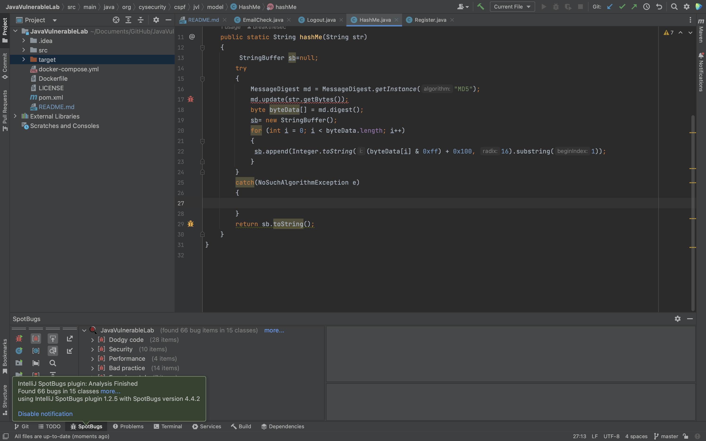

Security bugs identified:

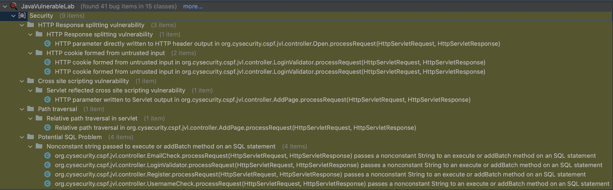

Modify the configuration to only report the scary bugs:

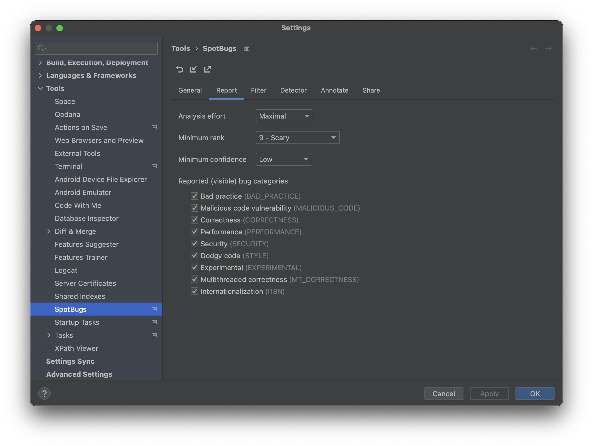

**5** scary bugs identified in **15** classes:

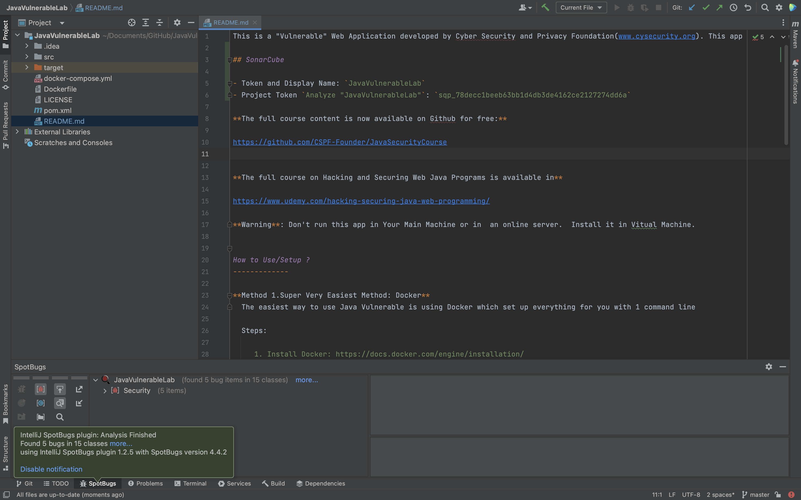

False positives found as following. The developer has actually indicated a TODO below `out` variable, but SpotBugs still reports it as _dead local store_:

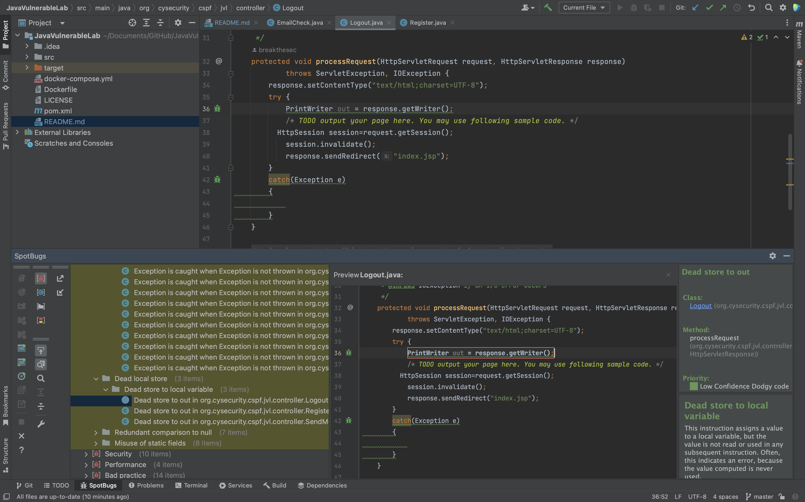

## Question 2

How many issues are identified by SonarQube? What are the categories of these issues? What is the difference between vulnerability and hot-spots? How many critical security issues are identified by SonarQube? Can you find any false positives?

### Solution

There are **139** issues identified by SonarQube. Categories of these issues are **Bug**, **Vulnerability**, and **Code Smell**:

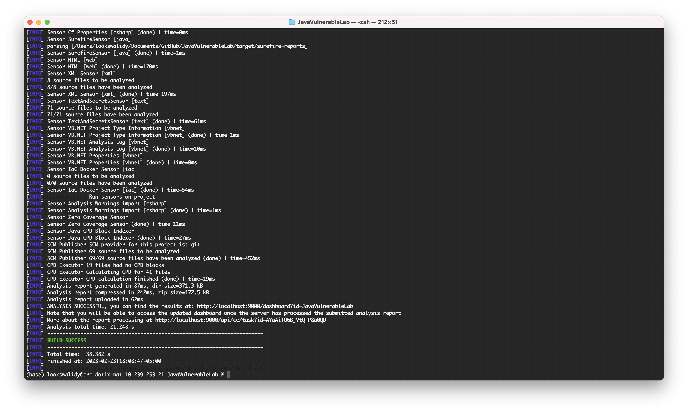

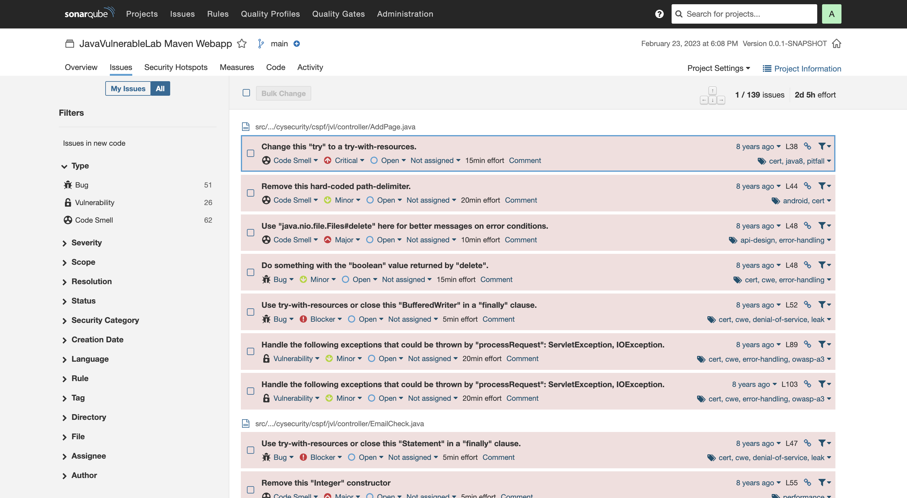

#### SonarCube

- Token and Display Name: `JavaVulnerableLab`
- Project Token `Analyze "JavaVulnerableLab"`: `sqp_78decc1beeb63bb1d4db3de4162ce2127274dd6a`

The difference between vulnerability and hotspots can be found [here](https://docs.sonarqube.org/9.6/user-guide/security-hotspots/):

> The main difference between a hotspot and a vulnerability is the _need_ for review before deciding whether to apply a fix:
>
> - With a hotspot, a security-sensitive piece of code is highlighted, but the overall application security may not be impacted. It's up to the developer to review the code to determine whether or not a fix is needed to secure the code.
> - With a vulnerability, a problem that impacts the application's security has been discovered and needs to be fixed immediately.

There are **0** critical security issues are identified by SonarQube:

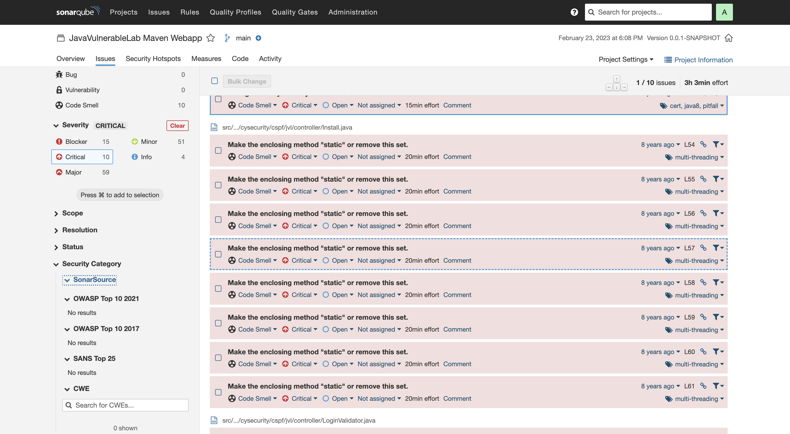

False positives found as following. The developer has actually indicated a TODO below `out` variable, but SonarQube still reports it as _remove this useless assignment to local variable_:

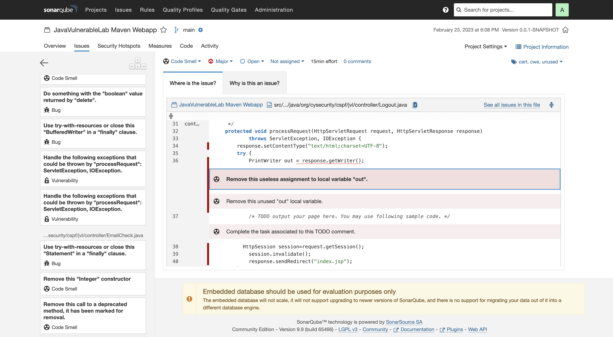

## Question 3

Compare the results by SpotBugs and SonarQube and state your findings.

### Solution

SpotBugs and SonarQube are kind reversed version for each's names. I suppose that SpotBugs would provide more messages for Java related bugs while SonarQube would offer more suggestions for general programming issue. However, it turns out that SpotBugs has very detailed documentation for bugs such as _HTTP Response splitting vulnerability_, which all programming language would face, while SonarQube indicates the cause and solution of _Make the enclosing method "static" or remove this set_ that the syntax only exists in Java.

Overall, SpotBugs are faster, and it is easy-to-use since it has been well integrated within IDEs (can write the solution and cause at one single window). SonarQube is slower, but it has many other features that SpotBug doesn't have such as tagging, issuing tickets, and visualizing.

## Question 4

Choose 5 security bugs (or security issues) from any report and explain them in more detail. Do you know how to fix them? You may need to do additional research on them

### Solution

#### 1. Non-constant string passed to execute on an SQL statement

At `src/main/java/org/cysecurity/cspf/jvl/controller/EmailCheck.java` line 48 to 59. The method invokes the execute or addBatch method on an SQL statement with a String that seems to be dynamically generated:

```java
Statement stmt = con.createStatement();
rs=stmt.executeQuery("SELECT * FROM users WHERE email='" + email + "'");
```

Consider using a prepared statement instead. It is more efficient and less vulnerable to SQL injection attacks:

```java
stmt = con.prepareStatement("SELECT * FROM users WHERE email=?")
stmt.setString(1, email);
stmt.executeQuery();
```

#### 2. HTTP cookie formed from untrusted input

At `src/main/java/org/cysecurity/cspf/jvl/controller/LoginValidator.java` line 43 to 66. This code constructs an HTTP Cookie using an untrusted HTTP parameter. If this cookie is added to an HTTP response, it will allow a HTTP response splitting vulnerability:

```java
String user = request.getParameter("username").trim();
String pass = request.getParameter("password").trim();
try
    {
        Connection con = new DBConnect().connect(getServletContext().getRealPath("/WEB-INF/config.properties"));
        if(con != null && !con.isClosed())
        {
            ResultSet rs = null;
            Statement stmt = con.createStatement();
            rs=stmt.executeQuery("select * from users where username='" + user + "' and password='" + pass + "'");
            if(rs != null && rs.next()){
            HttpSession session=request.getSession();
            session.setAttribute("isLoggedIn", "1");
            session.setAttribute("userid", rs.getString("id"));
            session.setAttribute("user", rs.getString("username"));
            session.setAttribute("avatar", rs.getString("avatar"));
            Cookie privilege = new Cookie("privilege","user");
            response.addCookie(privilege);
            if(request.getParameter("RememberMe") != null)
            {
                Cookie username=new Cookie("username", user);
                Cookie password=new Cookie("password", pass);
                response.addCookie(username);
                response.addCookie(password);
            }
```

Try to come out a function to Format and verify `username` and `password`:

```java
String user = formatVerifyUsername(request.getParameter("username"));
String pass = formatVerifyPassword(request.getParameter("password"));
```

#### 3. Servlet reflected cross site scripting vulnerability

At `src/main/java/org/cysecurity/cspf/jvl/controller/AddPage.java` line 39 to 55. This code directly writes an HTTP parameter to Servlet output, which allows for a reflected cross site scripting vulnerability:

```java
try {
    String fileName = request.getParameter("filename");
    String content = request.getParameter("content");
    if(fileName != null && content != null)
    {
    String pagesDir = getServletContext().getRealPath("/pages");
    String filePath = pagesDir + "/" + fileName;
    File f = new File(filePath);
    if(f.exists())
    {
        f.delete();
    }
    if(f.createNewFile())
    {
        BufferedWriter bw = new BufferedWriter(new FileWriter(f.getAbsoluteFile()));
        bw.write(content);
        bw.close();
        out.print("Successfully created the file: <a href='../pages/" + fileName + "'>" + fileName + "</a>");
    }
```

Try to come out a function to Format and verify `fileName`:

```java
String fileName = formatVerifyFileName(request.getParameter("filename"));
```

### 4. Relative path traversal in servlet

At `src/main/java/org/cysecurity/cspf/jvl/controller/AddPage.java` line 44 to 45. The software uses an HTTP request parameter to construct a pathname that should be within a restricted directory, but it does not properly neutralize sequences such as ".." that can resolve to a location that is outside of that directory:

```java
String filePath=pagesDir + "/" + fileName;
File f = new File(filePath);
```

Fix it by adding `../` to neutralize sequences:

```java
String filePath=pagesDir + "/" + fileName;
File f = new File("../" + filePath);
```

#### 5. HTTP parameter directly written to HTTP header output

At `src/main/java/org/cysecurity/cspf/jvl/controller/Open.java` line 36 to 40. This code directly writes an HTTP parameter to an HTTP header, which allows for a HTTP response splitting vulnerability:

```java
String url = request.getParameter("url");
if(url != null)
{
    response.sendRedirect(url);
}
```

Use `URL.encoder` to ensure that the URL is valid:

```java
String url = URLEncoder.encode(request.getParameter("url"), StandardCharsets.UTF_8.toString());
```

## Question 5

If you are familiar with Java and web development, you may review the code manually, and see if you can find any security issues that are not identified by SpotBugs or SonarQube?

### Solution

The following is a bug not identified by SpotBugs:

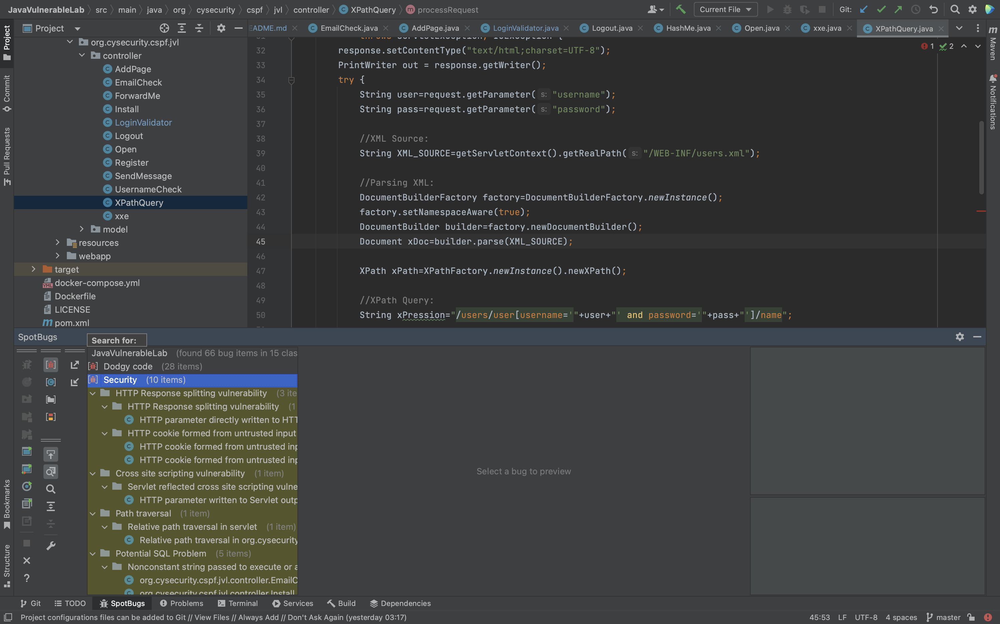

At `src/main/java/org/cysecurity/cspf/jvl/controller/XPathQuery.java` line 35 to 50. `xPression` directly use `user` and `pass` from `request` object, this may result in an XPath injection:

```java
String user = request.getParameter("username");
String pass = request.getParameter("password");

//XML Source:
String XML_SOURCE = getServletContext().getRealPath("/WEB-INF/users.xml");

//Parsing XML:
DocumentBuilderFactory factory = DocumentBuilderFactory.newInstance();
factory.setNamespaceAware(true);
DocumentBuilder builder = factory.newDocumentBuilder();
Document xDoc = builder.parse(XML_SOURCE);

XPath xPath = XPathFactory.newInstance().newXPath();

//XPath Query:
String xPression = "/users/user[username='" + user + "' and password='" + pass + "']/name";
```

We can come out a function to format and verify `username` and `password` to prevent it:

```java
String user = formatVerifyUsername(request.getParameter("username"));
String pass = formatVerifyPassword(request.getParameter("password"));
```

## Question 6

If you have done any software project before, use SpotBugs and SonarQube to examine one of your projects and report your findings.

### Solution

The program is a Java assignment that parses a text file and structure it into a node-linked-list. The files are on the [Google Drive folder](https://drive.google.com/drive/folders/1f4PTCvqbs-2ng4ZKnITqaleg7mSV3sGK?usp=share_link). There are **0** bugs identified in **15** classes by SpotBugs. Categories of these bugs are **Security**, **Bad Practice**, **Experimental**, **Internationalization**, **Dodgy Code**, **Correctness**, and **Performance**:

There are **0** issues identified by SonarQube. Categories of these issues are **Bug**, **Vulnerability**, and **Code Smell**:

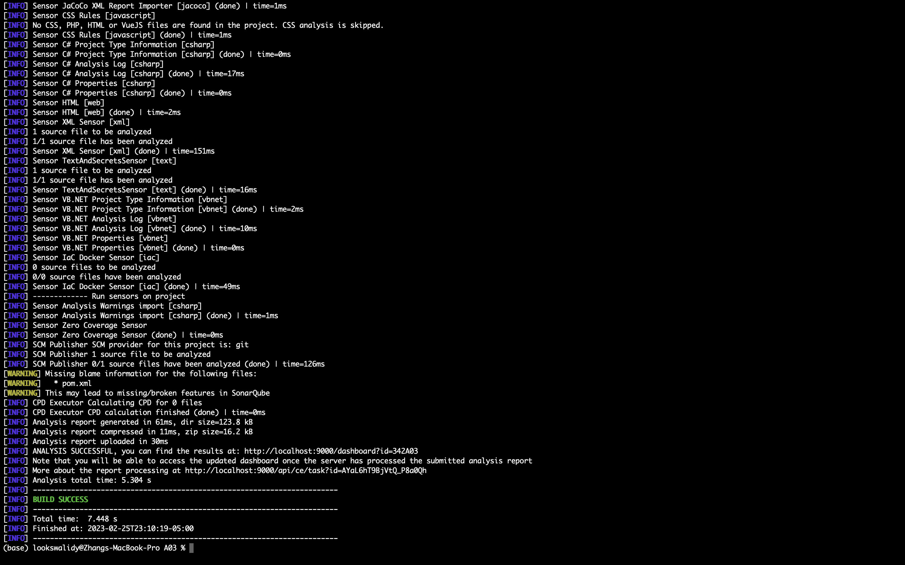

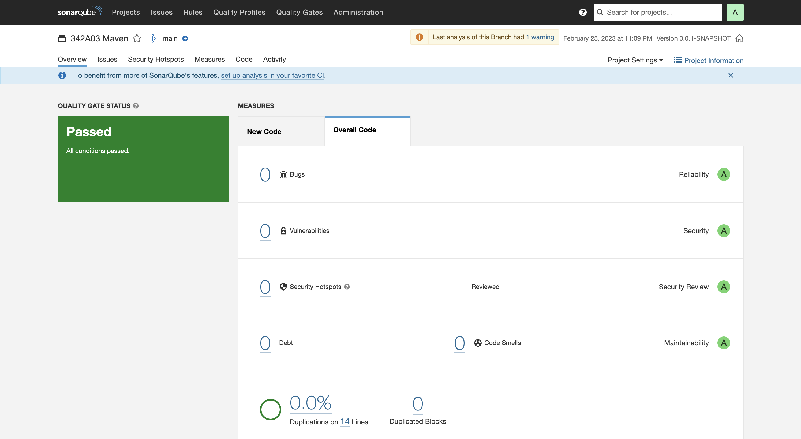

#### SonarCube

- Token and Display Name: `342A03`
- Project Token `Analyze "342A03"`: `sqp_64784d7843110141d53d0d5a72d76466d7f12133`

There are **17** bugs identified in **6** classes by SpotBugs with Maximal Analysis effort, 20 Minium rank, and Low Minimum confidence. Categories of these bugs are **Security**, **Bad Practice**, **Experimental**, **Internationalization**, **Dodgy Code**, **Correctness**, and **Performance**:

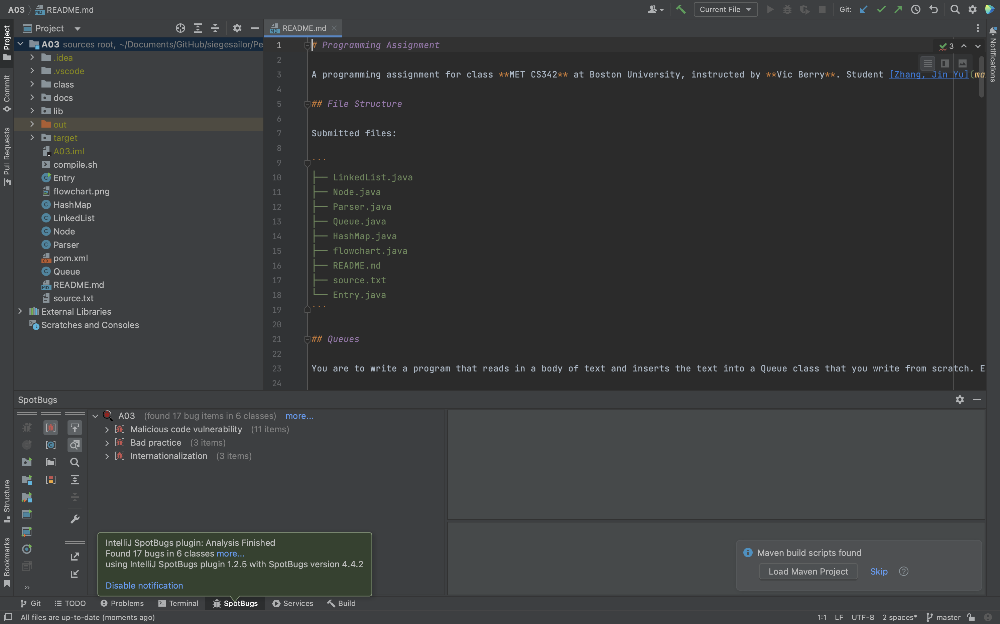

## Summary

A summary of your own reflection on the lab exercise, such as:

- What is the purpose of the lab in your own words?
  - Practice SpotBugs and SonarQube, and understand some common security issues/bugs.
- What did you learn? Did you achieve the objectives?
  - Hands-on experience on SpotBugs, IntelliJ, and SonarQube, and some basic understanding of security issues/bugs in codes. Yes, I achieved my objectives.
- Was this lab hard or easy? Are the lab instructions clear?
  - I would say this lab is not hard, but it is extremely time-consuming. A lot of steps need screenshots and detailed descriptions. The instructions were clear.
- What do you think about the tools used? What worked? What didn’t? Are there other better alternatives?
  - I am not a Java programmer, so I will have only very small change to use SpotBugs. SonarQube is a really great tool to as a SAST, but I prefer simpler solutions because SonarQube comes with too many project settings which I don't need. I personally use linting tools for now, such as ESLint for JS, PyLint for Python, and type set to verify types such as TypeScript.
- Any other feedback?
  - It is better to practice tools that are open to different languages, especially popular ones.
