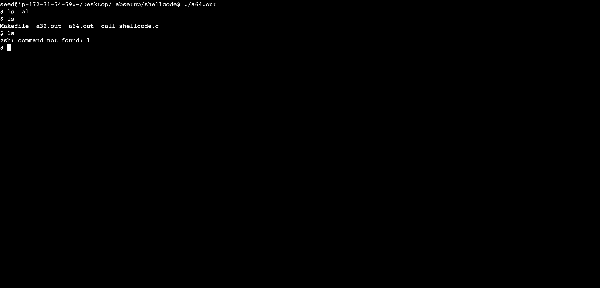
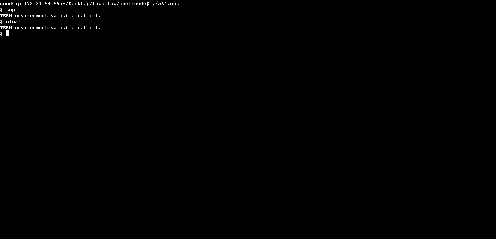
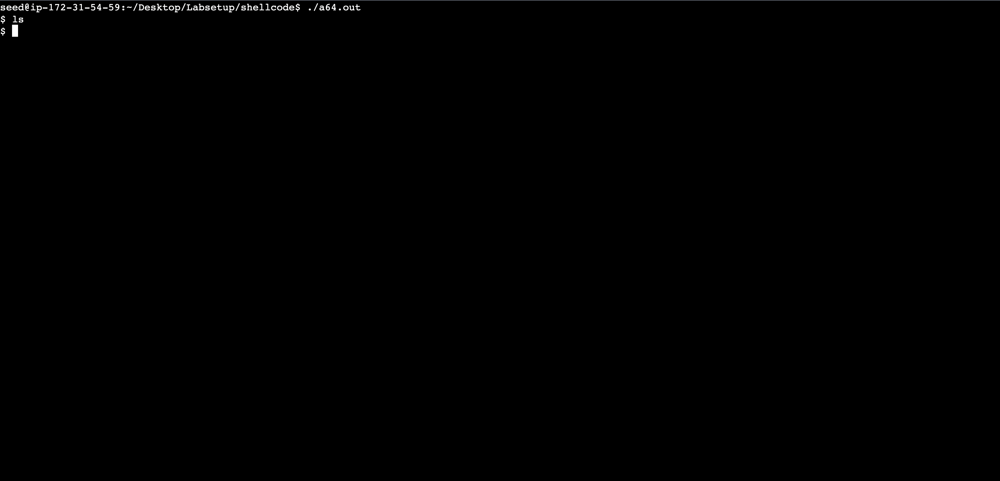
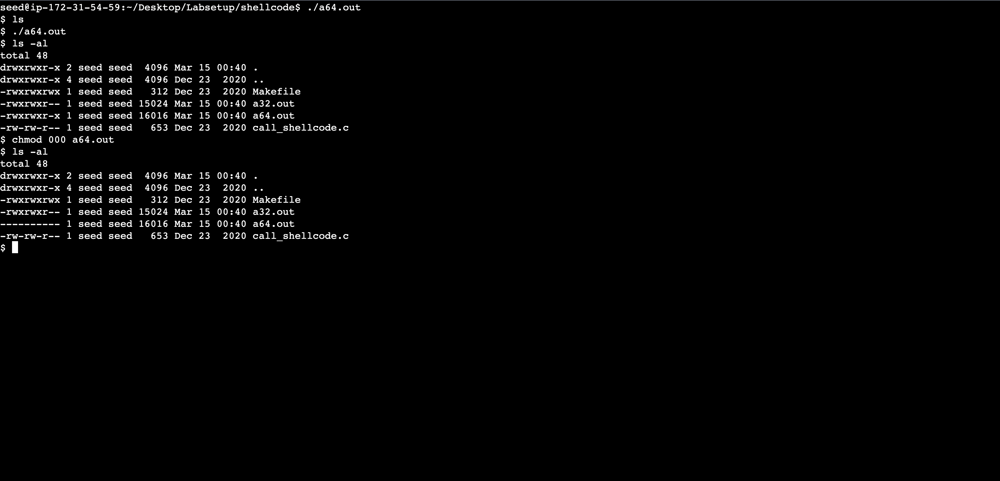
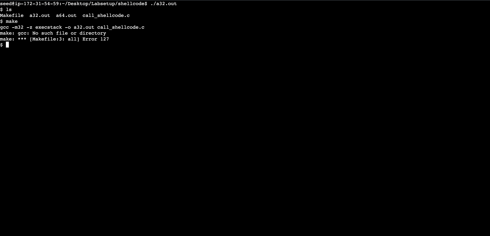
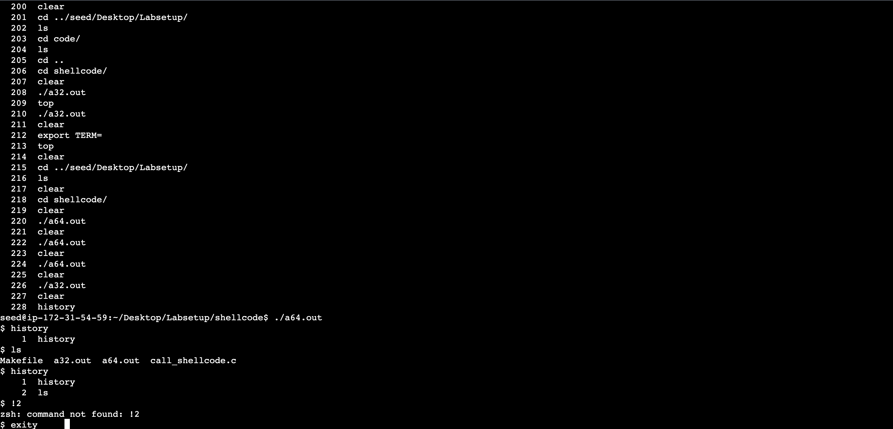
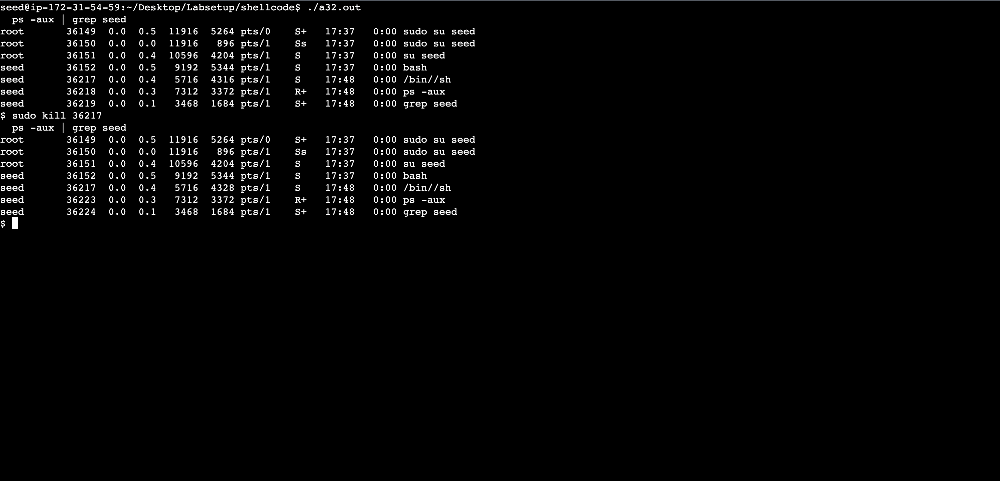

- [Lab](#lab)
  - [Installation](#installation)
    - [Cloud](#cloud)
  - [Hints](#hints)
  - [Tasks](#tasks)
    - [Task 1](#task-1)
    - [Task 2](#task-2)
    - [Task 3](#task-3)
  - [Summary](#summary)

# Lab

A lab for class **MET CS 763** at Boston University, instructed by **Yuting Zhang**. Student [Zhang, Jin Yu](siege@bu.edu) submitted on **March 16, 2023**.

## Installation

There were some issues regarding using image on the MacBook laptop with M1 chip. I have tried the following and none of them worked. I ended up with AWS EC2:

- **UTM**: No current available solution for arm64 systems to convert `.vid` to QEMU image
- **VirtualBox**: Crash every time starting the machine

### Cloud

Overall information is [here](https://seedsecuritylabs.org/Labs_20.04/Software/Buffer_Overflow_Setuid/). Followed the [guideline](https://github.com/seed-labs/seed-labs/blob/master/manuals/cloud/seedvm-cloud.md) to setup an Ubuntu instance on AWS EC2, then used the following command to fetch `Labsetup.zip`:

```bash
wget https://seedsecuritylabs.org/Labs_20.04/Files/Buffer_Overflow_Setuid/Labsetup.zip
```

File structure after installing:

```
├── home/
│   ├── ubuntu/
│   │   ├── src-cloud/
│   │   └── ...
│   ├── seed/
│   │   ├── Desktop/
│   │   │   ├── Labsetup/
│   │   │   └── seed_*.desktop
│   │   └── ...
│   └── ...
└──...
```

## Hints

1. Write return address multiple times
2. Insert malicious code in front
3. Use `gdb`
4. C would read a string till meeting a `0` or `\n` (terminators)

## Tasks

Followed the [instruction](https://seedsecuritylabs.org/Labs_20.04/Files/Buffer_Overflow_Setuid/Buffer_Overflow_Setuid.pdf) and used the following commands to initialize the lab:

```bash
sudo su seed
sudo sysctl -w kernel.randomize_va_space=0
sudo ln -sf /bin/zsh /bin/sh
```

> Seed Lab Password: `seedss`

### Task 1

On `/home/seed/Desktop/Labsetup/shellcode`, ran `make` to generate `a32.out` and `a64.out`. Makefile as following. Flags `-m32` and `execstack` were mentioned in the instruction:

```makefile
all:
    gcc -m32 -z execstack -o a32.out call_shellcode.c
    gcc -z execstack -o a64.out call_shellcode.c

setuid:
    gcc -m32 -z execstack -o a32.out call_shellcode.c
    gcc -z execstack -o a64.out call_shellcode.c
    sudo chown root a32.out a64.out
    sudo chmod 4755 a32.out a64.out

clean:
    rm -f a32.out a64.out *.o
```

A few observations from running `a32.out` and `a64.out`. Executing `su` command would switch user without command line hint, and was able to exit following the order from user to shell. Commands such as `groups`, `id`, and `visudo` worked normally:


Deleting character worked, but would not reflected on the command line:



Using tools/commands such as `top` and `clear` would complain `TERM environment variable not set.`:



After setting `export TERM=xterm`, tools/commands such as `top` and `clear` were able to use, and characters were deleted and reflected on the command line:


Most environment variables were not set in `a*.out` shells, including self-defined variables:


> After setting `export TERM=xterm`, the original shell (after `exit`)'s `TERM` environment variable would become `unknown` and complain `'unknown': I need something more specific.` with unknown causes. `TERM` must be set again in the original shell (this behavior didn't happen to self-defined variables).

Escaping from entered command worked without exiting from the shell:



Modifying `a*.out`'s privilege with `chmod` didn't end the shell:



Running `/bin/sh` or `a*.out` would open another shell:


Running `make` would complain `make: gcc: No such file or directory`:



Command history only existed within the shell, and not able to be reused with `!`:



Killing the shell process with `kill` didn't work (PID from `ps -aux | grep seed` with `/bin//sh` command). In fact, `kill` wasn't able to kill any processes:



### Task 2

Followed the instructions to compile `stack`:


> I had to use `make clean` after `make` for multiple attempts.

### Task 3

Followed the instructions to lunch `gdb`:


- **bof**: `0x121e`
- **ebp**: `0xffffcfa8`
- **buffer**: `0xffffcf3c`

The following is the shellcode from `call_shellcode.c` in [Task 1](#task-1):

```
#if __x86_64__
  "\x48\x31\xd2\x52\x48\xb8\x2f\x62\x69\x6e"
  "\x2f\x2f\x73\x68\x50\x48\x89\xe7\x52\x57"
  "\x48\x89\xe6\x48\x31\xc0\xb0\x3b\x0f\x05"
#else
  "\x31\xc0\x50\x68\x2f\x2f\x73\x68\x68\x2f"
  "\x62\x69\x6e\x89\xe3\x50\x53\x89\xe1\x31"
  "\xd2\x31\xc0\xb0\x0b\xcd\x80"
```

Original `exploit.py` file:


Modified `exploit.py` file:

Values in `exploit.py`:

- Start:
- Ret:
- Offset:

## Summary

- What is the purpose of the lab in your own words?
- What did you learn? Did you achieve the objectives?
- Was this lab hard or easy? Are the lab instructions clear?
- What do you think about the tools used? What worked? What didn’t? Are there other better alternatives?
- Any other feedback?
