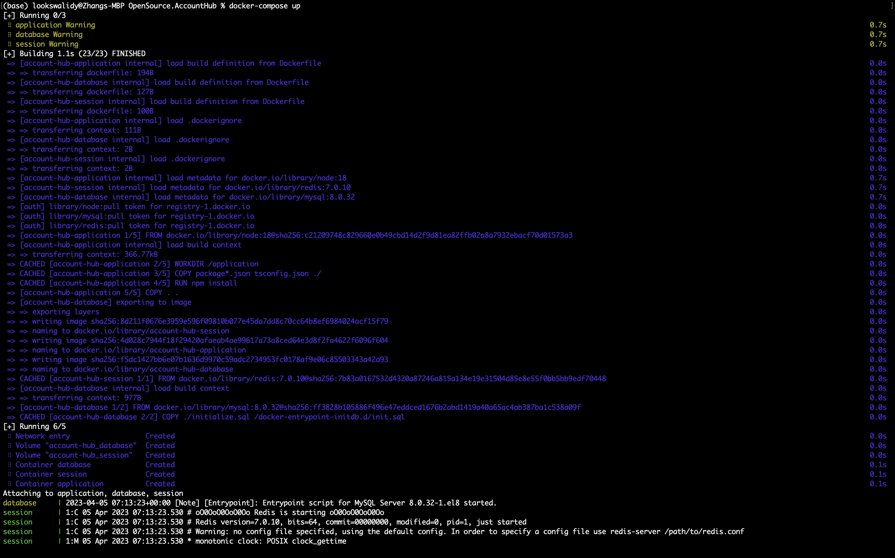
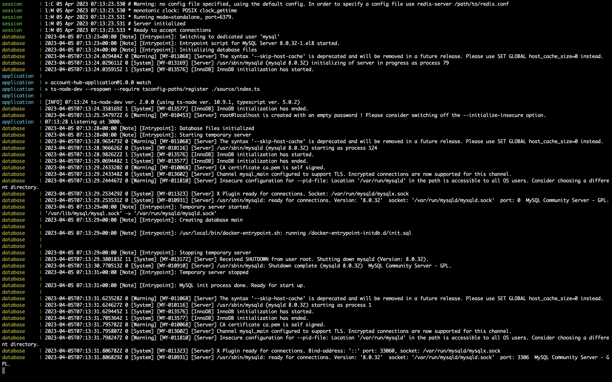
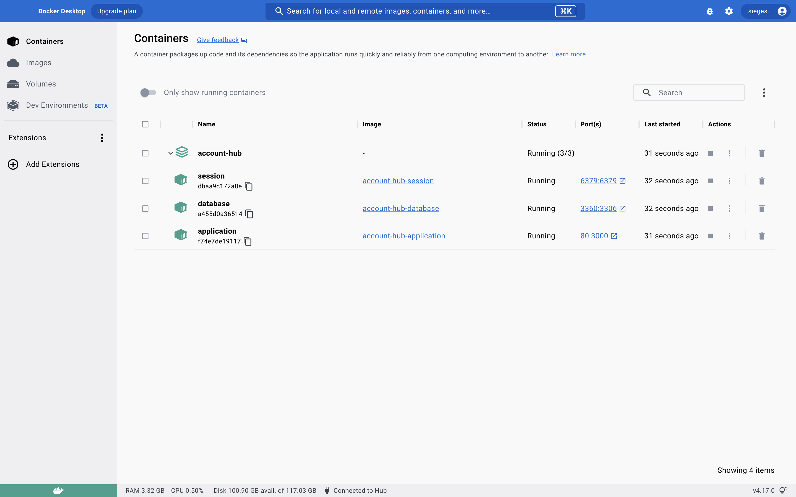
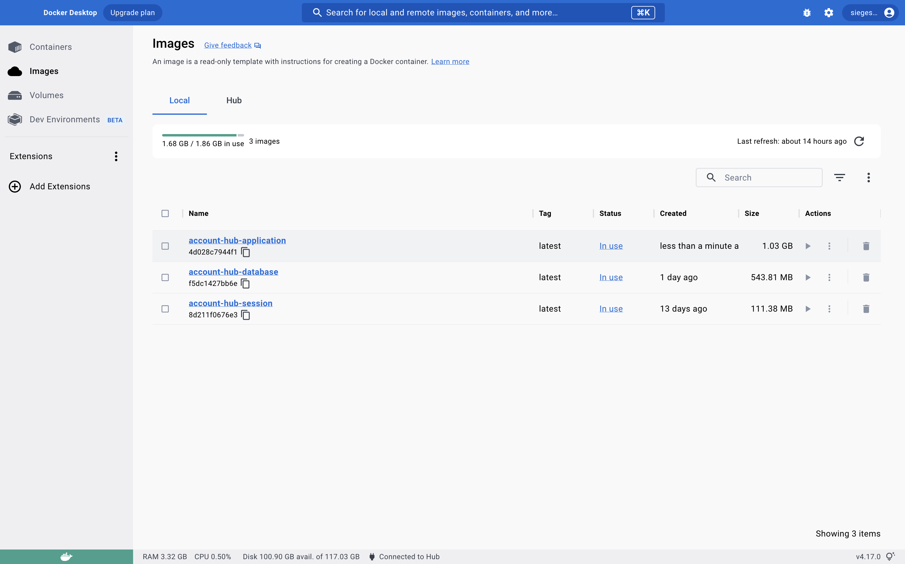
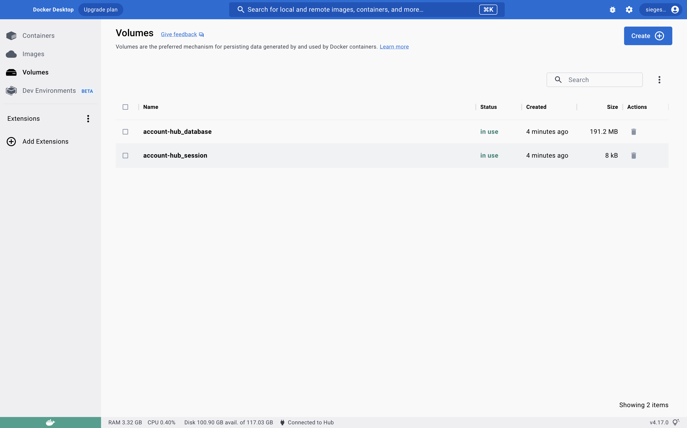
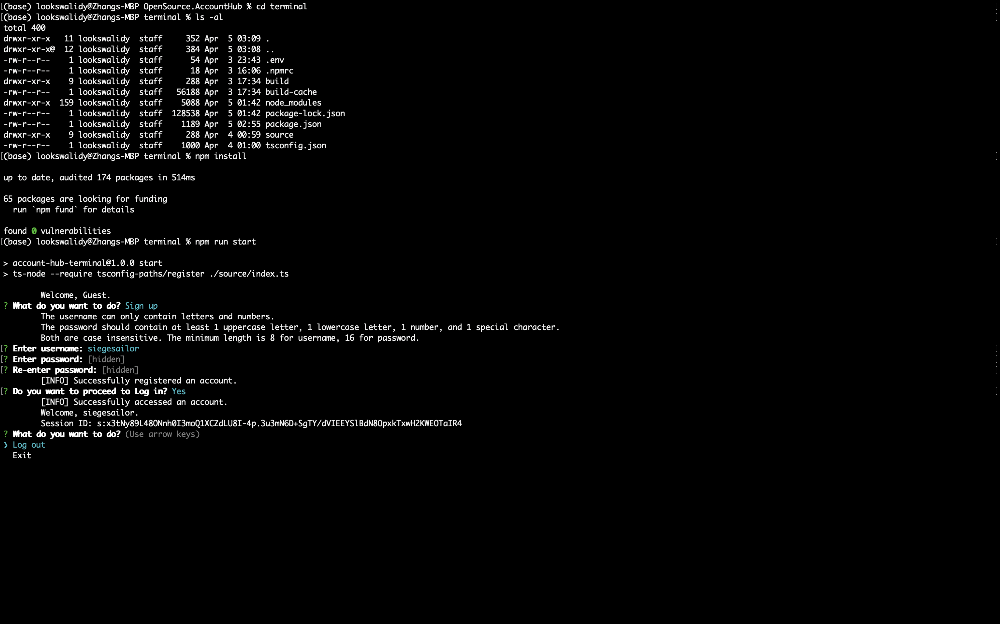
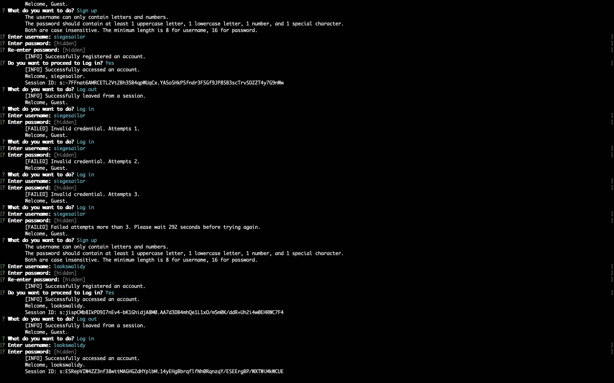
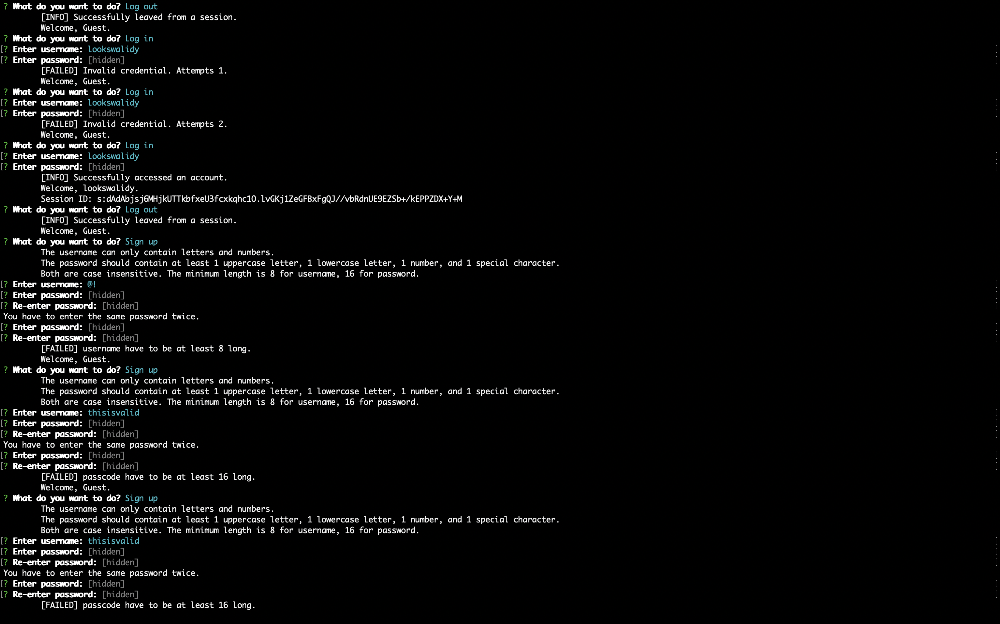
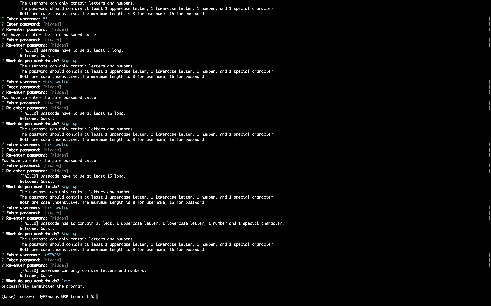
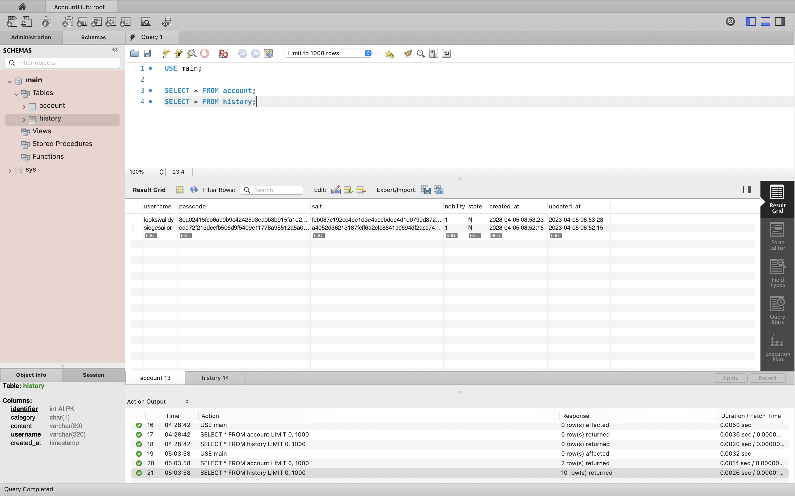

- [Lab](#lab)
  - [Prerequisites](#prerequisites)
  - [Structure](#structure)
  - [Get Started](#get-started)
  - [Crypto API](#crypto-api)
  - [Step Explanation](#step-explanation)
  - [Experiment Result](#experiment-result)
  - [Summary](#summary)

# Lab

A lab for class **MET CS 763** at Boston University, instructed by **Yuting Zhang**. Student [Zhang, Jin Yu](siege@bu.edu) submitted on **April 5, 2023**.

## Prerequisites

See `engines` in [package.json](./terminal/package.json):

```json
"engines": {
    "node": ">= 16.0.0",
    "npm": ">= 8.0.0"
},
```

Also, be sure to have **Docker** `>= 4` installed.

## Structure

The project is a monorepo with multiple services, each with its own `Dockerfile` and some source code. The project uses **Docker Compose** to manage the services. `terminal` is the CLI to interact with the whole service, and it is not a part of **Docker Compose**:

```
├── application/
│   ├── source/
│   ├── ...
│   └── Dockerfile
├── database/
│   ├── initialize.sql
│   └── Dockerfile
├── session/
│   └── Dockerfile
├── terminal/
│   ├── source/
│   ├── .env
│   └── ...
├── .gitignore
├── .npmrc
├── .env
└── docker-compose.yml
```

_application_ is a backend service following MVC pattern where views are defined as routes, using **Express** to handle requests with business logics. _database_ is a **MySQL** database, storing persistent data such as accounts and history records. `initialize.sql` would be executed to create tables once the database container is built. _session_ is a **Redis** database, storing session records.

For this lab, you use _terminal_, a CLI built in **NodeJS** with **TypeScript**, to send requests to _application_, and then _application_ would update data in _database_, and use _session_ for log-in/log-out features.

## Get Started

Create a `.env` file in the root folder:

```
DATABASE_HOST=database
DATABASE_USER=root
DATABASE_PASSWORD=Password!@$
DATABASE_CONNECTION_LIMIT=10
DATABASE_SKIP_TZINFO=1
DATABASE_PORT=3360
SESSION_HOST=session
SESSION_PORT=6379
SECRET=8F9FD33740771429D75E9E8C04046FF7E3785B2B677FA77700371D61B1003D4
HTTPS=0
APPLICATION_HOST=localhost
APPLICATION_PORT=3000
```

> For `SECRET`, you can choose any string you like. `DATABASE_PORT` is the port to connect the MySQL database inside the Docker container from outside. You can use `3306` if there is no conflict with other MySQL databases on your machine.

Run the services with Docker Compose:

```bash
docker-compose up
```





You could verify the services status through **Docker Desktop**:







After setting up services, create a `.env` file in `./terminal`:

```
HTTPS=0
APPLICATION_HOST=localhost
APPLICATION_PORT=80
```

Then run the following to start our CLI in `./terminal`:

```bash
npm install
npm run start
```


## Crypto API

All the magics happen within _application_. In `./application/source/utilities/index.ts`, I use `crypto` package to implement the hash function:

```typescript
const hash = {
  SALT_LENGTH: 64,
  PASSWORD_ITERATION: 1000,
  PASSWORD_HASH_LENGTH: 128,
  PASSWORD_DIGITAL_SIGNATURE: "SHA512",

  encode: function (buffer: Buffer) {
    return buffer.toString("hex");
  },
  salt: function () {
    return hash.encode(crypto.randomBytes(hash.SALT_LENGTH));
  },
  password: function (passcode: string, salt: string) {
    return hash.encode(
      crypto.pbkdf2Sync(
        passcode,
        salt,
        hash.PASSWORD_ITERATION,
        hash.PASSWORD_HASH_LENGTH,
        hash.PASSWORD_DIGITAL_SIGNATURE
      )
    );
  },
};
```

The hash function has been used in `./application/source/models/account.ts` for hashing passcode as a parameter function, and generating salts:

```typescript
static async insert(
  connection: PoolConnection,
  hash: typeof utilities.hash.password,
  username: string,
  passcode: string
) {
  const account = this.validate({ username, passcode });
  const salt = utilities.hash.salt();
  await connection.execute(
    "INSERT INTO account (username, passcode, salt) VALUES (?, ?, ?);",
    [account.username, hash(account.passcode, salt), salt]
  );
}
```

The hash function is passed to `insert` as a parameter function from `./application/source/controllers/register.ts`:

```typescript
await models.Account.insert(
  connection,
  utilities.hash.password,
  username,
  passcode
);
```

Also used to compare log-in password in `./application/source/controllers/access.ts`:

```typescript
if (account.passcode !== utilities.hash.password(passcode, account.salt)) {
  const attempt = await middleware.session.client.get(keySession);
  let count = 1;
  if (attempt) count = JSON.parse(attempt).count + 1;
  ...
```

`express-session` is used to generate session ID, you can find the setup at `./application/source/middleware/session.ts`. By default, `express-session` uses `uid-safe`, which is a CSPRNG package using random bytes:

```typescript
session: session({
    ...
}),
```

## Step Explanation

For the CLI to interact with the services, see `./terminal`. It is mainly built with `inquirer`, which is a prompt-based command line interface package. You can perform the three functionalities according to your profile status:

```typescript
async function initialize(message = "What do you want to do?") {
  try {
    console.log(
      `\tWelcome, ${
        profile.seeSession()
          ? `${profile.username}.\n\tSession ID: ${profile.session}`
          : "Guest."
      }`
    );
    const choices = profile.seeSession()
      ? [{ name: settings.constants.Choice.LEAVE }]
      : [
          { name: settings.constants.Choice.REGISTER },
          { name: settings.constants.Choice.ACCESS },
        ];
    ...
```

The format requirement for credentials is in `./application/source/models/account.ts`. They are implemented as regular expressions:

```typescript
class Account implements Schema.IAccount {
  static readonly USERNAME_MIN_LENGTH = 8;
  static readonly PASSWORD_MIN_LENGTH = 16;
  static readonly REGEX_ONLY_LETTERS_DIGITS = /^[A-Za-z-9]+$/;
  static readonly REGEX_ONE_BOTH_CASE_DIGIT_SPECIAL =
    /^(?=.*[A-Z])(?=.*[a-z])(?=.*\d)(?=.*[!@#$%^&*()_+{}|:"<>?;\[\]\\',./`~\-=])/;
```

And verify the format with the following code in the same file:

```typescript
static validate(input: Pick<Schema.IAccount, "username" | "passcode">) {
    const account: typeof input = { username: "", passcode: "" };
    for (const key in input) {
      account[key] = input[key];
      switch (key) {
        case "username":
          if (input[key].length < this.USERNAME_MIN_LENGTH)
            throw new Error(
              `${key} have to be at least ${this.USERNAME_MIN_LENGTH} long.`
            );
          if (!this.REGEX_ONLY_LETTERS_DIGITS.test(input[key]))
            throw new Error(`${key} can only contain letters and numbers.`);
          break;
        case "passcode":
          if (input[key].length < this.PASSWORD_MIN_LENGTH)
            throw new Error(
              `${key} have to be at least ${this.PASSWORD_MIN_LENGTH} long.`
            );
          if (!this.REGEX_ONE_BOTH_CASE_DIGIT_SPECIAL.test(input[key]))
            throw new Error(
              `${key} has to contain at least 1 uppercase letter, 1 lowercase letter, 1 number and 1 special character.`
            );
          break;
      }
    }
    return account;
  }

static async insert(
    connection: PoolConnection,
    hash: typeof utilities.hash.password,
    username: string,
    passcode: string
  ) {
    const account = this.validate({ username, passcode });
    const salt = utilities.hash.salt();
    await connection.execute(
      "INSERT INTO account (username, passcode, salt) VALUES (?, ?, ?);",
      [account.username, hash(account.passcode, salt), salt]
    );
  }
```

Used in `./application/source/controllers/register.ts`:

```typescript
try {
  await models.Account.insert(
    connection,
    utilities.hash.password,
    username,
    passcode
  );
} catch (_) {
  const error = _ as Error;
  return response.status(400).send(utilities.format.response(error.message));
}
```

The sign up features such as inputting passwords twice and hidden inputs are in `./terminal/source/commands/register.ts`:

```typescript
const { username } = await main.prompt([
  {
    type: "string",
    name: "username",
    message: "Enter username:",
  },
]);

let password = "";
while (!password) {
  const { _passcode, passcode } = await main.prompt([
    {
      type: "password",
      name: "_passcode",
      message: "Enter password:",
    },
    {
      type: "password",
      name: "passcode",
      message: "Re-enter password:",
    },
  ]);
  if (_passcode === passcode) password = passcode;
  else console.log("You have to enter the same password twice.");
}
```

To securely store the password, see `./application/source/controllers/register.ts`. The hashing flow is already introduced at [Crypto API](#crypto-api):

```typescript
await connection.beginTransaction();
try {
  await models.Account.insert(
    connection,
    utilities.hash.password,
    username,
    passcode
  );
} catch (_) {
  const error = _ as Error;
  return response.status(400).send(utilities.format.response(error.message));
}
...
await connection.commit();
```

For log-in feature, see `./application/source/controllers/access.ts`. The failed attempts count would be clear after a successful logging-in. Note that I implement constant-time password hashing with a fake account object with dummy hashing to prevent side channel attacks:

```typescript
connection = await models.pool.getConnection();
const accounts = await models.Account.findByUsername(connection, username),
  _account = accounts[0];
const account = _account || {
  passcode: settings.constants.Imitation.PASSWORD,
  salt: settings.constants.Imitation.SALT,
};
if (account.passcode !== utilities.hash.password(passcode, account.salt)) {
    ...
    return response
      .status(401)
      .send(
        utilities.format.response(`Invalid credential. Attempts ${count}.`)
      );
}
await middleware.session.client.del(keySession);
```

For max wrong attempts, see `./application/source/controllers/access.ts`. Once the request supplies the wrong password, we increase `count` in session database, which is Redis:

```typescript
if (account.passcode !== utilities.hash.password(passcode, account.salt)) {
      const attempt = await middleware.session.client.get(keySession);
      let count = 1;
      if (attempt) count = JSON.parse(attempt).count + 1;

      await middleware.session.client.set(
        keySession,
        JSON.stringify({ count, timestampLast: Date.now() })
      );
      ...
```

And we check if the attempts reach the max limitation at the beginning of the flow. We prohibit the user from logging-in if the last attempt timestamp is still in the past 5 minutes. `count` would not increase in this scenario in case of endless frozen due to malicious log-in attacks:

```typescript
const MAX_FAILED_ATTEMPT = 3;
const FAILED_ATTEMPT_PREFIX = "ATTEMPT:";
const LOCKOUT_TIME = settings.constants.Milliseconds.MINUTE * 5;

const keySession = `${FAILED_ATTEMPT_PREFIX}${username}`;
const attempt = await middleware.session.client.get(keySession);
if (attempt) {
  const { count, timestampLast } = JSON.parse(attempt);
  if (count >= MAX_FAILED_ATTEMPT) {
    const milliseconds = Date.now() - timestampLast;

    if (milliseconds < LOCKOUT_TIME) {
      return response
        .status(429)
        .send(
          utilities.format.response(
            `Failed attempts more than ${MAX_FAILED_ATTEMPT}. Please wait ${Math.ceil(
              (LOCKOUT_TIME - milliseconds) / 1000
            )} seconds before trying again.`
          )
        );
    }
  }
}
```

After successfully logging-in, a unique session ID is generated in `./application/source/controllers/account/access.ts`:

```typescript
request.session.regenerate(function (error) {
  if (error) next(error);
  request.session[settings.constants.Session.USERNAME] = username;
  response
    .status(200)
    .send(utilities.format.response("Successfully accessed an account."));
});
```

We can verify it through the CLI and `redis-cli`:




Note that session IDs are automatically sent by `express-session` with `set-cookie` header, so we have to parse it to cookie format in CLI and place in following requests in `./terminal/source/index.ts`:

```typescript
async function access(_username?: string, _passcode?: string) {
  const { response, username } = await commands.access(_username, _passcode);
  if (!response.ok) return;
  profile.username = username;
  const cookie = setCookieParser(response.headers.get("set-cookie") || "").find(
    function (predicate) {
      return predicate.name === settings.constants.Session.NAME;
    }
  );
  profile.session = cookie ? cookie.value : "_";
}

async function leave() {
  const { response } = await commands.leave(
    `${settings.constants.Session.NAME}=${profile.session};`
  );
  if (!response.ok) return;
  profile.reset();
}
```

To clear session, we set `maxAge` to 0 so that the cookie would no longer be valid in client-side, and we clear the cookies in the response object in `./application/source/controllers/account/leave.ts`:

```typescript
request.session.cookie.maxAge = settings.constants.Milliseconds.NOW;
request.session.destroy(function (error) {
  if (error) next(error);
  response.clearCookie(settings.constants.Session.NAME);
  response
    .status(200)
    .send(utilities.format.response("Successfully leaved from a session."));
});
```

In CLI, we clear session from `profile` object in `./terminal/source/index.ts`:

```typescript
if (!response.ok) return;
profile.reset();
```

The followings are used to ensure the security in `./application/source/utilities/index.ts`:

```typescript
const hash = {
  SALT_LENGTH: 64,
  PASSWORD_ITERATION: 1000,
  PASSWORD_HASH_LENGTH: 128,
  PASSWORD_DIGITAL_SIGNATURE: "SHA512",
  ...
```

## Experiment Result

Results for all functionalities:







The database query result:



## Summary

A summary of your own reflection on the lab exercise, such as:

- What is the purpose of the lab in your own words?
  - Build a crypto system for accounts from scratch.
- What did you learn? Did you achieve the objectives?
  - I achieved all the objectives. Sessions was the hardest one to implement because I didn't choose a web client and `express-session` is mainly for browsers.
- Was this lab hard or easy? Are the lab instructions clear?
  - I spent 4 days, nearly 30 hours to finish this lab. The scale for this lab is too big. All the instructions are clear.
- Any other feedback?
