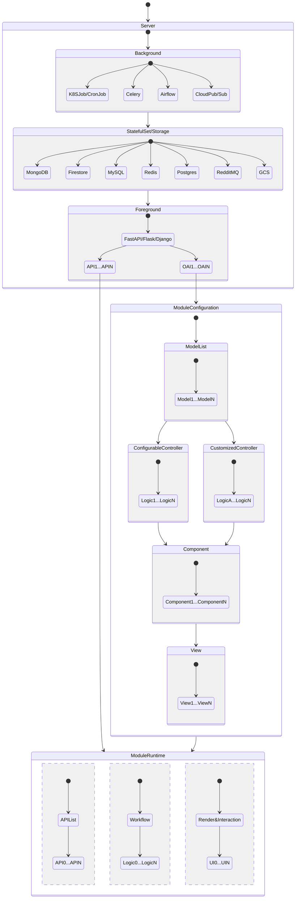

# Outline

參考 AppSheet、Data Studio，整合不同來源的資料、透過可複用的 Logic (Controller) 與 Component，展示可執行寫入與讀取的 UI (View)。操作者只需了解 Controller 與 View 的對應關係即可針對需求組合頁面。

以下為 Server、Module Configuration 與 Module Runtime 的對應關係：

> Model List 為各 API 的 `openapi.json`

使用 One to One 的配置為佳，即操作者在單一 Backstage (實現 Module Configuration 的地方) 設置前台各個 View 的 Config，使用者透過單一介面、讀取各前台 View Config 後展示。比起部署在不同 Forestage，能夠：

1. 單一 Application 內操作複數 View
2. 各 View 前有一層展示跨 Forestage 資訊的 UI (各 API 狀態、帳戶列表、權限一覽等)
3. 統合驗證與權限
