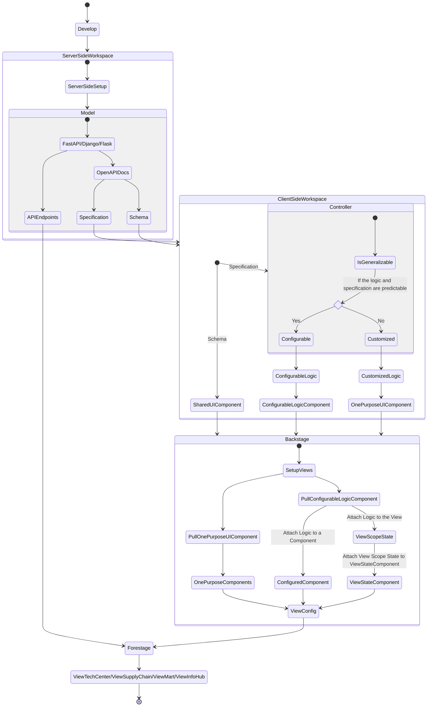

# View Config Flow

View 藉由讀取 Backstage 產生的 Config 生成，不單獨跟隨 Deploy Flow。也就是説，每份 View Config 有自己的、供使用者閱讀與追蹤的版本紀錄，而 Forestage 的版本通常隨著本身使用的 Component 更新而變動。具體流程大致為：



## 主要問題

以下列出此 Workflow 會面臨的困難：

- **Model to Controller**: Model 如何對應到 Controller、`openapi.json` 與 Controller 的關係
- **Controller Combo Hint**: 如何處理有先後順序、前置要求的 API
- **Front-end Monorepo**: 前端在 ServerlessServices、Backstage、Forestage、Utilities 等的開發架構
- **Package**: 由於前端互相之間的關聯，需審慎考慮 Package 的版本對應、需求與否
- **View Scope State**: 同一個 View 內、多個 Component 對於同樣 View Scope State Controller 的處理
- **Listener**: 資料的主動更新、Controller 類型定義
- **Error Handling**: 錯誤處理，尤其來自載入同樣資料來源的 Component

## File Structure

```bash
├── node_modules
├── ServerlessServices
│   ├── tsconfig.json
│   └── ...
├── Backstage
│   ├── tsconfig.json
│   └── ...
├── Forestage
│   ├── tsconfig.json
│   └── ...
├── Utilities
│   ├── tsconfig.json
│   └── ...
├── package.json
├── gitlab-ci.yml
├── tsconfig.json
└── ...
```
