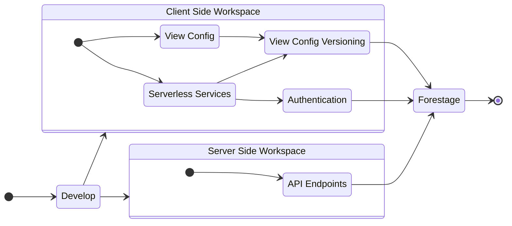

# Serverless Services

開發過程中，Authentication 和 View Config Versioning 的部分會隨前端有眾多變更，在此可使用 Serverless NoSQL Database 一類服務，由前端定義並控制。應整合於 ClientSideWorkspace 中，見 [File Structure](#file-structure)。



## View Config Versioning

操作者在 Backstage 設置 View 後，應以 View 為單位產出供 Forestage 讀取展示的設置檔，大致應有：

```tsx
// 每次創建、儲存 View 後，應產出如下的資料，並以 View 為單位存在 ViewConfigVersioning 中
interface IViewDetail {
  title: string;
  identityAuthor: string;
  message: string;
  entryOfComponent: {
    [identityComponent]: {
      order: number;
      controllerRead: {
        identity: string;
        position: number;
      }[];
      controllerWrite: {
        identity: string;
        position: number;
      }[];
    };
  };
  entryOfViewScopeStateController: {
    [identityController]: string[];
  };
  timestampCreated: number;
}

// 每份 IViewConfig 應對應到每個 Forestage 的頁面
interface IViewConfig {
  identityView: string;
  // 若無則使用 identityView 作為 pathname
  pathname?: string;
  // 若無則使用 currentVersion 的 title
  label?: string;
  icon: string;
  order: number;
  currentVersion: string;
  timestampCreated: number;
  [version: string]: IViewDetail;
}
```

:::info 提醒
考慮到後續維護，UI 應以順序 `order` 為基準展現、不在意互相關係，如 Pinterest 或 MicroSite。
:::

## Authentication

由於每個端點的驗證機制不同，在未來，也有需要獨立驗證的可能，應同時儲存不同使用者的各式 Credential，並存在整個 Forestage 的週期中：

```tsx
interface IUser {
  identity: string;
  username: string;
  email: string;
  listOfPermission: {
    identityView: string;
    listOfAllowedController: string[];
  }[];
  entryOfToken: {
    [token]: string;
  };
}
```

:::info 提醒
對於 Backstage 的使用者控管，可直接使用如 Firebase Authentication 一類的服務作 SSO。
:::
