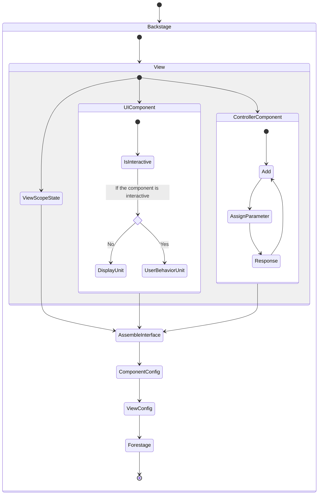

# Backstage

操作者在 Backstage 中使用 3 種 Component (OnePurposeComponent、ConfigurableComponent、ViewStateComponent) 來設置 View Config。通常來說，一個 Component 的組成有：

1. 1 個 UI Component，可能是單一 Button 或 Tabs 與 Table 的組合
2. 針對該 UI Component 的設置，如 Button 文字、數量、Unit ID 等
3. 1 個或多個 Controller Component
4. 針對以上 Controller、互相之間的呼叫順序、Controller 資料、對應 Unit 的資料、類型等設置 (壓平資料並排序)
5. 將第 4 點間或最後的資料指定至 UI Component 上
6. 對能產生使用者行為的 UI Component，能夠綁上建立、更新、刪除類的 Controller，並將第 4 點的資料作為 Parameter 使用
7. Component 再往上的層級是 View。第 4 點產生的資料 可以拉到 View 供其他 Component 取用 (View Scope State)
8. View 再往上的層級是整個 Forestage。在這層，可以取用使用者的資料與驗證、權限
9. UI Component 內要呈現的資料 (第 5 點)、操作綁定使用行為時 (第 6 點)，可以取用 View Scope State

3 種 Component 分別為：

- **OnePurposeComponent**: 或有少數邏輯無法泛化到 Controller 與 Component 上，此時因應的是為特定邏輯開發的 Component，使用上不需設置、拉取即使用。然而應是特例
- **ConfigurableComponent**: 主要組成。透過編輯 Controller 與 UI 的相互關係作成
- **ViewStateComponent**: 與 ConfigurableComponent 大致相同，然而只取用 View Scope State 的資料並顯示



## Controller

由 `openapi.json` 解析、自動產出的邏輯器，假設我們有以下檔案：

```json title="oai-people-portal.json"
{
  "openapi": "3.0.2",
  "info": {
    "title": "People Portal API",
    "version": "d5ea6895"
  },
  "paths": {
    "/people-portal/employees/{employees_type}": {
      "get": {
        "tags": ["People portal"],
        "summary": "List Employees",
        "operationId": "list_employees_people_portal_employees__employees_type__get",
        "parameters": [
          {
            "required": true,
            "schema": {
              "title": "Employees Type",
              "enum": ["full-time", "intern", "temporary"],
              "type": "string"
            },
            "name": "employees_type",
            "in": "path"
          }
        ],
        "responses": {
          "200": {
            "description": "Successful Response",
            "content": {
              "application/json": {
                "schema": {
                  "$ref": "#/components/schemas/ListObjectsOut"
                }
              }
            }
          },
          "422": {
            "description": "Validation Error",
            "content": {
              "application/json": {
                "schema": {
                  "$ref": "#/components/schemas/HTTPValidationError"
                }
              }
            }
          }
        }
      }
    }
  },
  "components": {
    "schemas": {
      "ListObjectsOut": {
        "title": "ListObjectsOut",
        "required": ["count", "data"],
        "type": "object",
        "properties": {
          "count": {
            "title": "Count",
            "type": "integer"
          },
          "data": {
            "title": "Data",
            "type": "array",
            "items": {
              "anyOf": [
                {
                  "type": "string"
                },
                {
                  "type": "string",
                  "format": "uuid"
                }
              ]
            }
          }
        }
      },
      "HTTPValidationError": {
        "title": "HTTPValidationError",
        "type": "object",
        "properties": {
          "detail": {
            "title": "Detail",
            "type": "array",
            "items": {
              "$ref": "#/components/schemas/ValidationError"
            }
          }
        }
      }
    }
  }
}
```

使用以下 Packages 來幫助解析 `openapi.json`：

- `openapi-types`: 提供 `openapi.json` 的 Type
- `@apidevtools/json-schema-ref-parser`: 幫助解析文件中以 `$ref` 定義的部分

首先建立 ParseOAI 以對 `openapi.json` 做整理：

```tsx title="helper/parse-oai.ts"
import { OpenAPIV3 } from 'openapi-types';
import $RefParser from '@apidevtools/json-schema-ref-parser';

export default class ParseOAI {
  openAPISource: string | $RefParser.JSONSchema;
  parser: $RefParser;
  document: OpenAPIV3.Document;
  constructor(parser: $RefParser, openAPISource: string | $RefParser.JSONSchema) {
    this.parser = parser;
    this.openAPISource = openAPISource;
  }

  async createSelfScopeDereferencedAPI() {
    const sourceBundled = await this.parser.bundle(this.openAPISource);
    const document = (await this.parser.dereference(sourceBundled)) as OpenAPIV3.Document;
    this.document = document;
    return document;
  }

  /**
   * Parse value from key `$ref` such as
   * `#/components/schemas/UpdateEmployeeInfoFromGoogleSheetOut` with their module value.
   * @param {String} path `#/<fieldLevel1>/<fieldLevel2>/<module>`
   * @returns {Object} Module value from `this.document`
   * @deprecated Since started using `@apidevtools/json-schema-ref-parser`
   */
  static parseReference(document: OpenAPIV3.Document | $RefParser.JSONSchema, path: string): object {
    const listOfKey = path.split('/').slice(1);
    const reference = listOfKey.reduce((accumulator, currentValue, currentIndex) => {
      const currentField = accumulator[currentValue];
      if (currentField) {
        accumulator = currentField;
      } else {
        listOfKey.splice(currentIndex);
      }
      return accumulator;
    }, document);
    return reference;
  }
}
```

接著建立分別以 Path、Pattern、Method 為單位的 UI Component：

```tsx title="component/PathAll.tsx"
import React from 'react';
import { OpenAPIV3 } from 'openapi-types';

import PatternCombo from './PatternCombo';

interface IPathAll {
  entryOfPath: OpenAPIV3.PathsObject;
}

export default function PathAll({ entryOfPath }: IPathAll) {
  return (
    <div>
      {Object.entries(entryOfPath).map(([pattern, item]) => {
        return <PatternCombo key={pattern} pattern={pattern} entryOfItem={item} />;
      })}
    </div>
  );
}
```

```tsx title="component/PatternCombo.tsx"
import React from 'react';
import { OpenAPIV3 } from 'openapi-types';

import MethodSingle from './MethodSingle';

interface IPatternCombo {
  pattern: string;
  entryOfItem: OpenAPIV3.PathItemObject;
}

export default function PatternCombo({ pattern, entryOfItem }: IPatternCombo) {
  return (
    <div id={pattern}>
      <h4>{pattern}</h4>
      {Object.keys(entryOfItem)
        .filter((key: OpenAPIV3.HttpMethods | string) => {
          return Object.values<string>(OpenAPIV3.HttpMethods).includes(key);
        })
        .map((key: OpenAPIV3.HttpMethods) => {
          return <MethodSingle key={key} pattern={pattern} method={key} entryOfOperation={entryOfItem[key]} />;
        })}
    </div>
  );
}
```

```tsx title="MethodSingle.tsx"
import React from 'react';
import { OpenAPIV3 } from 'openapi-types';

interface IMethodSingle {
  pattern: string;
  method: OpenAPIV3.HttpMethods;
  entryOfOperation: OpenAPIV3.OperationObject;
}

export default function MethodSingle({ pattern, method, entryOfOperation }: IMethodSingle) {
  const identity = `${pattern}-${method}`;

  return (
    <div id={identity}>
      <h6>{method.toUpperCase()}</h6>
      <p>{entryOfOperation.summary}</p>
    </div>
  );
}
```

最終在 `Main.tsx` 中使用：

```tsx title="Main.tsx"
import React, { useEffect, useState } from 'react';
import { OpenAPIV3 } from 'openapi-types';

export default function Main() {
  const [document, setDocument] = useState<OpenAPIV3.Document>(null);
  useEffect(() => {
    const wrapAsync = async () => {
      const parser = new $RefParser();
      const parseOAI = new ParseOAI(parser, 'https://api.people.twtc.uat.shopee.tw/openapi.json');
      const document = await parseOAI.createSelfScopeDereferencedAPI();
      setDocument(document);
    };
    wrapAsync();
  }, []);
  return <section>{document && <PathAll entryOfPath={document} />}</section>;
}
```

可以再加上一些測試：

```tsx title="parse-oai.test.ts"
import $RefParser from '@apidevtools/json-schema-ref-parser';

import ParseOAI from './parse-oai';
import OAIPeoplePortal from './oai-people-portal.json';

const parser = new $RefParser();
const parseOAI = new ParseOAI(parser, OAIPeoplePortal);

describe('Structure method', () => {
  describe('createSelfScopeDereferencedAPI', () => {
    it('does the method dereference properly', async () => {
      const document = await parseOAI.createSelfScopeDereferencedAPI();
      expect(
        document.paths['/people-portal/employees/{employees_type}'].get.responses['200']['content']['application/json'].schema
      ).toEqual(OAIPeoplePortal.components.schemas.ListObjectsOut);
    });
  });
});

describe('Static method', () => {
  describe('parseReference', () => {
    it('does the method work properly', () => {
      expect(ParseOAI.parseReference(OAIPeoplePortal, '#/components/schemas/ListObjectsOut')).toEqual(
        OAIPeoplePortal.components.schemas.ListObjectsOut
      );
    });
  });
});
```

:::info 提醒
後端在上版後，應更新一處供 Backstage 取用的 Open API Config，如：

```json
{
  "peoplePortal": {
    "versionCurrent": "https://api.people.twtc.uat.shopee.tw/v1.5.0/openapi.json",
    "versionPrevious": "https://api.people.twtc.uat.shopee.tw/v1.4.8/openapi.json",
    "versionStable": "https://api.people.twtc.uat.shopee.tw/v1.1.2/openapi.json"
  },
  "supplyChain": {
    "versionCurrent": "https://api.sci.twtc.uat.shopee.tw/v1.1.4/openapi.json",
    "versionPrevious": "https://api.sci.twtc.uat.shopee.tw/v1.1.3/openapi.json",
    "versionStable": "https://api.sci.twtc.uat.shopee.tw/v1.1.0/openapi.json"
  }
}
```

如上，後端上版後會更新對應版本號，而前端可根據配置的 Key (Remote Config、Firestore、Envs 等) 來決定當前 Backstage 內 Controller 與對應設置該解析的資料。理論上會維持在 `versionStable`，當有測試或優先需求時使用 `versionCurrent`，`versionPrevious` 作為 Rollback 選項。

:::

:::caution 注意
API 更新後的規格差異導致的錯誤，應會優先被 Forestage 執行時各 Component 的 `onError` 與 `ErrorBoundary` 捕捉。操作者應與後端同步規格更新，並在 Backstage 編輯以相容。Backstage 日後可新增比對既有 View Config 與當前 Controller Interface (最主要是 Key 與資料類型)，在進入 Backstage 時即自動偵錯，操作者能不透過 Forestage 反應排錯。
:::
