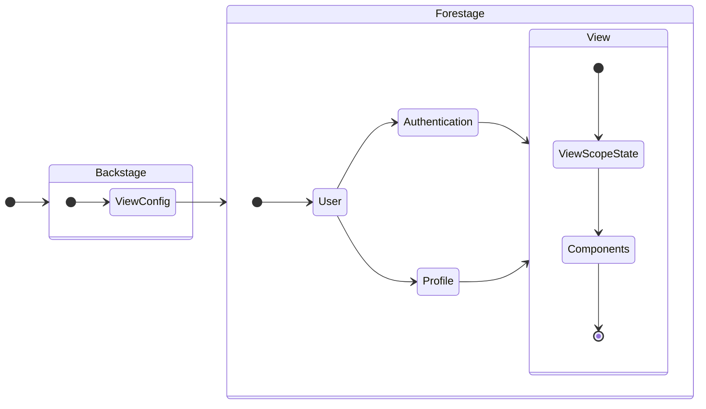

# Forestage

使用者登入後使用，流程大致為：



## Compatibility

無論是 Controller 或 Component，都會在更新時面臨一個問題：如何處理已在 View 上的邏輯與展示。將問題抽取出來，會造成在 View 上讀寫出錯的原因是因為輸入輸出不合預期 ( 通常發生在前後端更新不一致的情況，或者 UI 與 Input 對不上 )，那麼前端若要保證 Controller 與 Component 間的關係，應在最終的 Component 層做捕捉，以達到 Controller 與 Component 不合時，能直接反應在 UI 上、禁止使用，或者顯示統一的錯誤：

```tsx
import React from 'react';
import { ErrorBoundary } from 'react-error-boundary';
import FallbackComponent from '@component/FallbackComponent';

interface IComponent extends React.Component {}

class Component implements IComponent {
  render() {
    return (
      <ErrorBoundary
        onError={(error) => {
          // 處理 Controller Component 或 UI Component 拋出的錯誤，如 Toast
        }}
        FallbackComponent={FallbackComponent}
      ></ErrorBoundary>
    );
  }
}
```

:::info 提醒
Controller 的 Read 與 Write 仰賴 `IUser.listOfPermission[any].listOfAllowedController` 的識別，那麼當沒有對應權限時應如何處理？所有 Controller 給予 Component 的反應應一致，這樣 Component 可以做統一 UI 展現。
:::

:::info 提醒
每個 Component 都應有兩種表現：Backstage 編輯用以及 Forestage 使用用。
:::
