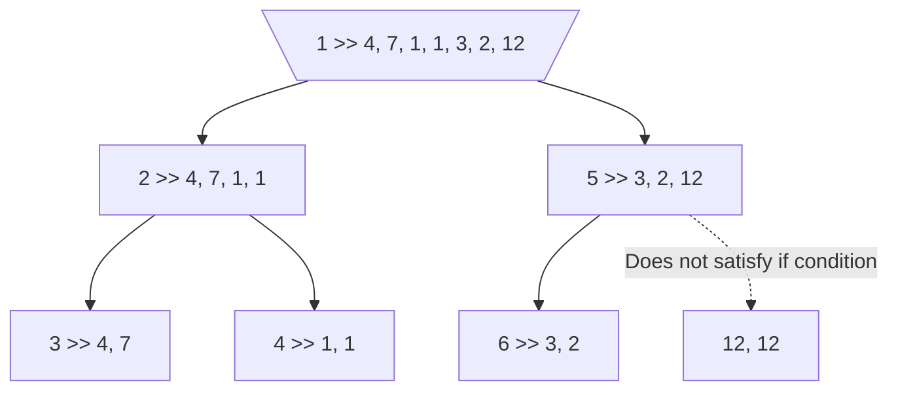
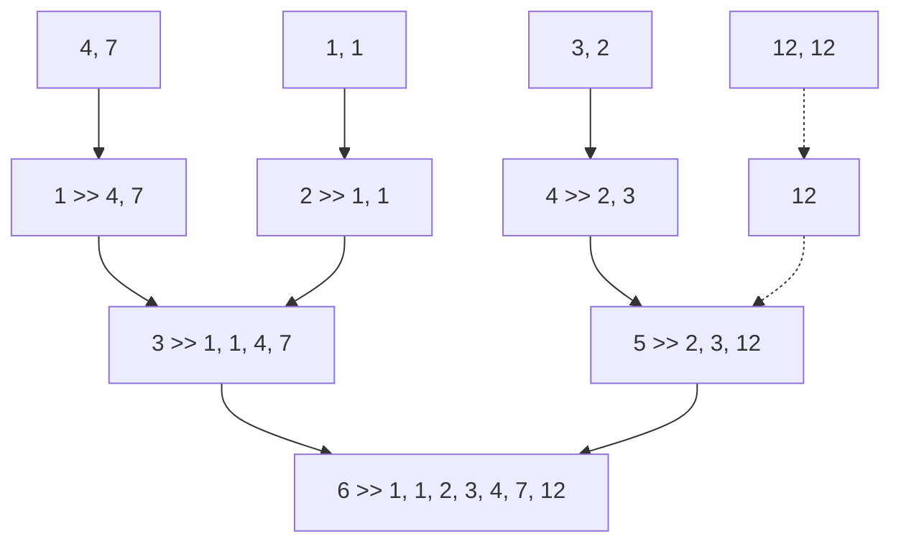

# Merge Sort

為 Divide and Conquer 的 Out of Place Recursion Algorithm。核心是將元素對半切分、直到 $\leq 2$，再兩兩成組合併排序。會 **直接** 更改輸入的陣列：

- **Worst Case Time Complexity**: $\mathcal{O}(n \times \log n)$
- **Best Case Time Complexity**: $\Omega(n \times \log n)$
- **Average Time Complexity**: $\Theta(n \times \log n)$
- **Space Complexity**: $\Theta(n)$

之所以 Time Complexity 為 $\Theta(n \times \log n)$，是因為每次的 Recursion 都會以 **indexOfMiddle** 為界、分為前後。而每次的合併都需要花費 $\Theta(n)$，這是因為每次都會分出 $m$ 個片段、每個片段為 $\frac{n}{2^m}$ 個：

```cpp
#include <iostream>

using namespace std;

void merge(int listOfInteger[], int indexOfStart, int indexOfMiddle, int indexOfEnd);
void mergeSort(int listOfInteger[], int indexOfStart, int indexOfEnd);

int main()
{
    const int sizeOfList = 7;
    int listOfInteger[sizeOfList] = {4, 7, 1, 1, 3, 2, 12};
    mergeSort(listOfInteger, 0, sizeOfList - 1);
    for (int i = 0; i < sizeOfList; i++)
    {
        cout << listOfInteger[i] << " ";
    }
    cout << endl;
    return 0;
}

void merge(int listOfInteger[], int indexOfStart, int indexOfMiddle, int indexOfEnd)
{
    int sizeOfList = indexOfEnd - indexOfStart + 1;
    int *listOfMerged = new int[sizeOfList];

    int indexOfFront = indexOfStart;
    int indexOfBack = indexOfMiddle + 1;
    int indexOfMerged = 0;

    while (indexOfFront <= indexOfMiddle && indexOfBack <= indexOfEnd)
    {
        if (listOfInteger[indexOfFront] < listOfInteger[indexOfBack])
        {
            listOfMerged[indexOfMerged] = listOfInteger[indexOfFront];
            indexOfFront++;
            indexOfMerged++;
        }
        /** Front 與 Back 值相等時，以 Back 為主 */
        else
        {
            listOfMerged[indexOfMerged] = listOfInteger[indexOfBack];
            indexOfBack++;
            indexOfMerged++;
        }
    }

    /**
     * 如有像 Front 為 5, 5, 6 而 Back 為 5, 5, 5 的情況，
     * 因為 indexOfFront 不可超過 indexOfMiddle 且 indexOfBack 不可超過 indexOfEnd，
     * Front 不會完全輸入到 listOfMerged 內，反之亦然。
     * 所以需要用以下 while loop 直接放入。
     * 注意只有一個會執行，因為只有 Front 或 Back 其中之一執行完的情況下，
     * 前面的第一個 while loop 才為完成
     */
    while (indexOfFront <= indexOfMiddle)
    {
        listOfMerged[indexOfMerged] = listOfInteger[indexOfFront];
        indexOfFront++;
        indexOfMerged++;
    }

    while (indexOfBack <= indexOfEnd)
    {
        listOfMerged[indexOfMerged] = listOfInteger[indexOfBack];
        indexOfBack++;
        indexOfMerged++;
    }

    /** listOfInteger 由 indexOfStart 開始，因此額外設 indexOfOrigin */
    for (int index = 0, indexOfOrigin = indexOfStart;
         index < sizeOfList;
         index++, indexOfOrigin++)
        listOfInteger[indexOfOrigin] = listOfMerged[index];

}

void mergeSort(int listOfInteger[], int indexOfStart, int indexOfEnd)
{
    if (indexOfStart == indexOfEnd)
        return;
    /** 也可以用 if (indexOfStart < indexOfEnd) */
    else
    {
        int indexOfMiddle = (indexOfStart + indexOfEnd) / 2;
        mergeSort(listOfInteger, indexOfStart, indexOfMiddle);
        mergeSort(listOfInteger, indexOfMiddle + 1, indexOfEnd);
        merge(listOfInteger, indexOfStart, indexOfMiddle, indexOfEnd);
    }
}
```

## 解釋

接著片段解析，以 `4, 7, 1, 1, 3, 2, 12` 作為範例：

```cpp
int main()
{
    const int sizeOfList = 7;
    int listOfInteger[sizeOfList] = {4, 7, 1, 1, 3, 2, 12};
    mergeSort(listOfInteger, 0, sizeOfList - 1);
    for (int i = 0; i < sizeOfList; i++)
    {
        cout << listOfInteger[i] << " ";
    }
    cout << endl;
    return 0;
}
```

### Recursion

將示範用 Array 帶入 `mergeSort` 中：

```cpp
void mergeSort(int listOfInteger[], int indexOfStart, int indexOfEnd)
{
    if (indexOfStart == indexOfEnd)
        return;
    else
    {
        int indexOfMiddle = (indexOfStart + indexOfEnd) / 2;
        mergeSort(listOfInteger, indexOfStart, indexOfMiddle);
        mergeSort(listOfInteger, indexOfMiddle + 1, indexOfEnd);
        merge(listOfInteger, indexOfStart, indexOfMiddle, indexOfEnd);
    }
}
```

可以注意到，這個 Recursion 每次會以 **indexOfMiddle** 為界、分為前後。Base Case 為 indexOfStart 小於 indexOfEnd、也就是 Array Length 至少為 2 時。每次分出的片段都是上一次的 $\frac{1}{2}$：



### Merge

在分出的所有片段都只有 2 個值時到達 Base Case，會開始往前回溯，在每個節點執行一次 **merge**：



可以看見，**merge** 時會創建一 listOfMerged，來暫存排序好的值，這是為什麼 mergeSort 會是 Out of Place 的原因：

```cpp
int sizeOfList = indexOfEnd - indexOfStart + 1;
int *listOfMerged = new int[sizeOfList];
```

而接著，會將輸入的 indexStart 與 indexOfMiddle 作為 Front 和 Back 兩個片段的開始。以步驟 6 為例，輸入的 Parameter 依序是 `Array, 0, 3, 6`，因此 Front 就是 Array 的 index 0-3，而 Back 就是 Array 的 index 4-6：

```cpp
int indexOfFront = indexOfStart;
int indexOfBack = indexOfMiddle + 1;
int indexOfMerged = 0;
```

前述 Front 與 Back 並未實際建立、而是使用傳入的 Array。這邊使用 indexOfFront 和 indexOfBack 取出對應的值、兩相比較後，依序值高者排入 listOfMerged：

```cpp
while (indexOfFront <= indexOfMiddle && indexOfBack <= indexOfEnd)
{
    if (listOfInteger[indexOfFront] < listOfInteger[indexOfBack])
    {
        listOfMerged[indexOfMerged] = listOfInteger[indexOfFront];
        indexOfFront++;
        indexOfMerged++;
    }
    else
    {
        listOfMerged[indexOfMerged] = listOfInteger[indexOfBack];
        indexOfBack++;
        indexOfMerged++;
    }
}
```

如有像 Front 為 `5, 5, 6` 而 Back 為 `5, 5, 5` 的情況，因為 indexOfFront 不可超過 indexOfMiddle 且 indexOfBack 不可超過 indexOfEnd，Front 不會完全輸入到 listOfMerged 內，反之亦然。所以需要用以下 while loop 直接放入。注意只有一個會執行，因為只有 Front 或 Back 其中之一執行完的情況下，前面的第一個 while loop 才為完成：

```cpp
while (indexOfFront <= indexOfMiddle)
{
    listOfMerged[indexOfMerged] = listOfInteger[indexOfFront];
    indexOfFront++;
    indexOfMerged++;
}

while (indexOfBack <= indexOfEnd)
{
    listOfMerged[indexOfMerged] = listOfInteger[indexOfBack];
    indexOfBack++;
    indexOfMerged++;
}
```

最後將排序好的 listOfMerged 作為參考、改變 listOfInteger 內對應的值 (兩者長度相等)。注意 listOfInteger 由 indexOfStart 開始，因此額外設 indexOfOrigin：

```cpp
for (int index = 0, indexOfOrigin = indexOfStart;
    index < sizeOfList;
    index++, indexOfOrigin++)
    listOfInteger[indexOfOrigin] = listOfMerged[index];
```
