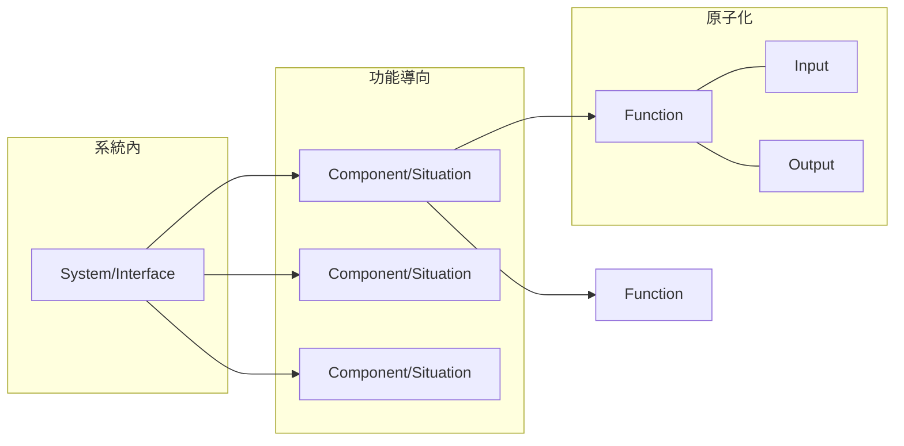
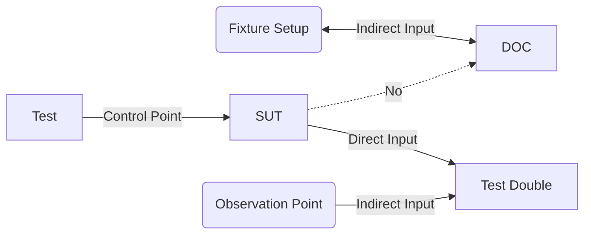

# Outline

Unit Test 是一種原子化的測試。把系統或介面拆解出元件與情境，再拆出一個一個可獨立於 UI 之外的 function，相當於把系統或介面原子化。最小的測試單位是一個 Function：

- **系統內**: 不動用到 SUT 外的資源 (網路、資料庫、其他 DOC 等)
- **功能導向**: 不具備故事性、無耦合 (隔離相依性)
- **原子化**: 一個測試案例，應只針對一個單元，因此輕巧快速、錯誤容易發現，且在任何環境的輸出結果皆一致

## Unit

而以 Unit 為單位，我們在 Test 中以 Control Point (通常是 GUI 操作) 控制 SUT，接著用 Test Fixture/Test Context 替代 DOC，再來藉由 SUT 與 Test Double 間的互動作觀察 Indirect Input：

