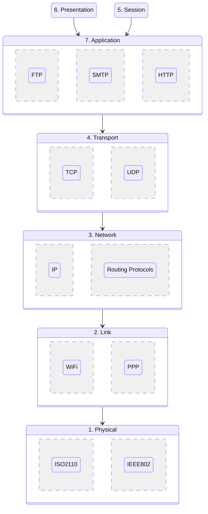

# Outline

Internet 的 5 Layers 的 **Internet Protocol Suite**，又稱 **TCP/IP**，是將 OSI 7 Layers 對應產生的。為什麼 OSI 的 Presentation 和 Session 都合併在 TCP/IP 的 Application 中，是因為現在的硬體條件 (CPU、Main Memory) 升級，已經不再需要切分。

:::info 提醒
Presentation 原指 Encryption、Compression 等，而 Session 原指 Synchronization、Checkpoint 等。
:::

之所以分層，是因爲 Network (Internet) 是一個複雜的設計，而分層級後、當有更動，只需要該層級的參與者變更即可。如 Transport 層需要更改協議，不會影響到 Physical 的線路是如何連結的。但雖然他們之間互相獨立，卻有上到下的依賴關係，Application 層不可獨立於 Transport 層運作，而 Link 層不可能在沒有 Physical 層線路下的情況傳輸：

:::info 提醒
關於 OSI 7 層與 TCP/IP 4 層的對應關係、TCP 3 次握手、以及 Socket 等等，見 [一篇文章明白 TCP/IP、TCP、IP、UDP、Socket 之間的關係](https://blog.csdn.net/freekiteyu/article/details/72236734)。
:::
