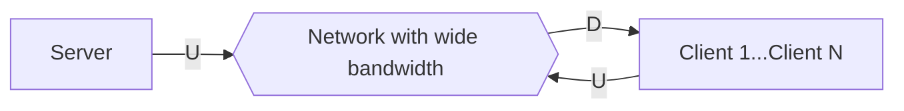
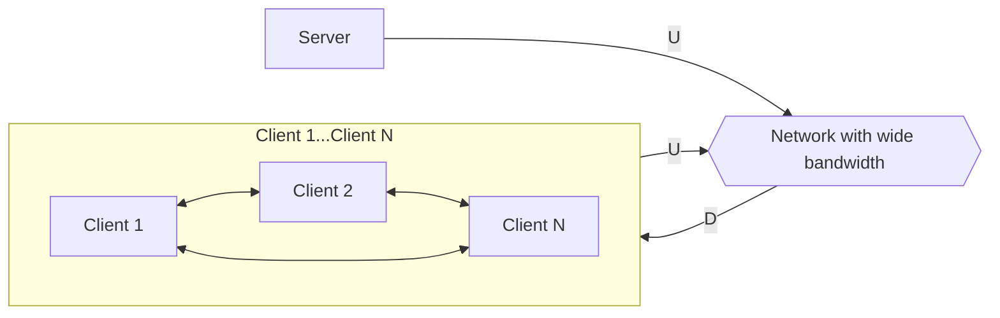
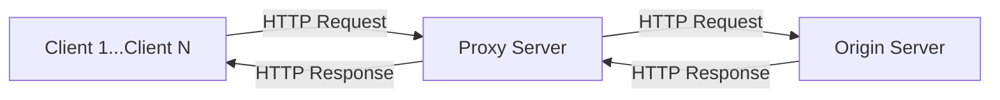
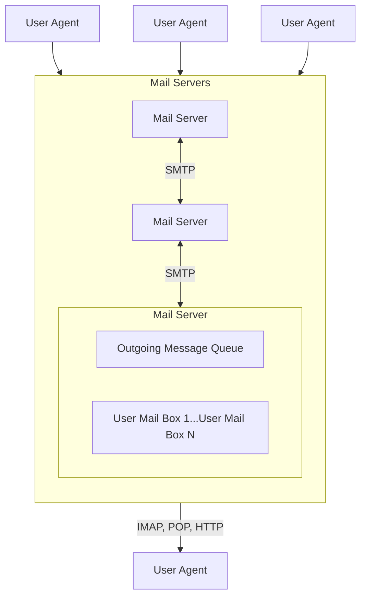
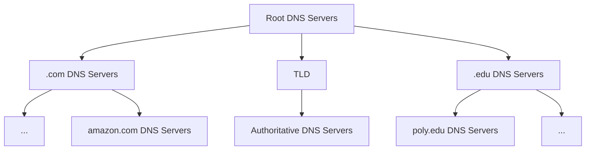
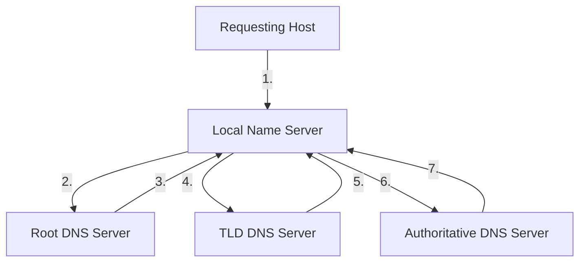
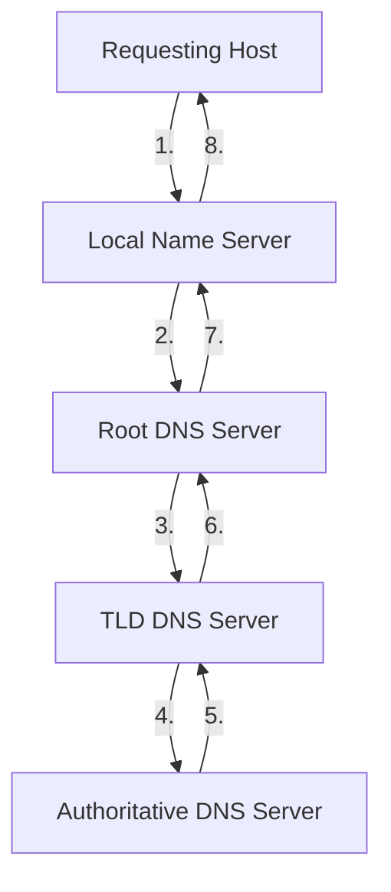

# Application

在 Internet 中，主要分為兩種 Architecture，Client-Server 與 P2P，Peer-Peer。

## Client-Server

即一般的 Web Application，有以下特徵：

- Client 間歇性 (Intermittently) 連上 Server，並且相互間不溝通
- Server 有固定 IP，而 Client 不必有
- Server 總是 on-host，且單一 Host 上可以有不同 Process 執行 (在不同 Port，單一 Host 間的 Process 溝通由 OS 定義)
- 不同 Host 的溝通由 Message Exchanging 完成
- 連結總是由 Client 發給 Server

## Peer-Peer

如 File Sharing、Movie Sharing、Streaming、VoIP (Skype) 等，有以下特徵：

- End System 直接來回間歇溝通
- 具有 Self-Capacity，New peer brings new service capacity, as well as service demand
- End System 上同時具有 Client Process 與 Server Process

:::info 提醒
BitTorrent (BT) 是一個 Peer-Peer 的使用範例。使用者加入 Torrent 後，當想下載時，會先從 Tracker 拿到 List (Chunk of data for a file)，接著就與 Subset Peer (Neighbor) 開始 Send/Receive Data。當使用者完成後，可以選擇繼續留在 Torrent 中繼續分享，或是直接離開。
:::

### DHT

Distributed Hash Table，儲存對應的 Key-Value 的 Database，Peer-Peer 用此來對應資源所在，格式如 `key: movie title, value: IP address`。Peer 可以 Insert Key-Value，並用 Key 去 Query 值 (資源)。可想而知，所有 Peer 的 IP 都會予他人知曉。

## Distribution Time

在 **Client-Server Architecture** 中，假設 $D_{c - s}$ 為 Client-Server Distribution Time，$F$ 為欲傳輸的檔案大小，$D_{min}$ 為最快下載速率，$U$ 為上傳速率，$N$ 為 Client 數量：

可以得出以下：

$$
D_{c - s} > \max\{\textbf{N} \times F/U, F/D_{min}\}
$$

但若是在 **Peer-Peer Architecture**：

可以看見，由於 Client 間也可以互相傳輸，我們得出以下：

$$
D_{p - p} > \max\{F/U, F/D_{min}, \textbf{N} \times F/(U + \Sigma U)\}
$$

注意到 $\textbf{N}$ 與 $\Sigma U$，這兩者代表、即使 Peer-Peer 與 Client-Server 一樣，需要的總時間呈 Linear 上升 ($N$)，但因為整體 Capacity 也隨著 $N$ 增加 ($\Sigma U$)，反而使整體 Distribution Time 減少：

> 圖片來源：[NYU CS Bridge](https://engineering.nyu.edu/academics/programs/nyu-tandon-bridge)

## Protocol

Application Layer 有自己的 Protocol，主要用於訊息間的交換，如 Request、Response，以及訊息各個欄位的存在、意義，和何時與如何做 Request 與 Response。Open Protocol 被記錄在 RFC 中，有：

- [HTTP](/docs/6@computer/10@layer/2@application#http): Hyper Text Transport Protocol
- [SMTP](/docs/6@computer/10@layer/2@application#smtp): Simple Mail Transport Protocol
- **IMAP**: Internet Mail Access Protocol

也有如 Skype 一般自行定義 (Proprietary)、專給 Skype 關聯的應用使用的 Protocol。

## HTTP

Hyper Text Transport Protocol。**Stateless**，通常使用 Port `80` (HTTPS 為 `403`)。接收 Request 端 (Server) 不會有過去的 Request 資訊。HTTP 仰賴 TCP，關於 TCP Connection 的建立，參考 [/Computer/Layer/Transport#Handshake](/docs/6@computer/10@layer/3@transport#handshake)。HTTP 分為：

- [Non-Persistent](/docs/6@computer/10@layer/2@application#non-persistent): 完成傳送後即斷開，一次性
- [Persistent](/docs/6@computer/10@layer/2@application#persistent): 可以在單一連結內傳送複數物件

:::caution 注意
此二者差異並不影響 Transport 層 TCP 建立、關閉的 Handshake。
:::

### Non-Persistent

假設要請求 `www.somewhere.com/index.html` 的資源，有文字與圖片：

> 圖片來源：[NYU CS Bridge](https://engineering.nyu.edu/academics/programs/nyu-tandon-bridge)

可以看到，對 Non-Persistent HTTP 而言 1 次 Request 是 2 次在 Client 到 Server 端之間來回的 (**RTT**，Round-Trip Time 為一次由 Client 端到 Server 端、再回到 Client 端的時間) 加上 Server 端處理 Request Message (Time to transmit file) 的時間：

> 圖片來源：[NYU CS Bridge](https://engineering.nyu.edu/academics/programs/nyu-tandon-bridge)

### Persistent

與 Non-Persistent 相對而言，Persistent 在建立後主動結束連結前 TCP Connection 都不會關閉，因此除了建立、關閉的 1 RTT 外，每次 Request 都只需要 1 RTT。然而，瀏覽器是有數量限制的支援 Parallel Connection、Server 端連結數也有上限，因此得視情況使用。

### Proxy Server

又稱 Web Cache，主要目的是讓 Client Request 不用涉及到 Origin Server。當 Client 的 Request 來到 Proxy Server，會先比對記憶體中是否有符合的 Cache，若無，會以 Proxy Server 的識別向 Origin Server 發送 Request，回傳給 Client 並暫存在記憶體中。Proxy Server 最主要可以：

- 透過 Cache 減少 Response Time 與 Traffic
- 以 Proxy Server 的身份作為 Client 的代理、隱蔽資訊

## FTP

File Transfer Protocol，RFC 959，通常使用 Port `21`，用於 Transfer file to/from remote host。採 Client-Server 架構，Client 端為發起 Transfer (To/From) 者，而 Server 端為 Remote Host。

## Electronic Mail

指 SMTP、IMAP、POP。主要由 3 個部分組成：

- **User Agent**: 如 Outlook
- **Server**: Contain incoming messages for users, and a message queue of outgoing (To be sent) mails
- **Connection Protocol**: SMTP, IMAP, POP, HTTP

### SMTP

SMTP，Simple Mail Transport Protocol，RFC 2821，通常使用 Port `25`，仰賴 TCP，主要處理：

- Transfer Mails from Client to Server
- Transfer Mails from Sending-Server to Receiving-Server
- 用於 Deliver/Storage 於 Receiver Server (但不直接到 Receiver Client)

Transfer 有 3 個階段：

1. Handshaking (Greeting)
2. Transfer of message
3. Closure

### Mail Access Protocol

對於用 User Agent 從 Mail Server 拿取 Mail，有以下：

- **POP**: Post Office Protocol，RFC 1939。常用於 Authorization、Download
- **IMAP**: Internet Mail Access Protocol，RFC 1730。比起 POP 有更多的功能，如創建資料夾等
- **HTTP**: Gmail, HotMail, Yahoo!Mail 等都使用 HTTP 進行 Mail Retrieval

將 POP 與 IMAP 進一步比較：

| Protocol | Policy                                            | Stateless (Across sessions)             |
| -------- | ------------------------------------------------- | --------------------------------------- |
| POP      | Download and Delete (To release space for server) | Y                                       |
| POP3     | Download and Keep                                 | Y                                       |
| IMAP     | Keep all message in server                        | N (Example: Naming and mapping folders) |

## DNS

Domain Name System，目的在於將 Host 的唯一識別用的 IP 轉為可閱讀的 Domain Name (如 yahoo.com.tw)。Distributed database implemented in hierarchy of many Name Servers。屬於 Internet Core Function (因此以 Application Layer Protocol 顯得更為特殊，等同將 Internet Complicity Move to Network's Edge)。主要服務有：

- Hostname to IP address translation
- Host aliasing (Canonical, alias names)
- Mail server aliasing
- Load distribution (Replicated Web Servers: Many IP address correspond to one hostname)

:::info 提醒
不使用 Centralized DNS 是為了避免以下：

- Single point of failure
- Traffic volume
- Distant centralized database
- Maintenance
- Doesn't scale

:::

DNS 由以下組成：

- **TLD**: Top-Level Domain Servers，如 `com`, `org`, `net`，以及 Country Domain 如 `uk`, `jp`
- **Authoritative DNS Servers**: 組織自行維護、內部的 Hostname-IP Mapping。維護者也可能是 Service Provider 如 GoDaddy
- **Local DNS Server**: 每個 ISP 都有一個，也被稱為 **Default Name Server**，When host makes DNS query, query is sent to its local DNS server

:::info 提醒
Name Server (任意) 與 Proxy Server 運作雷同，會在 Server 上 Cache Mapping，以及轉發 Query。例如，由於 TLD 的 Mapping 會存在 Local Name Server，因此 Root Name Server 事實上並不常被訪問。DNS Cache 會根據 **TTL**，Time To Live 來消失，若 Name Host 改變 IP，那麼需要等候 TTL 過期才可更新。Update/Notify Mechanism 有 IETF 標準，RFC 2136。
:::

### Distributed Hierarchy Database

採用分散式系統，DNS 事實上是：

假設 Client 想要得到 www.amazon.com 的 IP address，那麼他會需要：

1. Query Root DNS Servers
2. Query .com DNS Servers
3. Query amazon.com DNS Servers, get the IP for www.amazon.com

世界上有 13 個 Root Name Server，並且：

- Connected by a local name server that can't resolve name
- Root Name Server contacts **Authoritative Name Servers** if name mapping is not known. It gets mapping, then returns it to local name server

### DNS Name Resolution

有不同取得 Domain Name Mapping 的方式：

#### Iterated Query

#### Recursive Query

### DNS Record

Distributed Database Storing Resource Records (RR)。RR 的 Format 為 Name, Value, Type, TTL (照順序)：

| Type  | Name                                                               | Value                                                 |
| ----- | ------------------------------------------------------------------ | ----------------------------------------------------- |
| A     | Hostname (如 www)                                                  | IP address                                            |
| NS    | Domain (如 foo.com)                                                | Hostname of authoritative name server for this domain |
| CNAME | Alias name for some canonical (The real) name, such as www.ibm.com | Canonical name                                        |
| MX    | Mail server                                                        | Name of mail server associated with **Name**          |

### Inserting Record Into DNS

舉例而言，新建了一間新創，名為 `Utopia`，而我們想要將相關 Record 加入到 DNS 中：

1. Register name `utopia.com` at DNS register (.com 假設是 Network Solution Company，也可以是 .org 等)
2. Provide names, IP addresses of authoritative name server (Primary and secondary)
3. Registrar inserts 2 RR into .com TLD server, `utopia.com, dns1.utopia.com, NS` and `dns1.utopia.com, 212.212.212.1, A`
4. Create authoritative server type `A` record for `www.utopia.com`, and type MX record for `utopia.com`

### Attacking DNS

有幾種 DNS 被攻擊的方法：

- [DDoS](/docs/6@computer/8@internet#ddos-attack): 針對 Root Name Server 和 TLD Server。由於 Local Name Server 會 Cache TLD IP，因此 Root Name Server 通常仍可以通過。今日而言，效果並不明顯
- **Redirect**: Main-in-Middle (Intercept queries) 或 DNS Poisoning，將 Bogus relies 送到 DNS Server 並使其被 Cache

:::info 提醒
DDoS 是可以借助 DNS 實現的，即透過 Spoofed IP 來發送 Request，但需要 Amplification。
:::
