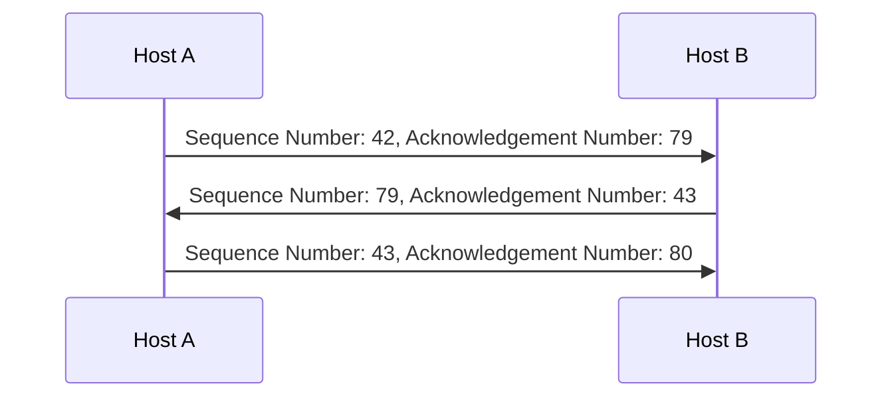

# Transport

Logical communication between application processes running on different hosts, formatting transmission flow。首先，當 Transport Layer 要從 Multiple Socket 送出資料時，Sender 會為每個 Data 增加 Transport Header (**Multiplexing**)，而 Receiver 則在收到後、用這些 Header Information 將 Data 傳入正確的 Socket (**De-Multiplexing**)。

Segment (IP Datagram) 由以下組成：

```cli
| -------------------------------------------------------- |
| Header                                                   |
| Source Socket | Destination Socket | Other Header Fields |
| -------------------------------------------------------- |
| Payload                                                  |
| -------------------------------------------------------- |
```

:::info 提醒
Socket 指的是對外的接口，由 IP Address 和 Port 組成。而 Transport 層中各種實現 Connection 的方法則稱為 Socket API。
:::

有些服務需要 Low-Delay 來讓該服務有效，如網路電話，也有些服務需要維持一定量的 Throughput，如多媒體。常見的有：

| Application      | Data Loss   | Throughput     | Time Sensitive   |
| ---------------- | ----------- | -------------- | ---------------- |
| File Transfer    | Not allowed | Elastic        | No               |
| Web Document     | Not allowed | Elastic        | No               |
| Email            | Not allowed | Elastic        | No               |
| Audio            | Allowed     | 5kbps - 1Mbps  | Yes, 100msec     |
| Video            | Allowed     | 10kbps - 5Mbps | Yes, 100msec     |
| Interactive Game | Allowed     | Few kbps up    | Yes, few seconds |
| Text Messaging   | Not allowed | Elastic        | Yes, 100msec     |

## Protocol

常見的協議有：

- [TCP](/docs/6@computer/10@layer/3@transport#tcp): Transmission Control Protocol，Connection oriented
- **UDP**: User Datagram Protocol，Connection less deals with the ordering and guarantee of delivery of packets

| Field       | TCP                                      | UDP                                      |
| ----------- | ---------------------------------------- | ---------------------------------------- |
| 可靠性      | 可靠                                     | 不可靠                                   |
| 速度        | 慢                                       | 快                                       |
| 傳輸方式    | 封包按順序傳輸                           | 封包以串流方式傳輸                       |
| 檢查修正    | 有                                       | 無                                       |
| 壅塞控制    | 有                                       | 無                                       |
| 確認        | 有                                       | 只有檢查碼                               |
| Handshaking | Y                                        | N                                        |
| 適用服務    | 要求可靠，如電子郵件、網頁瀏覽、檔案傳輸 | 要求即時，如串流媒體、網路電話、網路遊戲 |

:::info 提醒
若要在同樣的條件下以相同速度傳送，UDP 只要求 40% 的 Bandwidth 即可達到。
:::

而不同的服務，也要求不同的 Protocol：

| Application            | Application Layer Protocol    | Transport Layer Protocol |
| ---------------------- | ----------------------------- | ------------------------ |
| Email                  | SMTP, RFC 2821                | TCP                      |
| Remote Terminal Access | Telnet, RFC 854               | TCP                      |
| Web                    | HTTP, RFC 2616                | TCP                      |
| File Transfer          | FTP, RFC 959                  | TCP                      |
| Streaming Multimedia   | HTTP, RFC 2616. RTP, RFC 1889 | TCP or UDP               |
| Internet Telephony     | SIP. RTP. Proprietary         | TCP or UDP               |

## RDT

Reliable Data Transfer Protocol。會需要建立 RDT 的原因之一，正是因為 Transport 的下一層 Network 並不能提供 Reliable Channel，因此藉由確保 Sender/Receiver 的 Transport Protocol 來保證資料正確。RDT 已經過多次更新：

#### 1.0

假設 Network 能提供 Reliable Channel，因此只需要傳送與接收即可。現實不成立。

#### 2.0

RDT 建立的連結，在收到 Packet 後會：

- **ACK**: Acknowledgement，Receiver 告訴 Sender 收到的 Packet 正確
- **NAK**: Negative Acknowledgement，Receiver 告訴 Sender 收到的 Packet 有誤。Sender 在收到 NAK 後，會重新傳送

#### 2.1

若 ACK/NAK 本身就是有誤的，可以想像，可能會發生 Sender 重新傳送的 Packet 是重複的情況。因此，Sender 會加上 Sequence Number (僅 0 與 1，且 Sender/Receiver 會記憶是否此次應為 0 或 1) 給 Packet，Receiver 據此檢查並丟棄重複的 Packet，在這當中採用 **Send and Wait**，也就是每當 Sender 送出 1 Packet，直到 Receiver 回應收到前、不會送出第二個。在這過程中，Receiver 仍**不會** 知道 Sender 是否正確收到了 Receiver 回傳的 ACK/NAK。

#### 2.2

與 2.1 不同的是，Receiver 只在收到最後一個 Packet 時回傳 ACK，棄用 NAK。在這規範下，Sender 給 Packet 的 Sequence Number 必須清楚 (1...N，而非僅僅 0 與 1)，以讓 ACK 能達到 NAK 的作用。舉例而言，當 Receiver 收到 2、但收到 3 失敗時，會再回傳一次 ACK 2，Sender 在收到重複的 2 的情況，即知道 3 失敗、會再重新傳送。

#### 3.0

除了收到的 Packet 有誤的情況，還有可能 Packet/ACK 會遺失、或者 ACK Delay。因此，Sender 會等待一段合理的時間，若沒有在時間內收到 ACK、則自動重傳。即使重複，Sequence Number 也能用來判別。

### Pipelined Protocol

然而 Send and Wait 會促使傳輸效能不佳，因為總是必須等待一個 Packet 傳輸完成、才能傳下一個：


> 圖片來源：Computer Networks: A Top Down Approach

Pipelined Protocol 是指 Packet Transmission 和 ACK 都是一連串的動作、不再等待再執行下一個動作：


> 圖片來源：Computer Networks: A Top Down Approach

在 RDT 3.0 中，Utilization 為：

$$
\frac{L/R}{RTT + L/R}
$$

然而，若以 Pipelined Protocol 的示範圖來看，可以注意到 中，Utilization 足足增長了 3 倍：

$$
\frac{\textbf{3} \times L/R}{RTT + L/R}
$$

Pipelined Protocol 有：

| Go Back N (GBN)                                                                                     | Selective Repeat                                                                                        |
| --------------------------------------------------------------------------------------------------- | ------------------------------------------------------------------------------------------------------- |
| Sender can have up to N unACKed packets in pipeline                                                 | Sender can have up to N unACKed packets in pipeline                                                     |
| Receiver only sends **cumulative** ACK (Doesn't ACK packet if there's gap)                          | Receiver sends **individual** ACK for each packet                                                       |
| Sender has timer for the oldest unACKed packet (When timer expires, retransmit all unACKed packets) | Sender maintain timer for each unACKed packet (When timer expires, retransmit only that unACKed packet) |

## TCP

TCP 屬於 RDT，可以注意到在傳輸的 Segment 中有 RDT 特性所需的資訊：

```cli
| -------------------------------------------------------------|
| Header                                                       |
| Source Socket   |  Destination Socket  | Other Header Fields |
| Sequence Number (Counting by Bit rather than Segment)        |
| Acknowledgement Number (Counting by Bit rather than Segment) |
| Head Length     |      Not Used      | U | A | P | R | S | F |
| Receive Window  | Checksum  |  Urg Data Pointer  |  Options  |
| ------------------------------------------------------------ |
| Payload                                                      |
| ------------------------------------------------------------ |
```

特別注意 Sequence Number 與 Acknowledgement Number。他們事實上並非以 Segment 為單位、而是以 Bit，並且相互之間有依賴關係：



在 [RDT 3.0](/docs/6@computer/10@layer/3@transport#30) 中提到，Sender 會等待一段合理的時間、在沒有收到 ACK 時會重新發送，那麼如何判別何謂合理的時間？主要依據是 RTT，若比 RTT 短，會每次都 Timeout、造成不必要的重傳，而若是過長，會對 Data Loss 的反應過慢。可以得出，合理 Timeout 時限為：

$$
(1 - \alpha) \times EstimatedRTT + \alpha \times SampleRTT
$$

$\alpha$ 通常為 `0.125`。

:::info 提醒
當 Sender 收到 **3** 個一樣的 Acknowledge Number 時，表示該 Data 很有可能遺失，在此時，Sender 不會等到 Timeout、而是會立即 Retransmit。
:::

而在 TCP 中，ACK 可以分為以下場景：

| Event At Receiver                                                                                                | TCP Receiver Action                                                               |
| ---------------------------------------------------------------------------------------------------------------- | --------------------------------------------------------------------------------- |
| Arrival of in-order segment with expected sequence number. All data up to expected sequence number already ACKed | Delayed ACK. Wait up to 500ms for next segment. If no next segment, send ACK      |
| Arrival of in-order segment with expected sequence number. One other segment has ACK pending                     | Immediately send single cumulative ACK, ACKing both in-order segment              |
| Arrival of out-of-order segment with higher-than-expected sequence number. Gap detected                          | Immediately send duplicated ACK, indicating sequence number of next expected byte |
| Arrival of segment that partially or completely fills gap                                                        | Immediate send ACK, provided that segment starts at lower end of gap              |

### Flow Control

TCP 保證 Sender 的資料不會超過 Receiver 的 Buffer 的方法，是在 Receiver-Sender Segment 中，指名 **rwnd**，Receive Window (比 RcvBuffer，TCP Receive Buffer 小，該值通常由 OS 自動調整)，而 Sender 在傳送時，會限制 Data 不超過 Receive Window。

### Congestion COntrol

主要會發生，是因為在有多個 Sender 對單一 Receiver 時，若其中一個 Sender 不停的送、佔滿所有通道，那麽其他 Sender 會在沒收到的 ACK 的情況下、重新傳送，造成更多 Congestion。另一個問題是，萬一 Packet Dropped，當中所有 Upstream Transmission Capacity 都是浪費的。TCP 使用以下方法控制 Congestion：

#### AIMD

Additive Increase Multiplicative Decrease，使用以下 2 種方法：

- **Additive Increase**: Sender increases transmission rate (Window size), probing for usable bandwidth
- **Multiplicative Decrease**: When loss detected, cut cwnd (Congestion Window, sent data size) in half


> 圖片來源：[程式人生](https://www.796t.com/content/1548818118.html)

#### Slow Start

Initially Congestion Window (**Segment**) = 1, when connection begins, increase rate exponentially until first loss event:


> 圖片來源：[程式人生](https://www.796t.com/content/1548818118.html)

### Handshake

建立和關閉 TCP 連結的動作。

- **SYN**: Synchronize Sequence Numbers。如果有設置，才發出連線請求，用來同步序列號
- **SEQ**: Segment Number
- **ACK**: Acknowledgment Number。如果有設置，使確認號欄位有效

:::info 提醒
通常會透過 Socket 完成，如 Socket.io 等。
:::

#### Three Way Handshake

建立 TCP 連結的動作：


> 圖片來源：[NYU CS Bridge](https://engineering.nyu.edu/academics/programs/nyu-tandon-bridge)

#### Four Way Handshake

關閉 TCP 連結的動作：


> 圖片來源：[NYU CS Bridge](https://engineering.nyu.edu/academics/programs/nyu-tandon-bridge)
