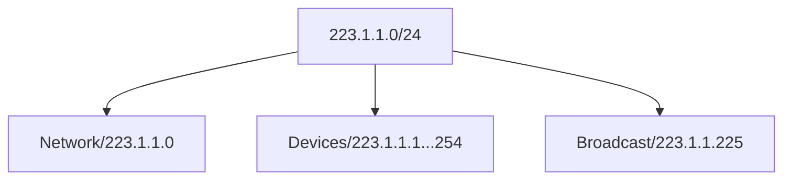
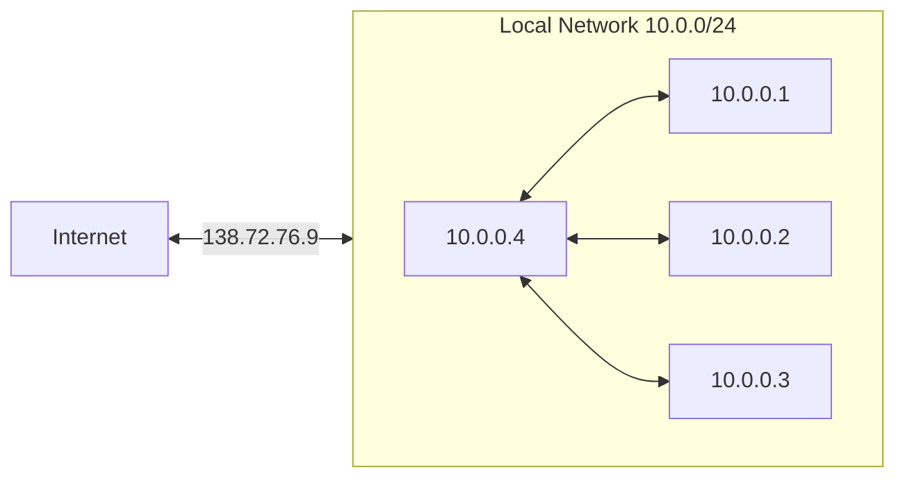

# Network

主要與 Packet 的 Routing、Switching 相關。要注意，與 Transport Layer、Application Layer 不同，Network Layer 存在每個 Device、Router、Switch 中 (與此同時，Transport Layer 與 Application Layer 通常只存在 Host)。Network 主要負責：

- **Routing**: Determine route taken by packets from source to destination
- **Forwarding**: Move packets from router's input to appropriate router output

## Router

Routing 與 Forwarding 皆在 Router 中發生，透過 Routing Algorithm/Protocol，我們得知 Packet 將要在 Network 上通過的 End-End-Path。而在每個 Router 中，使用 **Local Forwarding Table** 來得知下一個 Router 為何：


> 圖片來源：[NYU CS Bridge](https://engineering.nyu.edu/academics/programs/nyu-tandon-bridge)

Local Forwarding Table，又稱 Datagram Forwarding Table。值得注意的是，在 Table 當中並非列出一個個 IP Address，而是指示出一個範圍：


> 圖片來源：[NYU CS Bridge](https://engineering.nyu.edu/academics/programs/nyu-tandon-bridge)

:::info 提醒
關於 **Input Port**，也就是 Packet (Datagram) 進入後的流程與可能發生的問題 (Head-Of-Line Blocking)，可以參考 [Computer/Internet#Packet](/docs/6@computer/8@internet#packet)。另外要注意的是，**Output Port** 也會經歷一樣的流程。
:::

### Interface

每個 Router 都會有複數以上的 Interface，如 223.1.1.4、223.1.2.9 等等。相對而言，Host 可能會有 1 至 2 個，如 Wired Ethernet、Wireless 802.11。Interface 的作用是與 IP Address 相互關聯。

### Switching Fabric

主要將 Packet 由 Input Buffer 傳送到正確的 Output Buffer 中。通常傳送的單位是指一次性能傳送的 Input/Output Line Rate，N Input 即代表 N Lines。共有 3 種 Switching Fabric，目的是為了更多的發揮 Router 的性能、以避免 Head-Of-Line Blocking：


> 圖片來源：[NYU CS Bridge](https://engineering.nyu.edu/academics/programs/nyu-tandon-bridge)

## Service Model

由 Sender 到 Receiver，透過不同的 Service Model 來確保不同的需求，如針對單一 Datagram 的保證送達，或是對整個傳送的順序保證：

| Architecture | Service Model | Band Weight     | Loss | Order | Timing | Congestion Feedback    |
| ------------ | ------------- | --------------- | ---- | ----- | ------ | ---------------------- |
| Internet     | Best Effort   | None            | No   | No    | No     | No (Inferred via loss) |
| ATM          | CBR           | Constant Rate   | Yes  | Yes   | Yes    | No Congestion          |
| ATM          | VBR           | Guaranteed Rate | Yes  | Yes   | Yes    | No Congestion          |

:::info 提醒
**ATM**，即 Asynchronous Transfer Mode，可以參考 [Asynchronous Transfer Mode](https://en.wikipedia.org/wiki/Asynchronous_Transfer_Mode)。
:::

## Connection

如同 TCP/UDP 的概念，Network Layer 中也有 Connection 與 Connection-Less 供不同場合使用。不同的是，只用於 Host-To-Host，並且不能隨意切換 (實作於 Network Core 中，只會是其一)：

- **Datagram Network**: Connection
- **Virtual Circuit Network** Connection-Less

### Diagram

即 Internet：

- Data exchange among computers
- Elastic service. No strict timing requirements
- Many link types
- Smart end systems. Can adapt, perform control, error recovery
- Complicity at edge

### Virtual Circuit

Very expansive to maintain。由 Telephone Circuit 演變而來，作用於 Source-Destination Path 中，且當中的 Packet 會攜帶 VC (Virtual Circuit) Identifier。一但開始，就會有 Bandwidth、Buffers 被 Allocate 到 VC Identifier 中，一但結束，整個 Circuit 即關閉。每個在 Path 中的 Router 都會為了此 Path 維護一個 State。是 Dedicated Service，也被稱為 Predictable Service：

- Strick timing, Reliability requirements
- Need for guaranteed service
- Dumb end systems
- Complicity inside network

## Protocol

如 [Computer/Layer/Transport#Protocol](/docs/6@computer/10@layer/3@transport#protocol) 有針對不同需求的協議，Network Layer 有：

- **Internet**: **IP** stands for Internet Protocol. Address conventions. Datagram/Packet format
- **ICMP**: Error reporting. Router signaling
- **Routing**: Related to Forwarding Table. RIP, OSPF, and BGP

## Internet

常見的有 32 Bits 的 IPV4，以及 128 Bits 的 IPV6。

:::info 提醒
IP Datagram 的傳輸可以參考 [Computer/Internet#Transmission](/docs/6@computer/8@internet#transmission)。
:::

### Subnet

假設有個 `223.1.1.0/24` 的 IP Address，`/24` 表示在 32 Bits (IPV4) 中，我們將前面的 24 Bits 用來作 Network 的識別，而其餘 8 Bits 用來表示有多少台裝置在該裝置中。2 進制中共有 256 個數字，表示 `223.1.1.0/24` 內有最多 256 台裝置。

其中，`223.1.1.0` 指 Network 本身，而 `223.1.1.255` 則是 Broadcast Address，也就是說我們還有 254 ($2^8 - 2$) 個 IP Address 在 `223.1.1.0/24` 內能被分配給不同裝置：



:::info 提醒
一開始，IP Address 是固定每 8 Bits 作為一單位的。也就是 Subnet 的數量由 256 ($2^8$) 開始、下一級就有 65536 ($2^{16}$)，這樣對一般公司的需求都不符合，因此出現了 **CIDR**，Classless Inter Domain Routing，RFC 1918。主旨在於指定 Host IP Address 的長度、從而讓 Subnet 數量能更靈活的擴充，如 `/24` 表示從頭算起、有 24 Bits 被用作 Host IP Address、8 Bits 用作 Subnet。

若是 `135.1.1.0/20`，則表示有 20 Bits 被用作 Host IP Address、12 Bits 用作 Subnet。CIDR 同樣被運用在 IPV6 中，也就是 `135.1.1.0/20` 在 IPV6 中有 108 Bits ($2^{108} - 2$) 可被 Subnet 內個別裝置使用。
:::

Subnet 可以是巢狀：


> 圖片來源：[AVI Networks](https://avinetworks.com/glossary/subnet-mask/)

Subnet 的 IP Address 是由 ISP (參考 [Computer/Internet#ISP](/docs/6@computer/8@internet#isp)) 分配的，而 ISP 又是由 [ICANN](https://www.icann.org/)，International Corporation for Assigned Names and Numbers 中取得 IP Address，具體有：

- Allocates addresses
- Manages DNS
- Assigns domain names, resolves disputes

ISP 利用 **Route Summarization** (Route Aggregation) 減少大量 Route Table 的耗費，與 CIDR 相同，比起傳送以下：

```terminal
ip route-static 192.168.1.0 24 10.1.12.2
ip route-static 192.168.2.0 24 10.1.12.2
...
ip route-static 192.168.255.0 24 10.1.12.2
```

改由以下取代。這樣一來，單一行即可將 192.168.1.0/24 , 192.168.2.0/24...192.168.255.0/24 全都涵蓋在內：

```terminal
ip route-static 192.168.0.0 16 10.1.12.2
```

### DHCP

通常在 OS 中我們可以手動設置 IP Address，但通常現代裝置使用的是 DHCP，Dynamic Host Configuration Protocol，也就是動態的從 Server 端取得 IP Address、無需任何設定。具體而言，每個 Subnet 中都會有個 DHCP Server，像是家中的 Wireless Router，當一個新的裝置加入時，它會透過 Broadcast 來請求一個 IP Address，而 DHCP Server 在收到後會 Unicast 一個檔案到該裝置上。收到後，裝置會自動設置檔案內的資訊如 IP Address。檔案中，還有：

- Address of first-hop router for client's packet to go outside of the subnet that they are part of
- Name and IP Address of DHS server
- Network mask indicating network versus host portion of address

### NAT

首先，有些 IP Address 基於用途，是 Private、不可作為交換用途的：

| Class | Block          |
| ----- | -------------- |
| A     | 10.0.0/8       |
| B     | 172.16.0.0/12  |
| C     | 192.168.0.0/16 |

但因為 IP Address 日益缺乏的關係，基於 RFC 1918，我們使用 **NAT**，Network Address Translation 來將以下 IP Address 透過 Mapping 來同樣用於網路中 (Transform into publicly rotatable address)。可以注意到，由 `10.0.0/24` 進出的 Packet 的 Source/Destination 都被視為 `138.72.76.9`：



使用 NAT 有以下具體益處：

- Just one IP Address for all devices. No need for a range of address from ISP
- Can change local network addresses without notifying outside world (ISP)
- Can change ISP without modifying local network addresses
- Local devices are not visible and addressable by outside world, which is a security plus

NAT 的實際運用：


> 圖片來源：[NYU CS Bridge](https://engineering.nyu.edu/academics/programs/nyu-tandon-bridge)

### Routing

Routing Protocol，又稱 Routing Algorithm，主要用來找出 Source-Destination 間最低成本的路徑。根據不同情境選擇最適當的方法，如在本地建構網路，那麼會選用 Decentralized 和 Static，快速且節省成本，但不利於長期發展。若是跨區域，則會選用 Global 和 Dynamic，雖然昂貴但能適應龐大的架構：

- **Global**: All routers have complete topology and link cost information. **Link State** algorithm
- **Decentralized**: Router knows physically-connected neighbors and link costs to neighbors. Iterative process of computation exchange of info with neighbors. **Distance Vector** algorithm
- **Static**: Routes change slowly over time
- **Dynamic**: Routes periodically update in response to link cost changes

#### Dijkstra's Algorithm

為 **Link State** algorithm，通常用於規模較大的 Network。追蹤當下 Node 到鄰近 Node 間的 Cost，在選擇最低成本同時、釐清整體的最佳路徑。要注意的是，由於一開始時只知道鄰近 Node 的 Cost、也因為 Node 有可能隨機消失與形成，因此與有所有 Cost 資訊後找出的最佳解並不一定一致：


> 圖片來源：[NYU CS Bridge](https://engineering.nyu.edu/academics/programs/nyu-tandon-bridge)

#### Bellman Ford Algorithm

為 **Distance Vector** algorithm，通常用於小規模 Network。與 Dijkstra's Algorithm 的不同之處在於，可以解決有負數的路徑 (Dijkstra's Algorithm 中若出現負數路徑，由於其貪婪選擇最短的特性，會無限繞回)。另外，主要做法是、每次取所有 Node 的 Distance Vector，再從中選擇最低成本的路徑：


> 圖片來源：[NYU CS Bridge](https://engineering.nyu.edu/academics/programs/nyu-tandon-bridge)

Node `x` 獲得對於周遭 Node 的距離後，會用以下公式 B-F Equation 更新自身的 DV，Distance Vector：

$$
D_{x}(y) \impliedby min_{v}\{c(x,y) + D_{v}(y)\} \textrm{for each node} y \in \N
$$

#### Algorithm Comparison

比較 Link State 與 Distance Vector：

|                      | Link State                                                                           | Distance Vector                                                                                           |
| -------------------- | ------------------------------------------------------------------------------------ | --------------------------------------------------------------------------------------------------------- |
| Message Complexity   | With $N$ nodes, $E$ lniks, $\Theta(N \times E)$ messages sent                        | Exchange between neighbors only (Convergence time varies)                                                 |
| Robustness           | Nodes can advertise incorrect **Link Cost**. Each node computes only its own table   | Nodes can advertise incorrect **Path**. Each node's table used by others. Error propagate through network |
| Speed Of Convergence | $\Theta(N \times 2)$ requires $\Theta(N \times E)$ messages. Maybe have oscillations | Convergence time varies. May be routing loops. Count-to-infinity problem                                  |

:::info 提醒
Incorrect Link Cost 可能導致 Packet Delivery Delay，但 Incorrect Path 有可能令 Packet 無法送達。
:::

#### Hierarchy Routing

將 Routers 併在同個區域中，並賦予自治與管理權，稱為 **AS**，Autonomous System，且在同一 AS 中的 Router 使用同一種 Routing Protocol，稱為 Intra-AS Routing Protocol。AS 間有 Link Router 相連結。這是源於不可能有單一 Router 能夠存儲一張涵蓋所有 Routing 的 Table，因此，只在 **需要** 時 Collapse Intra-As Routing Algorithm，平時我們只取該 AS 的 Router、極大增加一次能溝通的量。
