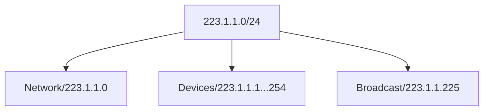

# Network

主要與 Packet 的 Routing、Switching 相關。要注意，與 Transport Layer、Application Layer 不同，Network Layer 存在每個 Device、Router、Switch 中 (與此同時，Transport Layer 與 Application Layer 通常只存在 Host)。Network 主要負責：

- **Routing**: Determine route taken by packets from source to destination
- **Forwarding**: Move packets from router's input to appropriate router output

## Router

Routing 與 Forwarding 皆在 Router 中發生，透過 Routing Algorithm/Protocol，我們得知 Packet 將要在 Network 上通過的 End-End-Path。而在每個 Router 中，使用 **Local Forwarding Table** 來得知下一個 Router 為何：

> 圖片來源：[NYU CS Bridge](https://engineering.nyu.edu/academics/programs/nyu-tandon-bridge)

Local Forwarding Table，又稱 Datagram Forwarding Table。值得注意的是，在 Table 當中並非列出一個個 IP Address，而是指示出一個範圍：

> 圖片來源：[NYU CS Bridge](https://engineering.nyu.edu/academics/programs/nyu-tandon-bridge)

:::info 提醒
關於 **Input Port**，也就是 Packet (Datagram) 進入後的流程與可能發生的問題 (Head-Of-Line Blocking)，可以參考 [Computer/Internet#Packet](/docs/6@computer/8@internet#packet)。另外要注意的是，**Output Port** 也會經歷一樣的流程。
:::

### Interface

每個 Router 都會有複數以上的 Interface，如 223.1.1.4、223.1.2.9 等等。相對而言，Host 可能會有 1 至 2 個，如 Wired Ethernet、Wireless 802.11。Interface 的作用是與 IP Address 相互關聯。

### Switching Fabric

主要將 Packet 由 Input Buffer 傳送到正確的 Output Buffer 中。通常傳送的單位是指一次性能傳送的 Input/Output Line Rate，N Input 即代表 N Lines。共有 3 種 Switching Fabric，目的是為了更多的發揮 Router 的性能、以避免 Head-Of-Line Blocking：

> 圖片來源：[NYU CS Bridge](https://engineering.nyu.edu/academics/programs/nyu-tandon-bridge)

## Service Model

由 Sender 到 Receiver，透過不同的 Service Model 來確保不同的需求，如針對單一 Datagram 的保證送達，或是對整個傳送的順序保證：

| Architecture | Service Model | Band Weight     | Loss | Order | Timing | Congestion Feedback    |
| ------------ | ------------- | --------------- | ---- | ----- | ------ | ---------------------- |
| Internet     | Best Effort   | None            | No   | No    | No     | No (Inferred via loss) |
| ATM          | CBR           | Constant Rate   | Yes  | Yes   | Yes    | No Congestion          |
| ATM          | VBR           | Guaranteed Rate | Yes  | Yes   | Yes    | No Congestion          |

:::info 提醒
**ATM**，即 Asynchronous Transfer Mode，可以參考 [Asynchronous Transfer Mode](https://en.wikipedia.org/wiki/Asynchronous_Transfer_Mode)。
:::

## Connection

如同 TCP/UDP 的概念，Network Layer 中也有 Connection 與 Connection-Less 供不同場合使用。不同的是，只用於 Host-To-Host，並且不能隨意切換 (實作於 Network Core 中，只會是其一)：

- **Datagram Network**: Connection
- **Virtual Circuit Network** Connection-Less

### Diagram

即 Internet：

- Data exchange among computers
- Elastic service. No strict timing requirements
- Many link types
- Smart end systems. Can adapt, perform control, error recovery
- Complicity at edge

### Virtual Circuit

Very expansive to maintain。由 Telephone Circuit 演變而來，作用於 Source-Destination Path 中，且當中的 Packet 會攜帶 VC (Virtual Circuit) Identifier。一但開始，就會有 Bandwidth、Buffers 被 Allocate 到 VC Identifier 中，一但結束，整個 Circuit 即關閉。每個在 Path 中的 Router 都會為了此 Path 維護一個 State。是 Dedicated Service，也被稱為 Predictable Service：

- Strick timing, Reliability requirements
- Need for guaranteed service
- Dumb end systems
- Complicity inside network

## Protocol

如 [Computer/Layer/Transport#Protocol](/docs/6@computer/10@layer/3@transport#protocol) 有針對不同需求的協議，Network Layer 有：

- **Internet**: **IP** stands for Internet Protocol. Address conventions. Datagram/Packet format
- **ICMP**: Error reporting. Router signaling
- **Routing**: Related to Forwarding Table. RIP, OSPF, and BGP

## Internet

常見的有 32 Bits 的 IPV4，以及 128 Bits 的 IPV6。

:::info 提醒
IP Datagram 的傳輸可以參考 [Computer/Internet#Transmission](/docs/6@computer/8@internet#transmission)。
:::

### Subnet

假設有個 `223.1.1.0/24` 的 IP Address，`/24` 表示在 32 Bits (IPV4) 中，我們將前面的 24 Bits 用來作 Network 的識別，而其餘 8 Bits 用來表示有多少台裝置在該裝置中。2 進制中共有 256 個數字，表示 `223.1.1.0/24` 內有最多 256 台裝置。

其中，`223.1.1.0` 指 Network 本身，而 `223.1.1.255` 則是 Broadcast Address，也就是說我們還有 254 ($2^8 - 2$) 個 IP Address 在 `223.1.1.0/24` 內能被分配給不同裝置：

:::info 提醒
一開始，IP Address 是固定每 8 Bits 作為一單位的。也就是 Subnet 的數量由 256 ($2^8$) 開始、下一級就有 65536 ($2^{16}$)，這樣對一般公司的需求都不符合，因此出現了 **CIDR**，Classless Inter Domain Routing，RFC 1918。主旨在於指定 Host IP Address 的長度、從而讓 Subnet 數量能更靈活的擴充，如 `/24` 表示從頭算起、有 24 Bits 被用作 Host IP Address、8 Bits 用作 Subnet。

若是 `135.1.1.0/20`，則表示有 20 Bits 被用作 Host IP Address、12 Bits 用作 Subnet。CIDR 同樣被運用在 IPV6 中，也就是 `135.1.1.0/20` 在 IPV6 中有 108 Bits ($2^{108} - 2$) 可被 Subnet 內個別裝置使用。
:::

Subnet 可以是巢狀：

> 圖片來源：[AVI Networks](https://avinetworks.com/glossary/subnet-mask/)
